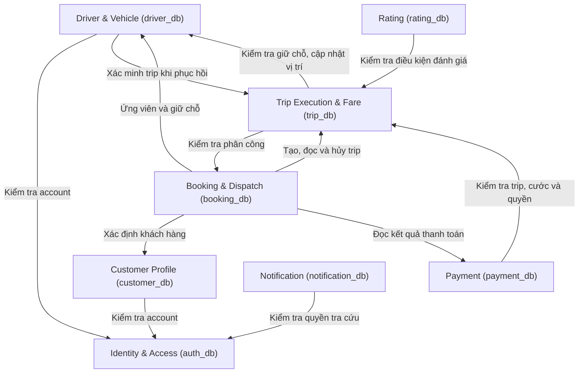
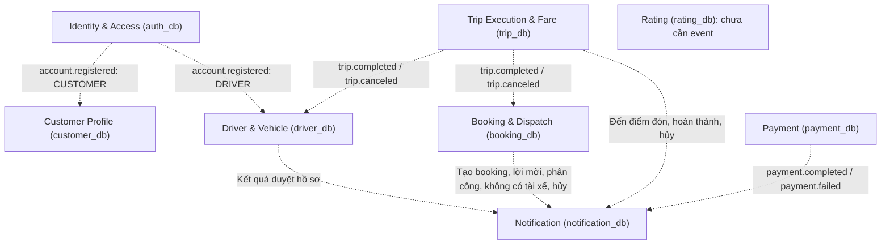

# THIẾT KẾ MICRO-SERVICE — CAB SYSTEM

**Validation demo cập nhật 28/10/2026:** Password là String không rỗng (ít nhất 1 ký tự, ví dụ "123" hoặc "a"), không trim và không yêu cầu độ phức tạp; Phone là String không rỗng sau trim (ví dụ "0123", "123", "abc123"), giữ số 0 đầu và vẫn unique. Email giữ định dạng cơ bản. Chỉ áp dụng cho học tập/demo local; không phải chính sách production. Argon2id, JWT, role/ownership và OTP Driver giữ nguyên.

**Quyết định tiếp theo Identity v3:** Auth cấp cid/did bằng counter DB; không nhập mã khi Register. Driver Register plateNumber bước 1 tạo challenge, bước 2 thêm code mới tạo Account; account.registered mang plateNumber để Driver context giữ thông tin xe dự kiến. Driver vẫn sở hữu Vehicle và license encryption; Submit tạo xe BIKE từ plate, kiểm unique và chuyển PENDING. Booking/Driver/Trip sở hữu bản demo_locations A/B riêng; không đọc chéo DB. Các body v1/v2 bên dưới được thay bởi hợp đồng docs/api hiện hành; không thêm service/event mới.

Giai đoạn 4 • 8 bounded context • Phiên bản cơ bản

Căn cứ: SRS mới gửi trong cuộc trò chuyện. Trình tự mục và tiêu đề cột theo Thiết Kế Micro-Service.docx. Mã UC sử dụng theo SRS mới. API và cơ chế kỹ thuật là đề xuất thiết kế để đồng bộ ở giai đoạn triển khai.

# 1. Phân tách Use Case theo miền nghiệp vụ

| Bounded Context       | Use Case liên quan                                       | Năng lực nghiệp vụ                                  | Khái niệm chính                        |
| --------------------- | -------------------------------------------------------- | --------------------------------------------------- | -------------------------------------- |
| Identity & Access     | UC01, UC02, UC12                                         | Đăng ký, đăng nhập, OTP và JWT.                     | Account, OtpChallenge, Role            |
| Customer Profile      | UC03, UC23                                               | Quản lý hồ sơ khách hàng; quản trị tra cứu.         | CustomerProfile                        |
| Driver & Vehicle      | UC03, UC05, UC13–UC17, UC22; hỗ trợ UC24                 | Hồ sơ, duyệt, xe, online/offline, vị trí và nearby. | DriverProfile, Vehicle                 |
| Booking & Dispatch    | UC06–UC08, UC10, UC18, UC24–UC25                         | Đặt xe, lời mời tuần tự, phân công, hủy và lịch sử. | Booking, TripInvitation                |
| Trip Execution & Fare | UC07–UC08, UC19–UC20, UC24–UC25                          | Thực hiện chuyến, vị trí trong chuyến và tính cước. | Trip, BookingSnapshot, VehicleSnapshot |
| Payment               | UC09, UC21, UC26–UC27                                    | Tiền mặt, payment mock, callback và retry.          | Payment                                |
| Notification          | UC04; hỗ trợ UC06, UC08–UC09, UC18–UC19, UC21–UC22, UC27 | Lưu và tra cứu thông báo đúng người nhận.           | Notification                           |
| Rating                | UC11                                                     | Đánh giá tài xế sau chuyến hoàn thành.              | Review                                 |

Một Use Case có thể phối hợp nhiều context. Driver và Vehicle thuộc chung một context; ADMIN là vai trò, không tạo admin_service. File API YAML không tương ứng bắt buộc một–một với bounded context.

# 2. Ubiquitous Language

| Thuật ngữ       | Ý nghĩa                                                         | Context               |
| --------------- | --------------------------------------------------------------- | --------------------- |
| Account         | Tài khoản đăng nhập, role và trạng thái truy cập.               | Identity & Access     |
| OtpChallenge    | OTP đăng ký DRIVER; có thể tồn tại trước Account.               | Identity & Access     |
| CustomerProfile | Hồ sơ khách hàng; customerId khác accountId.                    | Customer Profile      |
| DriverProfile   | Hồ sơ, kết quả duyệt, online và vị trí tài xế.                  | Driver & Vehicle      |
| Vehicle         | Xe thuộc tài xế, tối đa một xe đang sử dụng.                    | Driver & Vehicle      |
| Booking         | Yêu cầu đặt xe, kể cả NO_DRIVER hoặc hủy trước phân công.       | Booking & Dispatch    |
| TripInvitation  | Lời mời nhận chuyến có thời hạn; không đồng nghĩa Notification. | Booking & Dispatch    |
| Trip            | Chuyến đã phân công và tiến trình thực hiện.                    | Trip Execution & Fare |
| PricingSnapshot | Khoảng cách và thông số giá lúc tạo booking; Trip giữ bản sao.  | Booking & Dispatch    |
| Payment         | Một lần thanh toán; retry online tạo paymentId mới.             | Payment               |
| Notification    | Thông báo nội bộ từ kết quả nghiệp vụ đã lưu.                   | Notification          |
| Review          | Điểm và nhận xét cho tài xế của trip hoàn thành.                | Rating                |

# 3. Bounded Context và Context Map

Hệ thống có đúng 8 bounded context được liệt kê trong mục 1 và ánh xạ tại mục 6. Mỗi service sở hữu một database MongoDB logic; có thể cùng chạy trên một MongoDB instance local.

Quan hệ context: Auth → Customer/Driver qua account.registered; Booking gọi Customer để xác định khách hàng, Driver để tìm/giữ chỗ, Trip để tạo/hủy chuyến. Payment và Rating gọi Trip để kiểm tra điều kiện. Trip phát event cho Booking và Driver đồng bộ kết quả. Notification nhận event từ Driver, Booking, Trip và Payment.

Các service kiểm tra trạng thái account qua Auth và tự kiểm tra role/ownership. API nội bộ cần xác thực service; không công khai qua Gateway. Không service nào truy cập database của service khác. ID tham chiếu được kiểm tra bằng API/event, không phải foreign key được MongoDB tự bảo đảm.

Sơ đồ Bounded Context bằng Mermaid sẽ bổ sung khi có ảnh mẫu. Business Process và Microservice Architecture Design cũng chờ ảnh mẫu; chưa tạo ở bản này.

### Context Map bổ sung theo yêu cầu hiện tại

Hai sơ đồ dưới đây thể hiện quan hệ API và event. Database ghi trong mỗi context là database do service tương ứng sở hữu; đường nối là giao tiếp giữa service, không phải truy cập database hoặc foreign key. Các service nghiệp vụ còn gọi Auth để kiểm tra quyền như phần mô tả đã nêu; không lặp các đường xác thực chung trong sơ đồ API để tránh rối.

#### Quan hệ gọi API

#### Quan hệ phát và nhận event

Các đường event được truyền qua RabbitMQ. ID và snapshot được kiểm tra, đồng bộ theo trách nhiệm service đã mô tả; MongoDB không tự bảo đảm quan hệ tham chiếu giữa các database.

# 4. Aggregate và invariant nghiệp vụ

| Aggregate              | Aggregate Root        | Thành phần chính                                                         | Invariant                                                                       | Use Case liên quan                                       |
| ---------------------- | --------------------- | ------------------------------------------------------------------------ | ------------------------------------------------------------------------------- | -------------------------------------------------------- |
| Account; OtpChallenge  | Account; OtpChallenge | Phone, PasswordHash, Role, Status; OTP hash, thời hạn và số lần sai      | Phone duy nhất; cấm đăng ký ADMIN; OTP chỉ dùng một lần.                        | UC01, UC02, UC12                                         |
| Customer Aggregate     | CustomerProfile       | AccountId, FullName, Email                                               | Một profile/account CUSTOMER; chỉ chủ hồ sơ được sửa.                           | UC03, UC23                                               |
| Driver Aggregate       | DriverProfile         | Vehicle, ApprovalStatus, Availability, Location, ActiveTripId            | Tối đa một xe active; xe không trùng biển số; chỉ đủ điều kiện mới nhận chuyến. | UC03, UC05, UC13–UC17, UC22; hỗ trợ UC24                 |
| Booking Aggregate      | Booking               | TripInvitation, CandidateDriverIds, Pickup, Destination, PricingSnapshot | Một lời mời PENDING; tối đa 5 ứng viên; không phân công booking đã hủy.         | UC06–UC08, UC10, UC18, UC24–UC25                         |
| Trip Aggregate         | Trip                  | BookingSnapshot, VehicleSnapshot, Status, Location, Fare                 | Một trip/booking; một trip hoạt động/driver; không bỏ qua mốc trạng thái.       | UC07–UC08, UC19–UC20, UC24–UC25                          |
| Payment Aggregate      | Payment               | TripId, Method, Amount, ReferenceCode, AttemptNumber                     | Tối đa một PENDING/COMPLETED mỗi trip; tối đa 3 lần online.                     | UC09, UC21, UC26–UC27                                    |
| Notification Aggregate | Notification          | RecipientAccountId, EventId, Type, Content                               | Không trùng event/người nhận/loại; chỉ người nhận được xem.                     | UC04; hỗ trợ UC06, UC08–UC09, UC18–UC19, UC21–UC22, UC27 |
| Review Aggregate       | Review                | TripId, CustomerId, DriverId, Rating, Comment                            | Một review/trip COMPLETED; rating nguyên 1–5; không sửa/xóa.                    | UC11                                                     |

Vehicle và TripInvitation là entity trong aggregate tương ứng nhưng vẫn dùng collection riêng theo mục 9 SRS. Snapshot nhúng trong Trip. Không nhúng các payment retry vào một Payment vì mỗi lần phải có định danh và idempotency riêng.

# 5. Domain Event phát sinh từ Use Case

| Domain Event                               | Use Case nguồn   | Producer Context      | Consumer Context                                   | Mục đích                              |
| ------------------------------------------ | ---------------- | --------------------- | -------------------------------------------------- | ------------------------------------- |
| account.registered                         | UC01             | Identity & Access     | Customer Profile / Driver & Vehicle                | Tạo profile theo role.                |
| driver.profile_approved / profile_rejected | UC22             | Driver & Vehicle      | Notification                                       | Báo kết quả duyệt.                    |
| booking.created                            | UC06             | Booking & Dispatch    | Notification                                       | Báo tiếp nhận booking.                |
| booking.invitation_created                 | UC06, UC18       | Booking & Dispatch    | Notification                                       | Báo lời mời; nguồn là TripInvitation. |
| booking.assigned                           | UC06, UC18       | Booking & Dispatch    | Notification                                       | Báo phân công đã xác nhận.            |
| booking.no_driver                          | UC06             | Booking & Dispatch    | Notification                                       | Báo không tìm được tài xế.            |
| booking.canceled                           | UC08             | Booking & Dispatch    | Notification                                       | Hủy trước phân công.                  |
| trip.arrived                               | UC19             | Trip Execution & Fare | Notification                                       | Báo đến điểm đón.                     |
| trip.completed                             | UC19             | Trip Execution & Fare | Booking & Dispatch; Driver & Vehicle; Notification | Đồng bộ kết quả, giải phóng tài xế.   |
| trip.canceled                              | UC08             | Trip Execution & Fare | Booking & Dispatch; Driver & Vehicle; Notification | Đồng bộ hủy sau phân công.            |
| payment.completed / payment.failed         | UC09, UC21, UC27 | Payment               | Notification                                       | Báo kết quả thanh toán.               |

Event chỉ phát sau khi kết quả đã lưu. Envelope gồm eventId, eventType, occurredAt, producer, aggregateId, aggregateVersion, correlationId và payload tối thiểu. Chọn RabbitMQ cho demo; consumer xử lý lặp an toàn. Không đưa password, OTP, JWT hoặc secret vào payload.

trip.started và trip.fare_calculated có thể được ghi nhận như mốc miền nghiệp vụ; không có consumer bắt buộc trong demo. Rating chưa cần phát event nếu không có chức năng sử dụng.

# 6. Ánh xạ Context sang Microservice

| Bounded Context       | Service triển khai   | Dữ liệu sở hữu  | Giao tiếp chính                        |
| --------------------- | -------------------- | --------------- | -------------------------------------- |
| Identity & Access     | auth_service         | auth_db         | REST qua Gateway; API nội bộ; RabbitMQ |
| Customer Profile      | customer_service     | customer_db     | REST qua Gateway; API nội bộ; RabbitMQ |
| Driver & Vehicle      | driver_service       | driver_db       | REST qua Gateway; API nội bộ; RabbitMQ |
| Booking & Dispatch    | booking_service      | booking_db      | REST qua Gateway; API nội bộ; RabbitMQ |
| Trip Execution & Fare | trip_service         | trip_db         | REST qua Gateway; API nội bộ; RabbitMQ |
| Payment               | payment_service      | payment_db      | REST qua Gateway; API nội bộ; RabbitMQ |
| Notification          | notification_service | notification_db | REST qua Gateway; API nội bộ; RabbitMQ |
| Rating                | rating_service       | rating_db       | REST qua Gateway; API nội bộ           |

Gateway định tuyến và tổng hợp tình trạng service; không sở hữu DB nghiệp vụ. Payment mock là adapter của payment_service. Không tạo vehicle_service, admin_service, report_service hoặc audit_service.

# 7. Mô tả Service

| Bounded Context       | Service triển khai   | Trách nhiệm chính                                   | Dữ liệu sở hữu                         |
| --------------------- | -------------------- | --------------------------------------------------- | -------------------------------------- |
| Identity & Access     | auth_service         | Đăng ký, đăng nhập, OTP và JWT.                     | auth_db: accounts, otp_challenges      |
| Customer Profile      | customer_service     | Quản lý hồ sơ khách hàng; quản trị tra cứu.         | customer_db: customer_profiles         |
| Driver & Vehicle      | driver_service       | Hồ sơ, duyệt, xe, online/offline, vị trí và nearby. | driver_db: driver_profiles, vehicles   |
| Booking & Dispatch    | booking_service      | Đặt xe, lời mời tuần tự, phân công, hủy và lịch sử. | booking_db: bookings, trip_invitations |
| Trip Execution & Fare | trip_service         | Thực hiện chuyến, vị trí trong chuyến và tính cước. | trip_db: trips                         |
| Payment               | payment_service      | Tiền mặt, payment mock, callback và retry.          | payment_db: payments                   |
| Notification          | notification_service | Lưu và tra cứu thông báo đúng người nhận.           | notification_db: notifications         |
| Rating                | rating_service       | Đánh giá tài xế sau chuyến hoàn thành.              | rating_db: reviews                     |

Các mục dưới đây bổ sung đủ nội dung thiết kế cho từng service. Endpoint là đề xuất; /api đi qua Gateway, /internal chỉ dùng giữa service. Không tự bổ sung refresh token, quên mật khẩu hay voucher từ ví dụ trong mẫu.

## 7.1. auth_service — Identity & Access

**Mục đích: **xác định người dùng là ai và được dùng vai trò nào.

**Trách nhiệm: **đăng ký CUSTOMER/DRIVER, OTP giả lập trước đăng ký DRIVER, băm mật khẩu và OTP, đăng nhập, cấp JWT, kiểm tra account ACTIVE, cung cấp định danh cho service khác. ADMIN tạo bằng seed/configuration.

**Không thuộc context: **hồ sơ khách hàng/tài xế, duyệt tài xế, xe, booking, trip, thanh toán, refresh token, quên mật khẩu và hệ thống session nâng cao.

**Entity/aggregate: **Account, OtpChallenge, Role. Chi tiết collection và index tại mục 8.

**API cung cấp qua Gateway: **POST /api/auth/otp-challenges — Yêu cầu OTP đăng ký DRIVER; POST /api/auth/otp-challenges/{otpId}/verify — Xác minh OTP gắn với phone và purpose; POST /api/auth/register — Tạo CUSTOMER hoặc DRIVER; DRIVER cần bằng chứng OTP còn hợp lệ, chưa dùng; POST /api/auth/login — Cấp JWT khi mật khẩu đúng và account ACTIVE; GET /api/auth/me — Trả định danh, role và status được phép xem.

**API nội bộ cung cấp: **GET /internal/accounts/{accountId}/access — Xác nhận account tồn tại, ACTIVE và role.

**API gọi sang service khác: **không bắt buộc trong luồng chính; tạo profile bằng event. Khi account đã tạo nhưng profile chưa xuất hiện, chưa cho đặt xe/nhận chuyến; không tạo profile trùng bằng cách ghi trực tiếp DB khác.

**Event phát/nhận: **Phát: account.registered chứa accountId, role và trường hồ sơ khởi tạo tối thiểu. Nhận: không có domain event bắt buộc.

**Quy tắc nghiệp vụ chính: **RULE01–RULE04, RULE33: phone dạng String không rỗng sau trim, không giới hạn độ dài/định dạng số, một role/account, cấm tự đăng ký ADMIN. OTP 6 chữ số, hiệu lực 5 phút, tối đa 5 lần nhập sai, yêu cầu mã cách nhau ít nhất 60 giây. Mã mới vô hiệu mã cũ; bằng chứng đã dùng không đăng ký lần nữa. Kiểm soát yêu cầu OTP đồng thời theo phone/purpose bằng cập nhật/transaction cục bộ; không chỉ kiểm tra thời gian trong bộ nhớ. Không trả hash/secret; tối đa 10 yêu cầu đăng nhập/phút/IP theo NFR04. OTP mock dùng cơ chế kiểm thử local, không ghi mã rõ vào log.

### Dữ liệu sở hữu

auth_db — accounts, otp_challenges. Các service khác truy cập qua API/event, không đọc database trực tiếp.

## 7.2. customer_service — Customer Profile

**Mục đích: **quản lý thông tin cá nhân khách hàng độc lập với xác thực.

**Trách nhiệm: **khởi tạo profile sau đăng ký CUSTOMER, tra cứu và cập nhật trường được phép; hỗ trợ ADMIN tra cứu khách hàng và service khác xác định customerId từ accountId.

**Không thuộc context: **mật khẩu/role, Booking history, trạng thái trip, kết quả payment hoặc Review. Lịch sử thuộc Booking, dù giao diện đặt trong trang khách hàng.

**Entity/aggregate: **CustomerProfile. Chi tiết collection và index tại mục 8.

**API cung cấp qua Gateway: **GET /api/customers/me — Xem hồ sơ của mình; PATCH /api/customers/me — Sửa fullName/email theo whitelist; GET /api/admin/customers — Tra cứu danh sách khách hàng; GET /api/admin/customers/{customerId} — Tra cứu chi tiết; không cho sửa qua API quản trị.

**API nội bộ cung cấp: **GET /internal/customers/by-account/{accountId} — Ánh xạ accountId sang customerId; GET /internal/customers/{customerId} — Cung cấp thông tin tối thiểu theo quyền caller.

**API gọi sang service khác: **Auth access để kiểm tra tài khoản và quyền. Không gọi Booking/Trip/Payment để sở hữu hoặc cập nhật lịch sử.

**Event phát/nhận: **Nhận: account.registered chỉ khi role CUSTOMER; upsert theo accountId, không ghi đè profile đã được người dùng sửa khi event giao lại. Phát: không có event nghiệp vụ bắt buộc ở bản cơ bản.

**Quy tắc nghiệp vụ chính: **RULE03: khách hàng chỉ sửa profile của mình; ADMIN chỉ tra cứu. Một account CUSTOMER có tối đa một CustomerProfile; profile khác role bị từ chối. Client không được tự sửa accountId, role hoặc trạng thái account qua profile API.

### Dữ liệu sở hữu

customer_db — customer_profiles. Các service khác truy cập qua API/event, không đọc database trực tiếp.

## 7.3. driver_service — Driver & Vehicle

**Mục đích: **quản lý điều kiện để tài xế và xe có thể tham gia nhận chuyến.

**Trách nhiệm: **profile, gửi duyệt và quyết định duyệt, phương tiện, online/offline, vị trí hiện tại, nearby, giữ chỗ tài xế khi phân công và giải phóng khi trip kết thúc.

**Không thuộc context: **OTP và account, danh sách ứng viên/lời mời của Booking, tiến trình Trip, tính cước, payment và điểm Review. Không có vehicle_service riêng.

**Entity/aggregate: **DriverProfile, Vehicle. Chi tiết collection và index tại mục 8.

**API cung cấp qua Gateway: **GET/PATCH /api/drivers/me — Xem/sửa trường hồ sơ được phép; POST /api/drivers/me/submissions — Gửi hồ sơ đầy đủ về PENDING; GET/POST /api/drivers/me/vehicles — Xem/thêm xe thuộc mình; PATCH /api/drivers/me/vehicles/{vehicleId} — Sửa xe hoặc chọn xe đang sử dụng khi hợp lệ; PATCH /api/drivers/me/availability — Bật/tắt online; PUT /api/drivers/me/location — Ghi vị trí phục vụ tìm xe; GET /api/drivers/nearby — Danh sách đủ điều kiện, phân trang; GET /api/admin/drivers; GET /api/admin/drivers/{driverId} — Danh sách/chi tiết hồ sơ, xe, trạng thái; POST /api/admin/drivers/{driverId}/approval-decisions — Duyệt hoặc từ chối PENDING.

**API nội bộ cung cấp: **GET /internal/drivers/by-account/{accountId} — Lấy driverId theo account; GET /internal/drivers/candidates — Cùng bộ lọc nearby, trả tối đa 5 ứng viên đã sắp xếp; GET /internal/drivers/{driverId}/dispatch-data — Hồ sơ, accountId, xe và vị trí cần cho phân công/ETA; PUT /internal/drivers/{driverId}/reservations/{operationId} — Giữ chỗ có điều kiện; cùng operationId gửi lại an toàn; POST /internal/drivers/{driverId}/reservations/{operationId}/confirm — Gắn activeTripId cho phân công đã xác nhận; DELETE /internal/drivers/{driverId}/reservations/{operationId} — Bù giữ chỗ khi chưa tạo trip, sau khi xác minh kết quả; PUT /internal/drivers/{driverId}/trip-location — Đồng bộ vị trí hợp lệ từ Trip, có tripId và thời điểm nguồn.

**API gọi sang service khác: **Auth access để kiểm tra account; Trip để xác minh trip khi phục hồi reservation hoặc kiểm tra trước đổi xe khi có dấu hiệu chưa đồng bộ. Không gọi Booking để tự chọn ứng viên.

**Event phát/nhận: **Phát: driver.profile_approved, driver.profile_rejected. Nhận: account.registered role DRIVER để tạo DRAFT/offline; trip.completed, trip.canceled để giải phóng đúng trip/reservation, không xóa chỗ của trip mới hơn.

**Quy tắc nghiệp vụ chính: **RULE06, RULE13, RULE34–RULE35: APPROVED, online, account ACTIVE, không bận/giữ chỗ, xe đúng loại, vị trí tuổi ≤120 giây. Hồ sơ DRAFT hoặc REJECTED được sửa để gửi lại; không tự sửa APPROVED/PENDING để bỏ qua duyệt. Quyết định duyệt dùng cập nhật có điều kiện approvalStatus=PENDING. Tối đa một xe active. Không sửa/đổi xe đang dùng khi giữ chỗ hoặc trip chưa kết thúc; kiểm tra và khóa theo Driver aggregate trong cùng transaction. Nearby: khoảng cách ≤1 km; sắp xếp khoảng cách rồi driverId tăng dần. page≥1, limit 1–50, mặc định 1/10. Account không xác minh được thì không đưa vào danh sách. Offline ngừng nhận chuyến mới, không hủy trip đã nhận. Reservation chỉ được tạo sau khi kiểm tra lại điều kiện hiện tại; hai booking không giữ cùng một tài xế. Không tự giải phóng reservation chỉ vì HTTP timeout hoặc hết thời gian chờ: phải tra cứu operation/Trip để tránh tài xế có hai chuyến.

### Dữ liệu sở hữu

driver_db — driver_profiles, vehicles. Các service khác truy cập qua API/event, không đọc database trực tiếp.

## 7.4. booking_service — Booking & Dispatch

**Mục đích: **quản lý yêu cầu đặt xe và điều phối tới khi phân công hoặc kết thúc tìm kiếm.

**Trách nhiệm: **tạo Booking idempotent, lưu tọa độ/khoảng cách/bộ giá, chọn danh sách ban đầu, lời mời tuần tự, timeout, nhận phản hồi, điều phối tạo Trip, hủy và Booking history.

**Không thuộc context: **profile/xe/online là nguồn của Driver; trạng thái thực hiện và cước cuối của Trip; kết quả thanh toán của Payment. Booking chỉ giữ bản sao kết quả trip cần cho lịch sử.

**Entity/aggregate: **Booking, TripInvitation. Chi tiết collection và index tại mục 8.

**API cung cấp qua Gateway: **POST /api/bookings — Tạo SEARCHING, bắt buộc Idempotency-Key; GET /api/bookings — Booking history có phân trang; GET /api/bookings/{bookingId} — Tổng hợp booking, trip, payment và ETA theo quyền; POST /api/bookings/{bookingId}/cancellation-preview — Kiểm tra ban đầu và báo phí 0, chưa hủy; POST /api/bookings/{bookingId}/cancellation — Kiểm tra lại và xử lý hủy; GET /api/drivers/me/invitations — Lời mời thuộc mình; trạng thái nguồn ở Booking; POST /api/invitations/{invitationId}/response — ACCEPT hoặc REJECT theo hợp đồng API; GET /api/admin/bookings — Tra cứu booking theo customer/trạng thái và dữ liệu vận hành.

**API nội bộ cung cấp: **GET /internal/bookings/{bookingId}/assignment — Kết quả/operation phân công và snapshot cần tạo trip; GET /internal/bookings/operations/{operationId} — Tra cứu quyết định xử lý để phục hồi.

**API gọi sang service khác: **Auth access; Customer by-account; Driver candidates/dispatch-data/reservation; Trip tạo và tra cứu theo bookingId, hủy; Payment tra cứu theo tripId. Gọi Driver lấy vị trí để tính ETA. Các API tổng hợp phải hiển thị phần dữ liệu lỗi/không lấy được, không giả định payment chưa tồn tại hoặc đã thất bại.

**Event phát/nhận: **Phát: booking.created, booking.invitation_created, booking.assigned, booking.no_driver, booking.canceled (hủy trước phân công). Nhận: trip.completed, trip.canceled để đồng bộ Booking. Sau hủy trip, dùng trip.canceled làm sự kiện thông báo chính, tránh hai event tạo hai thông báo cho một kết quả hủy.

**Quy tắc nghiệp vụ chính: **RULE05–RULE12, RULE36–RULE37, RULE39–RULE40: tọa độ hợp lệ, điểm đón/trả khác nhau, tối đa 5 ứng viên ban đầu, không tìm vòng mới. Mỗi booking một lời mời PENDING; hiệu lực 30 giây, phản hồi tại/sau expiresAt bị từ chối. Worker tự đóng timeout, rồi xét ứng viên tiếp theo, không phụ thuộc client mở ứng dụng. Thiếu vị trí/hết điều kiện → bỏ ứng viên; không nhầm lỗi Driver service với kết quả không có tài xế. Lỗi hạ tầng giữ trạng thái phục hồi, chưa tự gán NO_DRIVER. Tìm thấy hoặc ACCEPT chưa đủ để công bố ASSIGNED. Chỉ xác nhận sau khi giữ chỗ và biết Trip đã được tạo đúng. Hết ứng viên → NO_DRIVER; hủy SEARCHING → CANCELED, đóng lời mời, không tạo trip/payment. Hủy sau phân công phải dựa trên quyết định trạng thái tại Trip. history trả cả NO_DRIVER/CANCELED; sắp xếp createdAt rồi bookingId giảm dần. Idempotency trùng dữ liệu trả cũ, khác dữ liệu trả 409.

### Dữ liệu sở hữu

booking_db — bookings, trip_invitations. Các service khác truy cập qua API/event, không đọc database trực tiếp.

## 7.5. trip_service — Trip Execution & Fare

**Mục đích: **quản lý thực hiện chuyến đã phân công và xác định khoản cước phải trả.

**Trách nhiệm: **tạo Trip từ phân công hợp lệ, giữ snapshot, đến điểm đón/bắt đầu/hoàn thành, vị trí trong chuyến, quyết định hủy ở trạng thái được phép, tính cước cuối và cung cấp dữ liệu cho thanh toán/đánh giá.

**Không thuộc context: **tìm ứng viên/lời mời, hồ sơ/xe hiện tại, thu tiền, callback, retry payment và Review.

**Entity/aggregate: **Trip, BookingSnapshot, VehicleSnapshot. Chi tiết collection và index tại mục 8.

**API cung cấp qua Gateway: **GET /api/trips/{tripId} — Xem trip và cước được phép; POST /api/trips/{tripId}/arrival — ASSIGNED → ARRIVED; POST /api/trips/{tripId}/start — ARRIVED → IN_PROGRESS; POST /api/trips/{tripId}/completion — IN_PROGRESS → COMPLETED, tính cước khi đủ dữ liệu; PUT /api/trips/{tripId}/location — Vị trí khi IN_PROGRESS; GET /api/admin/trips — Tra cứu hoạt động/lịch sử theo bộ lọc.

**API nội bộ cung cấp: **POST /internal/trips — Tạo theo operationId, bookingId và giữ chỗ đã xác minh; GET /internal/trips/by-booking/{bookingId} — Tra cứu kết quả khi timeout hoặc phục hồi; GET /internal/trips/{tripId} — Trạng thái, ownership và snapshot cần thiết; POST /internal/trips/{tripId}/assignment-confirmation — Mở quyền thao tác trip sau khi phân công hoàn tất; POST /internal/trips/{tripId}/cancellation — Cập nhật có điều kiện ASSIGNED/ARRIVED; kiểm tra CUSTOMER sở hữu; POST /internal/trips/{tripId}/fare-recalculation — Xử lý lại khi fareAmount chưa có và dữ liệu đã đủ.

**API gọi sang service khác: **Auth access; Booking assignment; Driver reservation/dispatch-data để kiểm tra phân công; Driver trip-location để cập nhật vị trí hiện tại (lỗi đồng bộ được giữ lại để retry). Không gọi Payment để cho phép trip hoàn thành.

**Event phát/nhận: **Phát: trip.arrived, trip.started, trip.completed, trip.canceled, trip.fare_calculated. Nhận: không cần event bắt buộc cho chuyển trạng thái chính; dùng command REST có kiểm tra trạng thái. Hoàn thành và fare được lưu chung khi đủ dữ liệu; event fare_calculated phục vụ trường hợp tính lại, không tạo thêm thông báo hoàn thành.

**Quy tắc nghiệp vụ chính: **RULE08, RULE14–RULE20, RULE26, RULE38–RULE40: unique bookingId và partial unique driverId là hàng rào DB, vẫn kiểm tra quyền và điều kiện nghiệp vụ. ASSIGNED → ARRIVED → IN_PROGRESS → COMPLETED; CANCELED chỉ từ ASSIGNED/ARRIVED theo yêu cầu CUSTOMER. Cập nhật dùng điều kiện trạng thái/version để cạnh tranh start và cancel chỉ một thao tác thắng. Gửi lại mốc đã thành công trả kết quả lưu, không sửa timestamp. Không nhận location ngoài IN_PROGRESS; phân biệt vị trí hiện tại tài xế và vị trí gắn với chuyến. Cước: 1000 × ceil(((10000 + 5000 × distanceKm) × vehicleMultiplier)/1000), MOTORBIKE=1, CAR=2; dùng distance và thông số trong bookingSnapshot, không làm tròn distance trước. Thiếu dữ liệu: giữ COMPLETED, fareAmount=null, ghi log và tính lại; chưa cho thanh toán. Giải phóng tài xế khi kết thúc, độc lập payment/cước đã tính xong hay chưa. ETA demo tại lớp tổng hợp: ceil(distance tài xế–điểm đón ×60/20), ARRIVED=0; thiếu vị trí mới thì chưa có ETA. Không mô tả là tính tuyến đường thực tế.

### Dữ liệu sở hữu

trip_db — trips. Các service khác truy cập qua API/event, không đọc database trực tiếp.

## 7.6. payment_service — Payment

**Mục đích: **ghi nhận thanh toán đúng khoản cước, tối đa một lần thành công cho mỗi trip.

**Trách nhiệm: **xem khoản phải trả, CASH, khởi tạo MOCK_ONLINE, xác minh callback, trạng thái PENDING/COMPLETED/FAILED, idempotency, retry và tra cứu quản trị.

**Không thuộc context: **tính lại giá, sửa trạng thái trip, giữ tài xế bận, cổng thanh toán thật, ví, hoàn tiền, hoa hồng hoặc đối soát thật. Payment mock là adapter/module trong payment_service, không tạo service nghiệp vụ thứ chín.

**Entity/aggregate: **Payment. Chi tiết collection và index tại mục 8.

**API cung cấp qua Gateway: **GET /api/trips/{tripId}/payment-summary — Khoản phải trả và kết quả các lần thanh toán; POST /api/trips/{tripId}/payments — Chọn CASH hoặc tạo MOCK_ONLINE; khóa idempotency; POST /api/trips/{tripId}/payment-retries — Tạo Payment online mới khi lần trước FAILED, còn lượt; GET /api/payments/{paymentId} — Trạng thái đã lưu; POST /api/payments/{paymentId}/cash-confirmation — Xác nhận đã nhận tiền mặt đúng tài xế; POST /api/payments/mock/callback — Kết quả online; không dùng client tự khai thành công; GET /api/admin/payments — Tra cứu theo trip/trạng thái; không sửa kết quả.

**API nội bộ cung cấp: **GET /internal/payments/by-trip/{tripId} — Dữ liệu thanh toán cho lịch sử.

**API gọi sang service khác: **Auth access; Trip detail để kiểm tra COMPLETED, fare hợp lệ và đúng người trả/nhận. Adapter mock tạo referenceCode cố định theo paymentId và phát callback có chữ ký để kiểm thử. Không lấy cước qua client hoặc tính một công thức khác tại Payment.

**Event phát/nhận: **Phát: payment.completed, payment.failed. Nhận: không bắt buộc; đọc nguồn Trip khi tạo payment. Không tự thu tiền khi nhận trip.completed.

**Quy tắc nghiệp vụ chính: **RULE21–RULE27: chỉ trip COMPLETED có fare hợp lệ; VND và amount server. CASH có thể tạo PENDING khi khách chọn; chỉ tài xế được phân công xác nhận mới COMPLETED. Không tạo CASH nếu còn online PENDING/đã COMPLETED; khi các online đã FAILED thì được chuyển CASH. Online tối đa 3 Payment, lần đầu và 2 retry; retry cần lần trước FAILED, paymentId và key mới. Gửi lại key cũ không tính là retry. Callback phải khớp chữ ký, paymentId, referenceCode, amount, VND; cập nhật có điều kiện từ PENDING. Callback lặp trả kết quả cũ; trái kết quả cuối từ chối và log. Timeout khởi tạo mock không tự đổi FAILED; kiểm tra giao dịch theo cùng paymentId/referenceCode rồi xử lý lại. PENDING không bị coi FAILED chỉ vì client mất kết nối. Thành công không sửa Trip; thất bại không đảo COMPLETED. Không lưu dữ liệu thẻ hoặc tài khoản thanh toán nhạy cảm.

### Dữ liệu sở hữu

payment_db — payments. Các service khác truy cập qua API/event, không đọc database trực tiếp.

## 7.7. notification_service — Notification

**Mục đích: **cung cấp thông báo nội bộ đúng người nhận từ kết quả nghiệp vụ đã lưu.

**Trách nhiệm: **nhận event, tạo nội dung tối thiểu, lưu và cho người nhận tra cứu, chống trùng.

**Không thuộc context: **quyết định phân công, timeout lời mời, duyệt tài xế hoặc thành công thanh toán; không gửi SMS/email/push thật. Người dùng nhận thông báo lời mời vẫn phải đọc/phản hồi TripInvitation tại Booking.

**Entity/aggregate: **Notification. Chi tiết collection và index tại mục 8.

**API cung cấp qua Gateway: **GET /api/notifications — Danh sách của account hiện tại; GET /api/notifications/{notificationId} — Chi tiết nếu đúng người nhận.

**API gọi sang service khác: **Auth access cho API tra cứu. Không cần gọi service nghiệp vụ trong luồng tạo thông báo khi event đã có đủ ID, người nhận và trạng thái; không mở POST tạo thông báo cho client tùy ý.

**Event phát/nhận: **Nhận: booking.created/invitation_created/assigned/no_driver/canceled; trip.arrived/completed/canceled; payment.completed/failed; driver.profile_approved/profile_rejected. Phát: không có event bắt buộc.

**Quy tắc nghiệp vụ chính: **RULE32: cùng eventId, người nhận và loại chỉ tạo một thông báo. Chỉ người nhận đọc được. trip.started có thể dùng cho đồng bộ khác nhưng không bắt buộc tạo thêm thông báo ngoài các mốc SRS yêu cầu. Lỗi xử lý được retry/log, không làm Booking/Trip/Payment rollback. Không dùng “đã gửi thông báo” làm bằng chứng nghiệp vụ đã hoàn tất. Thông báo lời mời cũ không còn hiệu lực nếu lời mời đã đóng; API Booking vẫn kiểm tra expiresAt và trạng thái hiện tại.

### Dữ liệu sở hữu

notification_db — notifications. Các service khác truy cập qua API/event, không đọc database trực tiếp.

## 7.8. rating_service — Rating

**Mục đích: **ghi nhận phản hồi của khách hàng sau chuyến đã hoàn thành.

**Trách nhiệm: **kiểm tra điều kiện Review, lưu điểm/nhận xét và cho tra cứu theo quyền. Rating được giữ trong 8 context đã chốt của SRS mới.

**Không thuộc context: **tính cước/payment, thay đổi trip, duyệt tài xế, chỉnh sửa/xóa review, phân tích cảm xúc hoặc xếp hạng nâng cao.

**Entity/aggregate: **Review. Chi tiết collection và index tại mục 8.

**API cung cấp qua Gateway: **POST /api/trips/{tripId}/review — Tạo Review cho trip của mình; GET /api/trips/{tripId}/review — Tra cứu Review liên quan.

**API nội bộ cung cấp: **GET /internal/reviews/by-trip/{tripId} — Hỗ trợ chi tiết lịch sử nếu cần.

**API gọi sang service khác: **Auth access; Trip detail để xác nhận COMPLETED, khách hàng sở hữu và tài xế thực hiện. Không gọi Payment để yêu cầu đã thanh toán.

**Event phát/nhận: **Phát/nhận: không có event nghiệp vụ bắt buộc trong demo. Chưa thêm review.created nếu chưa có consumer cần dùng.

**Quy tắc nghiệp vụ chính: **RULE28–RULE29: một review/trip, rating nguyên 1–5, comment tùy chọn tối đa 500 ký tự. Không cần payment COMPLETED; trip COMPLETED là điều kiện riêng. Unique tripId bảo vệ cạnh tranh tạo trùng; Review đã lưu không sửa/xóa. Tạo lần nữa trả xung đột, không thay đổi nội dung cũ.

### Dữ liệu sở hữu

rating_db — reviews. Các service khác truy cập qua API/event, không đọc database trực tiếp.

# 8. Mô hình dữ liệu cho Service

Tên collection triển khai tương ứng entity trong mục 9 SRS. \_id là định danh document; các trường \*Id khác là ID tham chiếu. Unique/partial unique index chỉ bảo vệ dữ liệu trong DB sở hữu; vẫn phải kiểm tra nghiệp vụ.

## 8.1. auth_service

**Database: **auth_db

**accounts: **Account là aggregate root. Email đăng nhập, phone, passwordHash, role, status và ID nội bộ ObjectId; cid/did được Auth tự cấp từ profile_code_counters trong transaction. Index unique email/phone, partial unique cid/did. Register không nhận mã/role; Driver có plateNumber, lần đầu challenge OTP, lần sau code hợp lệ mới tạo Account. Xem docs/api/contracts.md; giấy phép/Vehicle vẫn do Driver context sở hữu.

**otp_challenges: **Entity/aggregate: OtpChallenge — root. Trường chính: phone, purpose, codeHash, failedAttempts, expiresAt, verifiedAt, consumedAt, invalidatedAt, createdAt. Index: (phone, purpose, createdAt desc) để lấy mã gần nhất.

OTP có thể tồn tại trước Account nên không bắt buộc accountId. Không dùng TTL làm căn cứ xác định OTP hợp lệ; server luôn kiểm tra expiresAt. Transaction Auth bảo đảm tiêu thụ bằng chứng OTP và tạo Account cùng thành công hoặc cùng rollback.

## 8.2. customer_service

**Database: **customer_db

**customer_profiles: **Entity/aggregate: CustomerProfile — root. Trường chính: \_id/customerId, accountId, fullName, email, createdAt, updatedAt. Index: Unique accountId.

accountId là tham chiếu logic tới Auth. Không lưu passwordHash/OTP hoặc sao chép toàn bộ Account. Email không tự đặt unique vì SRS chưa yêu cầu.

## 8.3. driver_service

**Database: **driver_db

**driver_profiles: **Entity/aggregate: DriverProfile — root. Trường chính: driverId, accountId, fullName, email, licenseNumber, approvalStatus, reviewedByAccountId, reviewedAt, rejectionReason, isOnline, activeTripId, latitude, longitude, locationUpdatedAt. Index: Unique accountId; (approvalStatus, isOnline, locationUpdatedAt) cho lọc demo.

**vehicles: **Entity/aggregate: Vehicle — entity thuộc aggregate Driver. Trường chính: vehicleId, driverId, plateNumber, vehicleType, model, color, isActive. Index: Unique plateNumber chuẩn hóa; partial unique driverId khi isActive=true; index driverId.

Vehicle là collection riêng nhưng các thao tác đổi xe đang sử dụng phải qua Driver aggregate và transaction driver_db. Không suy ra collection nào cũng là một bounded context. Vị trí dùng latitude/longitude và Haversine cho dữ liệu demo; không yêu cầu 2dsphere khi chưa lưu GeoJSON. Đề xuất nhúng assignmentReservation = {operationId, bookingId, tripId, phase, updatedAt} trong DriverProfile để phục hồi phân công. Đây là dữ liệu kỹ thuật; tài xế đang có reservation cũng bị loại khỏi nearby. activeTripId là bản sao trạng thái bận, không thay thế Trip làm nguồn trạng thái chuyến.

## 8.4. booking_service

**Database: **booking_db

**bookings: **Entity/aggregate: Booking — root. Trường chính: bookingId, customerId, idempotencyKey, requestHash, pickup/destination, vehicleType, status, distanceKm, bộ thông số giá, candidateDriverIds, dữ liệu hủy, createdAt, updatedAt. Index: Unique (customerId,idempotencyKey); (customerId,createdAt desc,\_id desc); (status,createdAt desc) cho ADMIN.

**trip_invitations: **Entity/aggregate: TripInvitation — entity trong aggregate Booking. Trường chính: invitationId, bookingId, driverId, candidateOrder, status, expiresAt, respondedAt, createdAt. Index: Unique (bookingId,driverId); partial unique bookingId khi PENDING; (status,expiresAt).

Đề xuất Booking có version, processingOperation = {operationId, type, phase, driverId, tripId, updatedAt} và tripId tham chiếu sau phân công. Transaction booking_db bảo đảm cập nhật Booking và TripInvitation cùng nhất quán. Không dùng unique index trên mảng offers để giả định bảo vệ được mọi ràng buộc lời mời.

## 8.5. trip_service

**Database: **trip_db

**trips: **Entity/aggregate: Trip — root. Trường chính: tripId, bookingId, driverId, vehicleId, bookingSnapshot, vehicleSnapshot, status, fareAmount, fareCalculatedAt, vị trí mới nhất, mốc thời gian. Index: Unique bookingId; partial unique driverId với ASSIGNED/ARRIVED/IN_PROGRESS; (status,assignedAt desc) và (driverId,assignedAt desc).

Snapshot nhúng không có collection riêng. Đề xuất thêm customerId, customerAccountId, driverAccountId trong booking/assignment snapshot để kiểm tra quyền; version, assignmentOperationId, assignmentConfirmed và dữ liệu hủy {reason, canceledByAccountId, canceledAt, fee} trong Trip. Các trường bổ sung là dữ liệu thiết kế cần phản ánh vào schema mục 9 khi triển khai, không tạo nghiệp vụ mới.

## 8.6. payment_service

**Database: **payment_db

**payments: **Entity/aggregate: Payment — root cho một lần thanh toán. Trường chính: paymentId, tripId, method, status, amount, currency, referenceCode, idempotencyKey, requestHash, attemptNumber, confirmedByAccountId, confirmedAt. Index: Unique (tripId,idempotencyKey); unique referenceCode khi có giá trị; partial unique tripId khi status thuộc PENDING/COMPLETED.

Thêm partial unique (tripId,attemptNumber) chỉ cho MOCK_ONLINE và validate attemptNumber nguyên 1–3. Khi các yêu cầu retry cạnh tranh cùng lượt, index chỉ cho một yêu cầu thắng; yêu cầu còn lại đọc lại kết quả và điều kiện. Kết hợp partial unique PENDING/COMPLETED ngăn CASH và online cùng thành công/đang chờ. Không chỉ đếm số Payment rồi insert mà bỏ bảo vệ đồng thời. Giữ bản sao customerId, customerAccountId, driverId/driverAccountId và fare của trip tại lần thanh toán để kiểm tra quyền và truy xuất. Snapshot lấy từ Trip, không tin amount/ownership do client khai.

## 8.7. notification_service

**Database: **notification_db

**notifications: **Entity/aggregate: Notification — root. Trường chính: notificationId, recipientAccountId, eventId, type, content, relatedEntityType, relatedEntityId, createdAt. Index: Unique (eventId,recipientAccountId,type); (recipientAccountId,createdAt desc,\_id desc).

recipientAccountId tham chiếu Auth; relatedEntityId có thể là Booking/Trip/Payment/DriverProfile, không phải foreign key tự kiểm soát. Event nguồn phải có accountId người nhận được producer lấy từ nguồn hợp lệ, tránh nhầm customerId với accountId.

## 8.8. rating_service

**Database: **rating_db

**reviews: **Entity/aggregate: Review — root. Trường chính: reviewId, tripId, customerId, driverId, rating, comment, createdAt. Index: Unique tripId; (driverId,createdAt desc); (customerId,createdAt desc).

tripId/customerId/driverId là tham chiếu logic; Rating lấy customer và driver từ Trip, không cho client tự chọn người được đánh giá. Đề xuất lưu customerAccountId từ snapshot để kiểm tra quyền tra cứu.

## 8.9. Ràng buộc phối hợp và dữ liệu phục hồi

Đăng ký: Auth lưu account và outbox cục bộ; consumer upsert profile theo accountId. Chưa có profile thì chưa cho tạo booking/nhận chuyến. Không transaction chung cho Auth và Profile.

Phân công: Booking ghi operationId/version bền vững; Driver giữ chỗ có điều kiện; Trip tạo duy nhất theo bookingId; xác nhận Booking/Driver/Trip rồi mới công bố phân công hoàn tất. Khi timeout phải tra cứu kết quả cũ, không mời người khác hoặc giải phóng giữ chỗ ngay. Chặn tài xế thao tác Trip chưa xác nhận phân công.

Hủy: Booking hủy SEARCHING trong transaction cục bộ. Khi đã có Trip, Trip quyết định hủy bằng cập nhật có điều kiện ASSIGNED/ARRIVED; nếu start đã thắng thì không được hủy. Event kết thúc đồng bộ Booking và chỉ giải phóng đúng activeTripId; không để event cũ xóa phân công mới.

Thanh toán: unique (tripId, idempotencyKey), partial unique tripId ở PENDING/COMPLETED và unique lượt online 1–3 ngăn retry đồng thời vượt giới hạn. Payment FAILED/PENDING không đổi Trip COMPLETED.

Đề xuất outbox_events/inbox_events tại DB service tương ứng để phục hồi event, không phải entity nghiệp vụ hoặc context mới. Ghi outbox cùng thay đổi nghiệp vụ; inbox unique (consumer,eventId). MongoDB local dùng single-node replica set nếu triển khai transaction cục bộ. Các bổ sung kỹ thuật cần đồng bộ schema SRS/API ở giai đoạn code; chưa phải tính năng đã triển khai.

Mỗi service cung cấp /health và /ready; Gateway cung cấp /health/services. Timeout HTTP nội bộ 5 giây; đồng bộ mục tiêu 5 giây khi hệ thống hoạt động bình thường, theo NFR08/NFR12. Kết quả này phải kiểm thử, chưa được coi là đã đạt.
