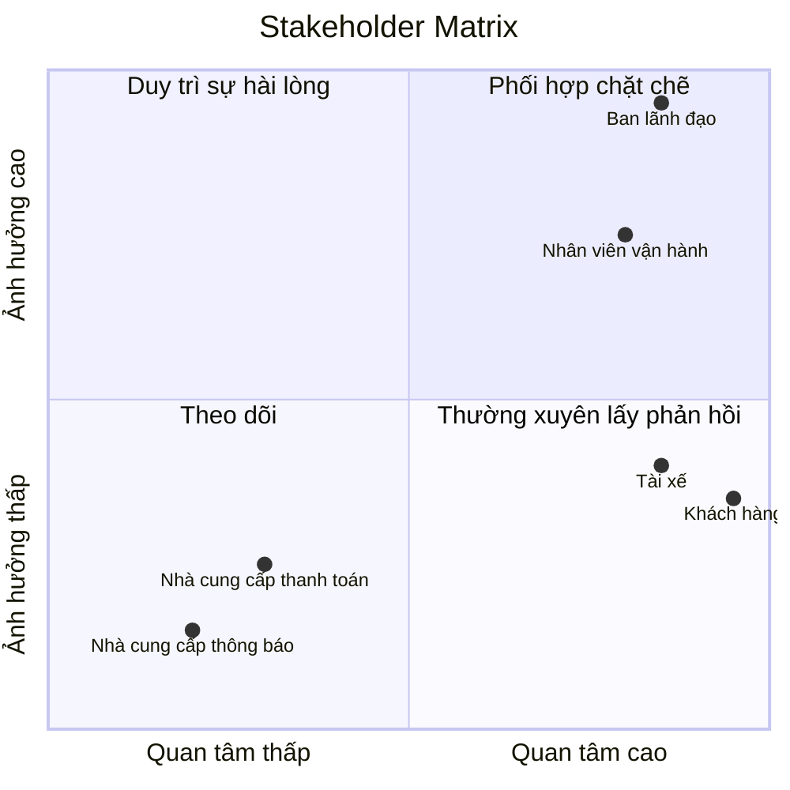
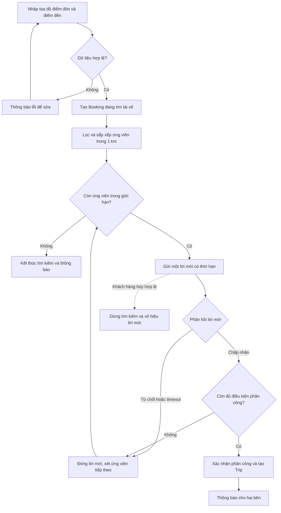
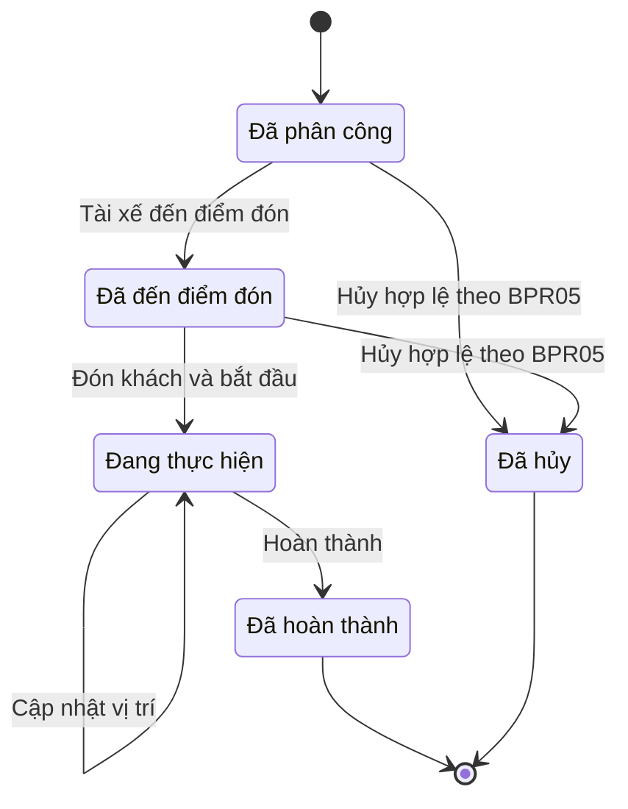
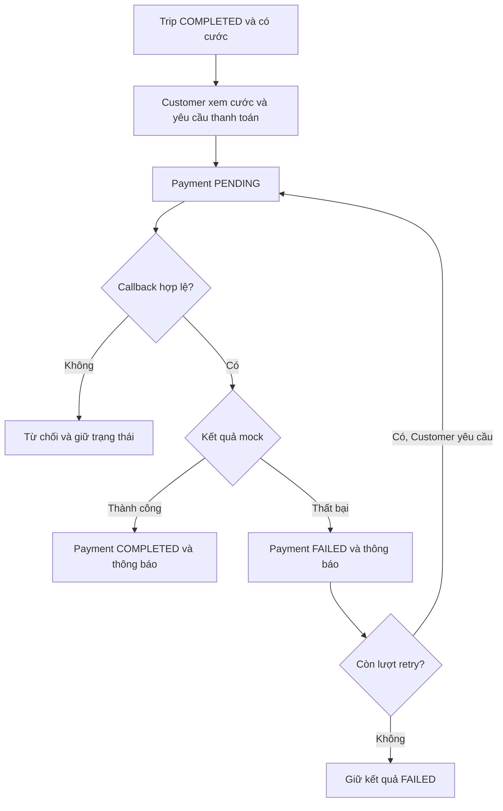
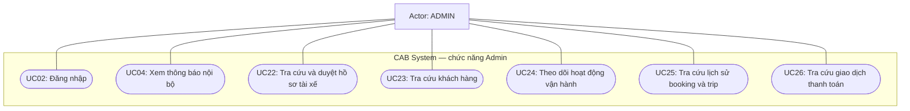

# CAB System — Đặc tả yêu cầu hệ thống MVP

| Thuộc tính      | Giá trị                                                                                                            |
| --------------- | ------------------------------------------------------------------------------------------------------------------ |
| Phiên bản       | 2.0 — Chuẩn hóa Giai đoạn 2                                                                                        |
| Ngày cập nhật   | 26/10/2026                                                                                                         |
| Ngôn ngữ        | Thuyết minh tiếng Việt; service, entity, API và event dùng tiếng Anh                                               |
| Mục đích        | Cơ sở thống nhất cho thiết kế 8 bounded context, kiến trúc, contracts và kiểm thử                                  |
| Trạng thái      | Đã chuẩn hóa yêu cầu; chưa xác nhận triển khai hoặc nghiệm thu                                                     |
| Nguồn           | Customer-Requirement.docx; CAB.docx; PHIEU_CHAM_PROJECT.pdf; SRS và thiết kế được cung cấp; Master Prompt mục I–XI |
| Ưu tiên áp dụng | Quyết định MVP mới nhất của người dùng; 30 mục phiếu chấm; nhu cầu khách hàng được giữ để truy xuất                |

**Trạng thái hạ tầng ban đầu:** người dùng xác nhận chưa thiết lập 8 database MongoDB, Docker Compose, Redis, RabbitMQ và gRPC hoàn chỉnh. Chưa khảo sát source code repository trong lần chuẩn hóa này. Mọi cấu hình, seed, container và kết quả kiểm thử trong SRS là yêu cầu phải thực hiện, không phải thành phần đang tồn tại.

**Giới hạn Giai đoạn 2:** chuẩn hóa SRS. Các YAML và Bounded-Context.md hiện có chưa được sửa trong giai đoạn này; không dùng bản cũ để kết luận contracts đã đồng bộ. Chưa sinh P01–P30 hoặc triển khai backend.

**Các thay đổi chính:** giữ OTP mock cho DRIVER theo mục 21; chỉ BIKE do server gán; chỉ MOCK_ONLINE sau khi Trip COMPLETED; Gateway gọi service bằng gRPC; RabbitMQ cho event; Redis cho rate limit; bổ sung bảo mật và truy xuất đủ 30 mục. Giữ mã FR24, UC21, RULE22, AC57–AC58 ở trạng thái ngoài phạm vi, không tái sử dụng.

# 1. Bối cảnh kinh doanh và vấn đề kinh doanh

## 1.1. Cơ sở phân tích

| Nội dung                       | Thông tin                                                                         |
| ------------------------------ | --------------------------------------------------------------------------------- |
| Tài liệu nguồn                 | `Customer-Requirement.docx`                                                       |
| Doanh nghiệp                   | Công ty ABC, cung cấp dịch vụ đặt xe trực tuyến                                   |
| Hệ thống đề xuất               | CAB System                                                                        |
| Thời gian dự án trong tài liệu | 7 tuần                                                                            |
| Mục đích phân tích             | Làm rõ hoạt động hiện tại, vấn đề cần giải quyết và nhu cầu xây dựng hệ thống mới |

## 1.2. Bối cảnh kinh doanh — Business Context

### 1.2.1. Hoạt động của doanh nghiệp

Công ty ABC cung cấp dịch vụ kết nối khách hàng có nhu cầu di chuyển với tài xế. Hoạt động cung cấp dịch vụ cần sự phối hợp giữa khách hàng, tài xế và nhân viên vận hành, từ lúc tiếp nhận yêu cầu đến khi chuyến đi kết thúc và thanh toán được ghi nhận.

Hiện tại, khách hàng yêu cầu xe qua tổng đài hoặc một ứng dụng đơn giản. Việc phân công tài xế chủ yếu được thực hiện thủ công. Khách hàng khó theo dõi trạng thái chuyến, thông tin thanh toán chưa được quản lý tập trung và bộ phận vận hành gặp khó khăn khi muốn mở rộng hệ thống.

### 1.2.2. Các bên tham gia hoạt động

| Bên tham gia            | Vai trò và nhu cầu chính                                                                          |
| ----------------------- | ------------------------------------------------------------------------------------------------- |
| Khách hàng              | Đặt xe, theo dõi chuyến, thanh toán, xem lịch sử và đánh giá tài xế                               |
| Tài xế                  | Quản lý hồ sơ và phương tiện, bật/tắt nhận chuyến, phản hồi lời mời và cập nhật tiến trình chuyến |
| Nhân viên vận hành      | Quản lý dữ liệu, theo dõi hoạt động và hỗ trợ xử lý sự cố theo quyền                              |
| Ban lãnh đạo            | Quyết định định hướng phát triển và theo dõi kết quả kinh doanh                                   |
| Nhà cung cấp thanh toán | Xử lý giao dịch điện tử bên ngoài CAB và cung cấp kết quả giao dịch                               |

Nhà cung cấp thông báo hoặc bản đồ có thể tham gia khi hệ thống tích hợp dịch vụ bên ngoài; tài liệu chưa xác định nhà cung cấp cụ thể.

### 1.2.3. Nhu cầu đối với hệ thống mới

Doanh nghiệp muốn CAB System hỗ trợ quy trình phục vụ thống nhất:

1. Người dùng đăng ký, đăng nhập và quản lý thông tin.
2. Khách hàng gửi yêu cầu đặt xe.
3. Hệ thống tìm tài xế phù hợp và gửi lời mời nhận chuyến.
4. Hệ thống tiếp tục tìm người khác nếu tài xế từ chối hoặc không phản hồi.
5. Tài xế thực hiện chuyến và cập nhật các mốc trạng thái.
6. Hệ thống tính cước, ghi nhận thanh toán và thông báo kết quả.
7. Khách hàng xem lịch sử và đánh giá sau chuyến.

Doanh nghiệp cũng kỳ vọng hệ thống bảo vệ dữ liệu, kiểm soát quyền truy cập và hạn chế ảnh hưởng của lỗi thanh toán hoặc thông báo đến hoạt động đặt xe.

## 1.3. Vấn đề kinh doanh — Business Problem

### 1.3.1. Phát biểu vấn đề tổng quát

**Công ty ABC thiếu một hệ thống hỗ trợ xuyên suốt quy trình đặt xe, phân công tài xế, theo dõi chuyến và quản lý thanh toán.** Việc phân công chủ yếu thủ công cùng thông tin chuyến và thanh toán chưa được quản lý hiệu quả gây khó khăn cho quá trình phục vụ khách hàng và điều hành hoạt động.

### 1.3.2. Các vấn đề cụ thể

| Mã   | Vấn đề được tài liệu xác nhận                      | Đối tượng bị ảnh hưởng                       | Tác động có thể phát sinh — phân tích                                                       | Nhu cầu giải quyết                                                                       |
| ---- | -------------------------------------------------- | -------------------------------------------- | ------------------------------------------------------------------------------------------- | ---------------------------------------------------------------------------------------- |
| BP01 | Phân công tài xế chủ yếu thủ công                  | Khách hàng, tài xế, nhân viên vận hành       | Có thể kéo dài thời gian tìm xe và tăng công việc điều phối khi yêu cầu tăng                | Tự động tìm tài xế phù hợp; tiếp tục mời người khác khi bị từ chối hoặc hết hạn phản hồi |
| BP02 | Khách hàng khó theo dõi trạng thái chuyến          | Khách hàng, nhân viên vận hành               | Khách hàng thiếu thông tin để biết tiến trình phục vụ và có thể phải liên hệ hỏi trạng thái | Cung cấp trạng thái yêu cầu, thông tin tài xế, tiến trình chuyến và thông báo            |
| BP03 | Thông tin thanh toán chưa được quản lý tập trung   | Khách hàng, nhân viên vận hành, ban lãnh đạo | Có thể khó đối chiếu khoản phải trả, kết quả giao dịch và các lần thanh toán thất bại       | Gắn cước và kết quả thanh toán với từng chuyến; kiểm soát xử lý lại và ghi nhận trùng    |
| BP04 | Bộ phận vận hành gặp khó khăn khi mở rộng hệ thống | Nhân viên vận hành, ban lãnh đạo             | Có thể hạn chế khả năng phục vụ thêm người dùng hoặc bổ sung chức năng                      | Tổ chức trách nhiệm các thành phần rõ ràng và xác định giới hạn triển khai               |

### 1.3.3. Những kết luận chưa đủ căn cứ

Tài liệu chưa cung cấp số liệu về thời gian chờ xe, lượng người dùng, tỷ lệ hủy, số giao dịch lỗi hoặc mức tải. Vì vậy:

- Chưa thể đặt mục tiêu cải thiện bằng phần trăm từ hiện trạng.
- Không có căn cứ kết luận doanh nghiệp đã thất thoát tiền, mất khách hàng hoặc giảm doanh thu.
- Khó khăn mở rộng chưa chứng minh nguyên nhân nằm hoàn toàn ở kiến trúc phần mềm.
- Kỳ vọng chịu tải lớn và hoạt động ổn định chưa phải chỉ tiêu nghiệm thu định lượng.

## 1.4. Định hướng cho phiên bản cơ bản

Phiên bản cơ bản tập trung vào quy trình **đặt xe → nhận chuyến → thực hiện chuyến → tính cước → thanh toán → đánh giá**, với ba vai trò `CUSTOMER`, `DRIVER`, `ADMIN`.

Thanh toán điện tử được giả lập bằng payment mock. Vị trí và thông báo được triển khai ở mức đủ để minh họa và kiểm thử nghiệp vụ. Các lựa chọn này là giới hạn của bản demo, không phải nội dung khách hàng đã yêu cầu trong tài liệu gốc.

Report, support case, audit query và cam kết vận hành thương mại được ghi nhận ngoài phạm vi cơ bản. Bảo mật, phân quyền, bảo vệ dữ liệu và log kỹ thuật cần thiết vẫn thuộc phạm vi thực hiện.

## 1.5. Thông tin cần đối chiếu khi viết các phần tiếp theo

Công thức cước, thời hạn phản hồi, giới hạn tìm tài xế, điều kiện hủy, phí hủy và chính sách retry thanh toán chưa có giá trị cụ thể trong tài liệu khách hàng.

Khi viết các phần tiếp theo, cần sử dụng bảng quy tắc demo đã chốt ở Giai đoạn 2 và ghi rõ nguồn của từng quy tắc. Các thông số demo phải được xác định cụ thể trước khi dùng làm cơ sở cho AC và TestCase.

## 2. Các bên liên quan — Stakeholders

**Cần phân biệt stakeholder với vai trò đăng nhập:** ban lãnh đạo và nhà cung cấp vẫn là stakeholder dù không có tài khoản trong bản demo. Mức ảnh hưởng thấp trong ma trận cũng không có nghĩa stakeholder ít quan trọng.

### 2.1. Danh sách stakeholders

| Tên stakeholder                                | Vai trò                                                                                                                                                            |
| ---------------------------------------------- | ------------------------------------------------------------------------------------------------------------------------------------------------------------------ |
| Khách hàng — Customer                          | Đặt xe, theo dõi chuyến, thanh toán, xem lịch sử và đánh giá tài xế; cung cấp phản hồi về trải nghiệm sử dụng.                                                     |
| Tài xế — Driver                                | Cung cấp hồ sơ và thông tin xe, bật/tắt nhận chuyến, chấp nhận hoặc từ chối lời mời và cập nhật tiến trình chuyến.                                                 |
| Nhân viên vận hành — Operations Staff          | Quản lý dữ liệu và theo dõi hoạt động theo quyền. Trong bản demo, vai trò `ADMIN` đại diện cho các chức năng quản trị cơ bản, gồm duyệt hoặc từ chối hồ sơ tài xế. |
| Ban lãnh đạo Công ty ABC — Leadership          | Quyết định mục tiêu, ưu tiên và phạm vi dự án. Nhu cầu báo cáo được ghi nhận nhưng nằm ngoài phạm vi bản demo cơ bản.                                              |
| Nhà cung cấp thanh toán — Payment Provider     | Xử lý thanh toán điện tử và trả kết quả giao dịch. Trong bản demo, bên này được thay bằng payment mock.                                                            |
| Nhà cung cấp thông báo — Notification Provider | Cung cấp kênh gửi thông báo nếu có tích hợp bên ngoài. Đây là stakeholder dự kiến; bản demo sử dụng thông báo nội bộ.                                              |

### 2.2. Stakeholder Matrix

Ma trận đánh giá stakeholder **đối với dự án**, sử dụng hai trục:

- **Interest — Mức độ quan tâm:** mức độ quan tâm hoặc chịu tác động bởi kết quả dự án.
- **Influence — Mức độ ảnh hưởng:** khả năng tác động đến quyết định, phạm vi và yêu cầu dự án.

Các vị trí dưới đây là đánh giá định tính được đề xuất, không phải số liệu đo lường. Payment mock và thông báo nội bộ làm giảm ảnh hưởng của nhà cung cấp bên ngoài trong phạm vi demo.

### 2.3. Cách phối hợp

- **Ban lãnh đạo và nhân viên vận hành:** phối hợp khi xác định phạm vi, quy tắc nghiệp vụ và nghiệm thu.
- **Khách hàng và tài xế:** thường xuyên lấy phản hồi, kiểm tra các luồng đặt xe, nhận chuyến và thực hiện chuyến.
- **Nhà cung cấp thanh toán và thông báo:** theo dõi nhu cầu tích hợp; đánh giá lại mức ảnh hưởng khi chuyển từ giả lập sang dịch vụ thực tế.

## 3. Mục tiêu kinh doanh — Business Goals

**“Hỗ trợ thanh toán” là chức năng, chưa thể hiện rõ kết quả kinh doanh.** Mục tiêu tương ứng nên là giúp khách hàng thanh toán thuận tiện và doanh nghiệp quản lý kết quả thanh toán tập trung. Tương tự, tự động tìm tài xế là chức năng hỗ trợ mục tiêu giảm thời gian phân công.

Các mục tiêu dưới đây giữ mã `BG01–BG10` của SRS hiện tại. Tài liệu chưa cung cấp số liệu ban đầu, nên không tự đặt tỷ lệ cải thiện hoặc cam kết thời gian phục vụ.

### 3.1. Danh sách mục tiêu kinh doanh

| Mã       | Mục tiêu kinh doanh                                                   | Mục đích                                                                       | Chức năng hoặc giải pháp hỗ trợ                                                                                                     |
| -------- | --------------------------------------------------------------------- | ------------------------------------------------------------------------------ | ----------------------------------------------------------------------------------------------------------------------------------- |
| **BG01** | Giảm thời gian tìm và phân công tài xế                                | Giảm thao tác điều phối thủ công và thời gian khách hàng chờ tìm xe            | Tự động tìm tài xế đủ điều kiện gần điểm đón, sắp xếp và gửi lời mời nhận chuyến                                                    |
| **BG02** | Giúp khách hàng thanh toán thuận tiện và quản lý thanh toán tập trung | Hỗ trợ thanh toán mock và ghi nhận rõ khoản phải trả, kết quả giao dịch        | Server tính cước; hỗ trợ MOCK_ONLINE sau chuyến đi; ghi nhận callback và retry khi thất bại                                         |
| **BG03** | Tăng tính minh bạch của quá trình phục vụ                             | Giúp khách hàng biết yêu cầu đang được xử lý đến đâu                           | Cung cấp trạng thái đặt xe, thông tin tài xế, tiến trình chuyến và thông báo tại các mốc chính                                      |
| **BG04** | Nâng cao khả năng đáp ứng yêu cầu đặt xe                              | Hạn chế yêu cầu bị gián đoạn chỉ vì tài xế đầu tiên không nhận chuyến          | Mời tài xế tiếp theo khi bị từ chối hoặc timeout; thông báo rõ khi kết thúc tìm kiếm không thành công                               |
| **BG05** | Nâng cao hiệu quả quản lý và hỗ trợ vận hành                          | Giúp nhân viên quản lý thông tin và kiểm tra tình trạng hoạt động              | Trong bản demo: `ADMIN` tra cứu dữ liệu cần thiết, duyệt hoặc từ chối hồ sơ tài xế; chưa triển khai support case                    |
| **BG06** | Cải thiện khả năng theo dõi và đánh giá chất lượng dịch vụ            | Cung cấp lịch sử sử dụng và phản hồi của khách hàng sau chuyến                 | Xem lịch sử chuyến; gửi đánh giá từ 1–5 sao và nhận xét                                                                             |
| **BG07** | Hỗ trợ ban lãnh đạo ra quyết định dựa trên dữ liệu                    | Giúp đánh giá kết quả kinh doanh và hiệu quả hoạt động                         | Theo yêu cầu gốc: báo cáo chuyến, doanh thu, tỷ lệ hoàn thành và hủy; ngoài phạm vi bản demo                                        |
| **BG08** | Duy trì khả năng cung cấp dịch vụ khi có sự cố hoặc nhu cầu tăng cao  | Hạn chế gián đoạn hoạt động đặt xe                                             | Trong bản demo: kiểm soát lỗi thanh toán và thông báo, cung cấp health check; chưa cam kết chịu tải lớn hoặc độ sẵn sàng thương mại |
| **BG09** | Giảm rủi ro truy cập trái phép và sử dụng sai dữ liệu                 | Bảo vệ tài khoản, thông tin cá nhân, vị trí và giao dịch                       | Xác thực, phân quyền theo vai trò và quyền sở hữu dữ liệu; bảo vệ mật khẩu, xác minh callback và ghi log kỹ thuật cần thiết         |
| **BG10** | Tạo điều kiện mở rộng dịch vụ trong tương lai                         | Giúp bổ sung chức năng hoặc thay đổi tích hợp với mức ảnh hưởng được kiểm soát | Phân chia trách nhiệm theo 8 bounded context; trong bản demo, thể hiện ranh giới service và dữ liệu sở hữu                          |

**BG01 và BG04 có ý nghĩa khác nhau:** BG01 tập trung vào tốc độ phân công; BG04 tập trung vào việc tiếp tục tìm tài xế khi lần mời trước không thành công.

### 3.2. Mức đáp ứng trong bản demo

| Mục tiêu  | Mức đáp ứng                                                                                    |
| --------- | ---------------------------------------------------------------------------------------------- |
| BG01–BG04 | Ưu tiên quy trình đặt xe, phân công, theo dõi và thanh toán giả lập                            |
| BG05–BG06 | Quản trị cơ bản, lịch sử chuyến và đánh giá                                                    |
| BG07      | Ngoài phạm vi; giữ mã để truy xuất yêu cầu gốc                                                 |
| BG08      | Kiểm tra xử lý lỗi ở mức local; không suy ra khả năng vận hành thương mại                      |
| BG09      | Bắt buộc thực hiện bảo mật và kiểm soát truy cập cơ bản                                        |
| BG10      | Thể hiện qua thiết kế 8 bounded context; chưa coi thiết kế là bằng chứng đã mở rộng thành công |

### 3.3. Cơ sở đánh giá

Bản demo được đánh giá bằng các kịch bản kiểm thử cụ thể: tìm đúng tài xế đủ điều kiện, chuyển sang ứng viên tiếp theo, cập nhật đúng trạng thái, tính đúng cước, không ghi nhận thanh toán trùng và từ chối truy cập sai quyền.

Các kết quả này chứng minh chức năng hỗ trợ mục tiêu kinh doanh. **Chúng chưa chứng minh doanh nghiệp thực tế đã giảm thời gian chờ, tăng tỷ lệ nhận chuyến hoặc cải thiện doanh thu.**

## 4. Phạm vi hệ thống — Scope

**Phạm vi cơ bản vẫn phải bao phủ một quy trình đặt xe hoàn chỉnh.** Đơn giản hóa bằng cách giả lập thanh toán, vị trí và thông báo; đồng thời loại các nghiệp vụ phụ chưa cần triển khai.

Phạm vi dưới đây áp dụng cho bản demo học tập, chạy local bằng Docker Compose. Ba vai trò sử dụng hệ thống là `CUSTOMER`, `DRIVER`, `ADMIN`.

### 4.1. Trong phạm vi — In Scope

| Mã   | Nhóm yêu cầu                  | Nội dung thực hiện                                                                                                                                                                                                      |
| ---- | ----------------------------- | ----------------------------------------------------------------------------------------------------------------------------------------------------------------------------------------------------------------------- |
| SC01 | Quản lý tài khoản             | Đăng ký khách hàng và tài xế; đăng nhập, cấp JWT; xem và cập nhật thông tin cá nhân được phép. Không cho tự đăng ký vai trò `ADMIN`.                                                                                    |
| SC02 | Quản lý tài xế và phương tiện | Xác thực OTP giả lập khi đăng ký tài xế; gửi hồ sơ ở trạng thái `PENDING`; `ADMIN` duyệt hoặc từ chối. Quản lý một xe đang sử dụng cho mỗi tài xế; cập nhật vị trí và online/offline.                                   |
| SC03 | Đặt xe                        | Khách hàng nhập điểm đón, điểm đến và tạo `Booking`; server tự gán `vehicleType = BIKE`; hệ thống ghi nhận trạng thái đang tìm tài xế.                                                                                  |
| SC04 | Tìm và phân công tài xế       | Tìm tài xế đủ điều kiện trong bán kính 1 km; ưu tiên khoảng cách; mời tuần tự, có timeout và giới hạn ứng viên. Tiếp tục tìm khi bị từ chối hoặc hết hạn; thông báo khi không tìm được. Danh sách nearby có phân trang. |
| SC05 | Thực hiện và theo dõi chuyến  | Tài xế chấp nhận hoặc từ chối lời mời; sau phân công, cập nhật đến điểm đón, bắt đầu, vị trí và hoàn thành `Trip` theo đúng trình tự. Khách hàng xem trạng thái và thông tin tài xế của chuyến mình.                    |
| SC06 | Hủy chuyến                    | Khách hàng hủy trong trạng thái được phép; cung cấp lý do; hệ thống ghi nhận người hủy, thời điểm và phí theo quy tắc demo. Dừng tìm tài xế hoặc giải phóng phân công tương ứng.                                        |
| SC07 | Tính cước                     | Server tính và lưu cước bằng công thức demo thống nhất; không nhận số tiền do client tự quyết định.                                                                                                                     |
| SC08 | Thanh toán                    | Chỉ hỗ trợ `MOCK_ONLINE` sau Trip `COMPLETED`; xác minh callback, xử lý thất bại và retry. Gửi lại yêu cầu hoặc callback không làm ghi nhận thanh toán trùng.                                                           |
| SC09 | Thông báo                     | Lưu và cho người nhận tra cứu thông báo nội bộ về lời mời, phân công, đến điểm đón, hoàn thành, hủy, kết quả thanh toán và kết quả duyệt hồ sơ.                                                                         |
| SC10 | Lịch sử và đánh giá           | Khách hàng xem Booking history có phân trang, chi tiết chuyến và kết quả thanh toán; đánh giá chuyến đã hoàn thành từ 1–5 sao, tối đa một đánh giá mỗi chuyến.                                                          |
| SC11 | Quản trị cơ bản               | `ADMIN` xem danh sách và chi tiết hồ sơ tài xế, duyệt hoặc từ chối; tra cứu khách hàng, tài xế, phương tiện, booking, trip và payment theo quyền. Không tùy ý sửa kết quả chuyến hoặc thanh toán.                       |
| SC13 | Bảo mật và log kỹ thuật       | Xác thực, kiểm tra vai trò và quyền sở hữu dữ liệu; bảo vệ mật khẩu và dữ liệu nhạy cảm; kiểm tra input, rate limit, chống xử lý thanh toán trùng; ghi log phục vụ kiểm tra lỗi.                                        |

`SC12 — Báo cáo cơ bản` được chuyển ra ngoài phạm vi, giữ nguyên mã và không dùng lại cho yêu cầu khác.

### 4.2. Các module cơ bản — Bảng MBB

**Module là nhóm chức năng; không bắt buộc tương ứng một–một với microservice.** Giữ mã MBB cũ, còn trách nhiệm triển khai được phân bổ vào 8 service đã thống nhất.

| Mã    | Module                      | Nên thực hiện                                                                    | Chưa thực hiện                                                  |
| ----- | --------------------------- | -------------------------------------------------------------------------------- | --------------------------------------------------------------- |
| MBB01 | Tài khoản và quyền truy cập | Đăng ký, đăng nhập, JWT, OTP giả lập; kiểm tra vai trò và quyền truy cập dữ liệu | Đăng nhập mạng xã hội, quyền tùy biến, tự đăng ký quản trị      |
| MBB02 | Tài xế và phương tiện       | Hồ sơ chờ duyệt, duyệt/từ chối, thông tin xe, online/offline, vị trí và nearby   | Xác minh giấy tờ tự động, nhận diện khuôn mặt, bảo dưỡng xe     |
| MBB03 | Đặt xe và chuyến đi         | Tạo booking, xem trạng thái, thực hiện trip, hủy và xem lịch sử                  | Đặt xe định kỳ, nhiều điểm dừng, ghép chuyến                    |
| MBB04 | Tìm và phân công tài xế     | Lọc điều kiện, bán kính 1 km, ưu tiên khoảng cách, mời tuần tự và xử lý timeout  | Điều phối bằng AI, tối ưu toàn mạng lưới, mời hàng loạt         |
| MBB05 | Tính cước và thanh toán     | Công thức cước BIKE, payment mock, callback, retry và idempotency                | Thu tiền thật, ví nội bộ, hoàn tiền, hoa hồng và chi trả tài xế |
| MBB06 | Thông báo                   | Thông báo nội bộ đúng người nhận; tra cứu thông báo; ghi nhận lỗi xử lý          | SMS, email hoặc push từ nhà cung cấp thực tế                    |
| MBB07 | Đánh giá sau chuyến         | Điểm 1–5 sao, nhận xét và kiểm tra điều kiện đánh giá                            | Phân tích cảm xúc, xếp hạng nâng cao, chỉnh sửa đánh giá        |
| MBB08 | Quản trị cơ bản             | Duyệt hồ sơ và tra cứu dữ liệu cần thiết theo quyền                              | Report, support case, audit query, dashboard phân tích          |

### 4.3. Ràng buộc triển khai bản demo

| Nội dung            | Phạm vi thực hiện                                                                                                                                                                   |
| ------------------- | ----------------------------------------------------------------------------------------------------------------------------------------------------------------------------------- |
| Service             | `auth_service`, `customer_service`, `driver_service`, `booking_service`, `trip_service`, `payment_service`, `notification_service`, `rating_service`                                |
| Phương tiện         | `Vehicle` thuộc `driver_service`; không tạo `vehicle_service` riêng                                                                                                                 |
| Dữ liệu             | Mỗi service sở hữu database MongoDB riêng về mặt logic; có thể dùng chung một MongoDB instance khi chạy local                                                                       |
| Gateway             | Các API cung cấp cho client đi qua Gateway; không công khai cổng service nội bộ                                                                                                     |
| Giao tiếp           | Client/Postman → Gateway: REST/HTTP JSON; Gateway → 8 service và các lời gọi đồng bộ nội bộ: gRPC/Protocol Buffers; event bất đồng bộ: RabbitMQ. Không dùng REST nội bộ hoặc Kafka. |
| Chạy hệ thống       | Docker Compose, cấu hình bằng biến môi trường, có dữ liệu demo và hướng dẫn chạy lại                                                                                                |
| Kiểm tra tình trạng | Cung cấp `/health`, `/ready`, `/health/services` qua Gateway                                                                                                                        |
| Kiểm thử            | Postman kiểm tra nghiệp vụ và bảo mật; chuẩn bị ít nhất 5 tài xế có trạng thái khác nhau và 5 booking để kiểm tra danh sách                                                         |
| Vị trí và ETA       | Dùng tọa độ giả lập; khoảng cách và thời gian đến dự kiến phải ghi rõ là ước tính demo                                                                                              |
| Tích hợp bên ngoài  | OTP và thanh toán giả lập; thông báo nội bộ; không lưu thông tin thẻ hoặc tài khoản thanh toán nhạy cảm                                                                             |

### 4.4. Ngoài phạm vi — Out of Scope

| Nội dung                                                                       | Lý do                                               |
| ------------------------------------------------------------------------------ | --------------------------------------------------- |
| Report và dashboard kinh doanh                                                 | Không cần cho quy trình demo chính                  |
| Support case và quy trình xử lý khiếu nại                                      | Làm tăng nghiệp vụ quản trị và trạng thái xử lý     |
| Audit query và giao diện tra cứu audit                                         | Chưa cần triển khai; vẫn giữ log kỹ thuật cần thiết |
| Thanh toán và OTP thực tế                                                      | Sử dụng mock để chạy local và kiểm thử chủ động     |
| Giá tăng theo nhu cầu, khuyến mãi, ví và chi trả tài xế                        | Vượt phạm vi tính cước và thanh toán cơ bản         |
| Bản đồ dẫn đường, GPS thiết bị và tối ưu tuyến đường thực tế                   | Dùng tọa độ và cách ước tính demo                   |
| Ứng dụng mobile và giao diện quản trị đầy đủ                                   | Nghiệm thu backend bằng Postman                     |
| Chịu tải lớn, SLA thương mại, triển khai không gián đoạn và khôi phục thảm họa | Chưa có hạ tầng và bằng chứng kiểm thử tương ứng    |

### 4.5. Ánh xạ các mục thay đổi phạm vi

| ID cũ | Xử lý trong bản mới                                              | Lý do                                               |
| ----- | ---------------------------------------------------------------- | --------------------------------------------------- |
| SC08  | Giữ ID; chỉ MOCK_ONLINE sau chuyến hoàn thành, bỏ CASH           | Giữ nghiệp vụ thanh toán, giảm độ phức tạp tích hợp |
| SC11  | Giữ ID; giới hạn ở quản trị và tra cứu cơ bản                    | Loại phần hỗ trợ sự cố bằng support case            |
| SC12  | Giữ ID; đánh dấu ngoài phạm vi                                   | Loại báo cáo khỏi bản demo                          |
| SC13  | Giữ ID; bảo mật và log kỹ thuật vẫn trong phạm vi                | Audit query được loại riêng; không loại bảo mật     |
| MBB08 | Giữ ID; đổi tên từ “Quản trị và báo cáo” thành “Quản trị cơ bản” | Thu hẹp nội dung module                             |

### 4.6. Kiến trúc và trạng thái triển khai ban đầu

| Thành phần     | Yêu cầu mục tiêu                                                                                          | Trạng thái tại thời điểm lập SRS              |
| -------------- | --------------------------------------------------------------------------------------------------------- | --------------------------------------------- |
| Runtime        | Node.js/JavaScript; Express cho Gateway; Mongoose cho MongoDB                                             | Chưa kiểm tra repository và phiên bản cài đặt |
| Gateway        | Một REST entry point; xác minh JWT, quyền chung, Redis rate limit, chuyển sang gRPC, chuẩn hóa lỗi và log | Chưa xác nhận đã triển khai                   |
| 8 service      | Mỗi service có gRPC server, ownership và kiểm tra nghiệp vụ riêng                                         | gRPC chưa được cấu hình hoàn chỉnh            |
| MongoDB        | Một instance local, 8 database logic riêng; mỗi service dùng tài khoản DB chỉ có quyền database mình      | Chưa tạo/cấu hình đủ 8 database               |
| Redis          | Bộ đếm giới hạn yêu cầu có TTL; không lưu toàn bộ JWT                                                     | Chưa thiết lập                                |
| RabbitMQ       | Event đã chốt; thông báo và đồng bộ kết quả Trip                                                          | Chưa thiết lập                                |
| Docker Compose | Gateway + 8 service + MongoDB + Redis + RabbitMQ, dự kiến 12 container thường trực                        | Chưa thiết lập                                |

Gateway không sở hữu dữ liệu nghiệp vụ. JWT do Auth cấp; token do Postman/client giữ và gửi bằng Authorization: Bearer. Redis không phải kho JWT hoặc MongoDB thay thế. Không triển khai refresh token, blacklist, Kubernetes, service mesh, Kafka hoặc saga framework.

Mọi request từ client, kể cả đăng ký/đăng nhập/health và callback mock, đi vào Gateway. Cổng gRPC service không publish ra host. Kết nối nội bộ service-to-service không vòng qua Gateway. MongoDB/Redis/RabbitMQ không công khai ra Internet; khi cần Compass/management cho demo chỉ bind localhost và có xác thực.

Mỗi service dùng MongoDB URI/database riêng: auth_db, customer_db, driver_db, booking_db, trip_db, payment_db, notification_db, rating_db. Codex tự tạo init/seed/index; không yêu cầu người dùng tạo database bằng Compass. Nếu dùng transaction nhiều document/outbox, Compose phải cấu hình MongoDB single-node replica set và hoàn tất khởi tạo trước khi app ready. Không sử dụng transaction xuyên 8 service.

**Thứ tự triển khai sau khi contracts được chuẩn hóa:** kiểm tra môi trường/repository và bảo toàn code → cấu trúc thư mục → .gitignore/.env.example/secrets → Compose/network/volumes/healthcheck → DB connection/index và contracts gRPC → Auth + profile Customer/Driver → Booking/Invitations + Trip theo giao diện phụ thuộc → Payment → Notification/Rating và event → seed hoàn chỉnh → health/smoke → nghiệp vụ/bảo mật. Có thể tạo skeleton các RPC trước để giải quyết phụ thuộc; không đánh dấu chức năng hoàn thành chỉ vì stub trả thành công.

Seed account/profile trước Booking; dữ liệu mẫu phải có ID tham chiếu hợp lệ. Seed ít nhất một ADMIN, hai CUSTOMER để kiểm tra ownership, ít nhất 5 DRIVER khác trạng thái/vị trí và ít nhất 5 Booking của Customer kiểm tra phân trang. Script có thể chạy lại mà không nhân bản hoặc ghi đè dữ liệu người dùng; cập nhật vị trí demo rõ ràng khi cần vì vị trí hết mới sau 120 giây. Tài khoản seed dùng mật khẩu giả lập do môi trường cung cấp, không chứa credential thật trong Git.

Các việc hạ tầng được phân bổ trong P01–P30 sau này, không thêm mục chấm 31. Số mục chấm khác thứ tự triển khai; mỗi prompt phải có dependency, file tác động, lệnh kiểm tra, kết quả thực tế, evidence và PASS/FAIL/BLOCKED. SRS này chưa phải bộ prompt triển khai.

### 4.7. Ánh xạ thay đổi phiên bản 2.0

| Mã/nội dung cũ                      | Quyết định mới                                        | Cách giữ truy xuất                                               |
| ----------------------------------- | ----------------------------------------------------- | ---------------------------------------------------------------- |
| MOTORBIKE/CAR, vehicleMultiplier    | Chỉ BIKE, không chọn loại xe, không hệ số giá         | Sửa nội dung FR06/FR09/FR22, RULE05, AC15/AC28/AC31/AC54; giữ mã |
| CASH, FR24, UC21, RULE22, AC57–AC58 | Ngoài phạm vi MVP                                     | Giữ mã tại danh mục ngoài phạm vi; không có TC57/TC58 nghiệm thu |
| Gateway/service REST nội bộ         | gRPC/Protocol Buffers                                 | Sửa NFR08, bổ sung NFR26 và AC98                                 |
| RabbitMQ hoặc Kafka                 | Chỉ RabbitMQ                                          | Bổ sung NFR27 và AC99–AC100                                      |
| Rate limit login                    | Giữ login, bổ sung OTP và Booking dùng Redis          | NFR04, NFR25; AC92, AC97                                         |
| Bảo mật chung                       | Bổ sung tiêu chí cụ thể mục chấm 24–30                | NFR21–NFR25; AC93–AC97, AC105                                    |
| Mã AC87–AC92 chỉ ở RTM              | Đưa về danh mục AC mục 13                             | Giữ mã và liên kết RTM                                           |
| UC01 tạo profile cùng Account       | Tạo profile qua account.registered, có trạng thái chờ | AC01–AC02, RULE41; không transaction liên DB                     |

Đây là thay đổi phạm vi được người dùng chỉ định, không phải yêu cầu khách hàng gốc đã được đáp ứng đầy đủ. Báo cáo, CASH, nhiều loại xe và giao diện quản trị đầy đủ tiếp tục được ghi nhận ngoài MVP.

## 5. Yêu cầu nghiệp vụ — Business Requirements

### 5.1. Các yêu cầu trong phạm vi

| Mã BR | Tên BR                                        | Diễn giải                                                                                                                                                                                                                    |
| ----- | --------------------------------------------- | ---------------------------------------------------------------------------------------------------------------------------------------------------------------------------------------------------------------------------- |
| BR01  | Đặt chuyến xe                                 | Khách hàng cung cấp tọa độ điểm đón và điểm đến để tạo yêu cầu đặt xe BIKE do server gán. Hệ thống ghi nhận yêu cầu và trạng thái đang tìm tài xế.                                                                           |
| BR02  | Quản lý tài khoản người dùng                  | Khách hàng và tài xế có thể đăng ký, đăng nhập, xem và cập nhật thông tin cá nhân được phép. Tài khoản `ADMIN` được tạo bằng cơ chế quản trị, không được tự đăng ký công khai.                                               |
| BR03  | Quản lý tài xế và phương tiện                 | Tài xế xác thực OTP giả lập, cung cấp hồ sơ và thông tin xe. Hồ sơ gửi duyệt có trạng thái `PENDING`; `ADMIN` duyệt hoặc từ chối và hệ thống thông báo kết quả. Mỗi tài xế có một xe đang sử dụng tại một thời điểm.         |
| BR04  | Quản lý trạng thái và vị trí tài xế           | Tài xế có thể bật/tắt nhận chuyến và cập nhật vị trí. Chỉ tài xế đáp ứng điều kiện về hồ sơ, phương tiện, trạng thái và vị trí mới được xét nhận chuyến.                                                                     |
| BR05  | Tìm và phân công tài xế                       | Hệ thống tìm tài xế đủ điều kiện trong bán kính 1 km quanh điểm đón, ưu tiên khoảng cách và chỉ phân công sau khi tài xế chấp nhận hợp lệ. Danh sách tài xế nearby có giới hạn và phân trang.                                |
| BR06  | Tiếp nhận yêu cầu chuyến xe                   | Tài xế nhận lời mời, xem thông tin cần thiết và chấp nhận hoặc từ chối trong thời hạn demo. Mỗi booking chỉ có một lời mời còn hiệu lực tại một thời điểm.                                                                   |
| BR07  | Tìm tài xế thay thế                           | Khi tài xế từ chối, hết hạn phản hồi hoặc không còn đủ điều kiện, hệ thống mời ứng viên tiếp theo trong cùng booking. Khi hết ứng viên hoặc đạt giới hạn tìm kiếm, hệ thống thông báo không tìm được tài xế.                 |
| BR08  | Thực hiện chuyến xe                           | Tài xế được phân công cập nhật đến điểm đón, bắt đầu chuyến, vị trí di chuyển và hoàn thành theo đúng trình tự. Một tài xế không được đồng thời thực hiện hai chuyến chưa kết thúc.                                          |
| BR09  | Theo dõi chuyến xe                            | Khách hàng xem trạng thái booking, thông tin tài xế đã nhận chuyến và tiến trình trip của mình. Thời gian đến dự kiến, nếu hiển thị, được ghi rõ là ước tính demo.                                                           |
| BR10  | Hủy chuyến xe                                 | Khách hàng hủy booking hoặc trip của mình trong trạng thái được phép và cung cấp lý do. Hệ thống ghi nhận kết quả, áp dụng phí hủy theo quy tắc demo và thông báo cho các bên liên quan.                                     |
| BR11  | Tính cước chuyến xe                           | Server xác định và lưu cước khi chuyến hoàn thành bằng công thức demo thống nhất. Khách hàng và tài xế không được tự quyết định hoặc sửa số tiền phải trả.                                                                   |
| BR12  | Thanh toán chuyến xe                          | Khách hàng chỉ thanh toán bằng `MOCK_ONLINE` sau khi Trip `COMPLETED` và có cước hợp lệ. Hệ thống ghi nhận khoản phải trả và kết quả thanh toán theo chuyến; trạng thái thanh toán được quản lý riêng với trạng thái trip.   |
| BR13  | Xử lý thanh toán thất bại                     | Khi thanh toán điện tử thất bại, khách hàng được thông báo và có thể retry theo quy tắc demo. Giao dịch đang chờ kết quả không được mặc nhiên coi là thất bại để tạo lần thanh toán mới.                                     |
| BR14  | Thông báo nghiệp vụ                           | Hệ thống cung cấp thông báo nội bộ cho đúng người nhận tại các mốc đặt xe, lời mời, phân công, đến điểm đón, hoàn thành, hủy, kết quả thanh toán và kết quả duyệt hồ sơ tài xế.                                              |
| BR15  | Tra cứu lịch sử chuyến xe                     | Khách hàng xem Booking history có giới hạn, phân trang và chi tiết chuyến thuộc tài khoản của mình. `ADMIN` tra cứu lịch sử trong phạm vi quyền được cấp.                                                                    |
| BR16  | Đánh giá tài xế                               | Khách hàng đánh giá tài xế của chuyến mình đã hoàn thành bằng điểm từ 1–5 sao và nhận xét tùy chọn. Mỗi trip có tối đa một đánh giá; bản demo chưa hỗ trợ chỉnh sửa đánh giá.                                                |
| BR17  | Quản trị vận hành cơ bản                      | `ADMIN` tra cứu khách hàng, tài xế, phương tiện, booking và trip; kiểm tra trạng thái hoạt động và xử lý duyệt hồ sơ. Không bao gồm support case hoặc tùy ý sửa kết quả chuyến.                                              |
| BR18  | Tra cứu giao dịch thanh toán                  | `ADMIN` tra cứu các lần thanh toán, số tiền, phương thức, trạng thái và mã tham chiếu theo chuyến. Chức năng tra cứu không cho phép tự đổi giao dịch thành thành công.                                                       |
| BR20  | Kiểm soát truy cập và bảo vệ dữ liệu          | Người dùng phải được xác thực và chỉ thao tác trong phạm vi vai trò, quyền sở hữu dữ liệu. Hệ thống bảo vệ mật khẩu, thông tin cá nhân, vị trí và giao dịch; không lưu thông tin thẻ hoặc tài khoản thanh toán nhạy cảm.     |
| BR21  | Ghi nhận thông tin kỹ thuật phục vụ kiểm tra  | Hệ thống ghi log cần thiết để xác định yêu cầu, thành phần và lỗi phát sinh. Log không chứa mật khẩu, token hoặc dữ liệu nhạy cảm dạng rõ; không cung cấp chức năng audit query trong bản demo.                              |
| BR22  | Hạn chế gián đoạn do lỗi thành phần           | Lỗi payment mock hoặc xử lý thông báo không được làm mất kết quả nghiệp vụ đã lưu hoặc khiến toàn bộ quy trình đặt xe ngừng hoạt động. Mức đáp ứng được kiểm tra trong môi trường local.                                     |
| BR23  | Hỗ trợ phát triển và thay đổi từng thành phần | Hệ thống phân chia trách nhiệm theo 8 bounded context đã thống nhất, mỗi service sở hữu dữ liệu của mình. Bản demo cho phép chạy và kiểm tra từng thành phần; chưa cam kết mở rộng theo tải hoặc triển khai không gián đoạn. |

### 5.2. Các yêu cầu thay đổi phạm vi

Không đánh số lại để lấp khoảng trống `BR19`. Các ID có nội dung thay đổi vẫn cần được giữ trong bảng truy xuất.

| Mã BR | Tên BR                             | Diễn giải thay đổi                                                                                                                                   |
| ----- | ---------------------------------- | ---------------------------------------------------------------------------------------------------------------------------------------------------- |
| BR02  | Quản lý tài khoản người dùng       | Giữ nghiệp vụ tài khoản; chức năng nhân viên tạo tài khoản tài xế trong SRS cũ được chuyển ngoài phạm vi demo. Tài xế tự đăng ký và gửi hồ sơ duyệt. |
| BR19  | Báo cáo hoạt động kinh doanh       | Giữ ID và đánh dấu **ngoài phạm vi**. Không triển khai báo cáo doanh thu, tỷ lệ hoàn thành, tỷ lệ hủy hoặc hiệu quả tài xế.                          |
| BR17  | Quản lý và hỗ trợ vận hành         | Thu hẹp thành quản trị cơ bản; loại nghiệp vụ tạo và xử lý support case.                                                                             |
| BR21  | Lưu vết thao tác quan trọng        | Thu hẹp thành log kỹ thuật cần thiết; loại chức năng tra cứu audit và quy trình quản lý audit chuyên biệt.                                           |
| BR22  | Duy trì hoạt động cung cấp dịch vụ | Giới hạn ở xử lý lỗi và kiểm tra local; loại cam kết phục vụ tải cao hoặc độ sẵn sàng thương mại.                                                    |
| BR23  | Hỗ trợ mở rộng hệ thống            | Giới hạn ở phân chia trách nhiệm và triển khai từng service; chưa coi kiến trúc microservice là bằng chứng đã đáp ứng mở rộng thực tế.               |

## 6. Quy trình nghiệp vụ — Business Processes

**Cần chỉnh thứ tự trong ví dụ:** khách hàng nhập tọa độ điểm đón và điểm đến **trước khi hệ thống tạo `Booking` BIKE**. Tìm thấy tài xế mới chỉ tạo ra ứng viên; chỉ khi tài xế chấp nhận hợp lệ, hệ thống mới xác nhận phân công và tạo `Trip`.

### 6.1. Danh sách quy trình

| Mã    | Quy trình                            | BR liên quan           | Phạm vi                              |
| ----- | ------------------------------------ | ---------------------- | ------------------------------------ |
| BPR01 | Đăng ký và quản lý tài khoản         | BR02, BR20             | Trong phạm vi                        |
| BPR02 | Chuẩn bị tài xế sẵn sàng nhận chuyến | BR03, BR04, BR14, BR17 | Trong phạm vi                        |
| BPR03 | Đặt xe, tìm và phân công tài xế      | BR01, BR05–BR07, BR14  | Trong phạm vi                        |
| BPR04 | Thực hiện và theo dõi chuyến xe      | BR08, BR09, BR14       | Trong phạm vi                        |
| BPR05 | Hủy booking hoặc trip                | BR10, BR14             | Trong phạm vi                        |
| BPR06 | Tính cước và thanh toán              | BR11–BR14, BR18        | Trong phạm vi                        |
| BPR07 | Xem lịch sử và đánh giá tài xế       | BR15, BR16             | Trong phạm vi                        |
| BPR08 | Hỗ trợ xử lý sự cố                   | BR17 cũ                | Ngoài phạm vi nghiệp vụ support case |
| BPR09 | Theo dõi báo cáo hoạt động           | BR19                   | Ngoài phạm vi                        |

### 6.2. BPR01 — Đăng ký và quản lý tài khoản

**Tác nhân:** Khách hàng, tài xế, `ADMIN`.

**Luồng chính:**

1. Người dùng chọn đăng ký `CUSTOMER` hoặc `DRIVER`.
2. Người dùng nhập thông tin đăng ký.
3. Hệ thống kiểm tra thông tin bắt buộc, định dạng, mật khẩu và định danh không trùng.
4. Với tài xế, hệ thống yêu cầu xác thực số điện thoại bằng OTP giả lập trước khi hoàn tất đăng ký.
5. Hệ thống tạo tài khoản và lưu mật khẩu đã băm.
6. Người dùng nhập thông tin đăng nhập.
7. Hệ thống xác thực và cấp JWT chứa vai trò phù hợp.
8. Người dùng xem hoặc cập nhật các trường thông tin cá nhân được phép.

**Thay thế và ngoại lệ:**

- Dữ liệu sai hoặc định danh trùng → từ chối tạo tài khoản, thông báo nội dung cần sửa.
- OTP sai hoặc hết hạn → chưa hoàn tất đăng ký tài xế.
- Đăng nhập sai hoặc tài khoản không được phép hoạt động → không cấp token.
- Người dùng gửi vai trò `ADMIN` khi đăng ký công khai → từ chối.

**Kết quả:** Tài khoản hợp lệ được tạo và có thể đăng nhập. Có tài khoản `DRIVER` chưa đồng nghĩa được nhận chuyến.

### 6.3. BPR02 — Chuẩn bị tài xế sẵn sàng nhận chuyến

**Tác nhân:** Tài xế, `ADMIN`.

**Luồng chính:**

1. Tài xế đăng nhập và cung cấp hồ sơ cùng thông tin phương tiện.
2. Hệ thống kiểm tra dữ liệu và ghi nhận hồ sơ gửi duyệt ở trạng thái `PENDING`.
3. `ADMIN` mở danh sách chờ duyệt và xem chi tiết hồ sơ.
4. `ADMIN` duyệt hoặc từ chối; khi từ chối phải cung cấp lý do.
5. Hệ thống cập nhật kết quả và thông báo cho tài xế.
6. Tài xế được duyệt cập nhật vị trí và chọn online.
7. Hệ thống kiểm tra hồ sơ được duyệt, xe đang sử dụng hợp lệ và vị trí đáp ứng quy tắc demo.
8. Hệ thống ghi nhận online; chỉ xét nhận chuyến khi tài xế không bận.

**Thay thế và ngoại lệ:**

- Hồ sơ thiếu hoặc dữ liệu xe sai → yêu cầu sửa trước khi gửi duyệt.
- Hồ sơ bị từ chối → tài xế chỉnh sửa và gửi lại, hồ sơ trở về `PENDING`.
- Chưa đủ điều kiện → không bật online, thông báo lý do.
- Tài xế chọn offline → ngừng xét nhận chuyến mới; không tự hủy trip đã nhận.

**Kết quả:** Hồ sơ có kết quả duyệt; tài xế đủ điều kiện có thể tham gia tìm và phân công.

### 6.4. BPR03 — Đặt xe, tìm và phân công tài xế

**Tác nhân:** Khách hàng, tài xế.

**Luồng chính:**

1. Khách hàng đã đăng nhập nhập tọa độ điểm đón và điểm đến; không chọn phương tiện.
2. Khách hàng gửi yêu cầu đặt xe.
3. Hệ thống kiểm tra dữ liệu và điều kiện tạo booking.
4. Hệ thống tạo `Booking` với trạng thái đang tìm tài xế.
5. Hệ thống tìm tài xế đủ điều kiện trong bán kính 1 km quanh điểm đón.
6. Hệ thống sắp xếp ứng viên theo khoảng cách và áp dụng giới hạn ứng viên.
7. Hệ thống gửi một lời mời có thời hạn cho ứng viên đầu tiên.
8. Tài xế xem thông tin và chấp nhận.
9. Hệ thống kiểm tra lại lời mời còn hiệu lực, booking còn đang tìm và tài xế vẫn đủ điều kiện.
10. Hệ thống xác nhận một phân công, tạo `Trip` và ghi nhận tài xế đang bận.
11. Hệ thống thông báo cho khách hàng và tài xế.

**Thay thế và ngoại lệ:**

- Tài xế từ chối, timeout hoặc không còn đủ điều kiện → đóng lời mời và mời ứng viên tiếp theo trong cùng booking.
- Không có ứng viên hoặc hết giới hạn tìm kiếm → kết thúc tìm kiếm không thành công và thông báo khách hàng.
- Khách hàng hủy hợp lệ → dừng tìm kiếm, vô hiệu lời mời còn lại.
- Tài xế chấp nhận lời mời hết hạn → từ chối phân công.
- Các thao tác đồng thời không được tạo hai trip cho cùng booking hoặc gán hai trip đang hoạt động cho một tài xế.

**Kết quả:** Booking được phân công, kết thúc tìm kiếm không thành công hoặc bị hủy. Không tìm được tài xế không được ghi thành khách hàng hủy.

### 6.5. BPR04 — Thực hiện và theo dõi chuyến xe

**Tác nhân:** Tài xế, khách hàng.

**Luồng chính:**

1. Tài xế mở trip được phân công.
2. Tài xế đến điểm đón và cập nhật trạng thái đến điểm đón.
3. Hệ thống lưu trạng thái, thời điểm và thông báo khách hàng.
4. Sau khi đón khách, tài xế xác nhận bắt đầu chuyến.
5. Trong quá trình di chuyển, tài xế cập nhật vị trí.
6. Khách hàng tra cứu tiến trình và thông tin được phép xem.
7. Đến điểm kết thúc, tài xế xác nhận hoàn thành.
8. Hệ thống lưu kết quả hoàn thành, giải phóng tài xế khỏi trạng thái bận và chuyển sang BPR06.

**Thay thế và ngoại lệ:**

- Sai thứ tự trạng thái hoặc cập nhật bởi tài xế khác → từ chối, giữ trạng thái hiện tại.
- Vị trí không hợp lệ → từ chối bản cập nhật đó.
- Mất kết nối → khi kết nối lại, tra cứu trạng thái trước khi gửi tiếp.
- Gửi lại thao tác đã ghi nhận → không tạo thêm chuyển trạng thái.
- Lỗi thanh toán không làm trip đã hoàn thành quay về trạng thái đang chạy.

**Kết quả:** Trip hoàn thành đúng trình tự; hoàn thành chưa đồng nghĩa đã thanh toán.

Các nhánh hủy chỉ áp dụng nếu trạng thái đó được quy tắc demo cho phép.

### 6.6. BPR05 — Hủy booking hoặc trip

**Tác nhân:** Khách hàng.

**Luồng chính:**

1. Khách hàng chọn booking hoặc trip của mình và nhập lý do hủy.
2. Hệ thống kiểm tra quyền sở hữu và trạng thái được phép hủy.
3. Hệ thống cung cấp phí hủy theo quy tắc demo, gồm cả trường hợp phí bằng 0.
4. Khách hàng xác nhận hủy.
5. Hệ thống kiểm tra lại trạng thái và ghi nhận kết quả, lý do, người hủy, thời điểm cùng phí.
6. Nếu đang tìm tài xế, hệ thống dừng tìm và vô hiệu lời mời.
7. Nếu đã phân công, hệ thống hủy trip tương ứng và giải phóng tài xế.
8. Hệ thống thông báo cho các bên liên quan.

**Thay thế và ngoại lệ:**

- Không xác nhận → giữ nguyên booking và trip.
- Thiếu lý do, sai quyền hoặc trạng thái không cho phép → từ chối.
- Trạng thái thay đổi trước lúc xác nhận → kiểm tra lại, không dùng kết quả kiểm tra cũ để hủy.
- Gửi lại thao tác hủy → không tạo thêm phí hoặc thông báo trùng.

**Kết quả:** Booking và trip liên quan có kết quả nhất quán; phí hủy được ghi nhận riêng, không mặc định bằng cước chuyến hoàn thành.

### 6.7. BPR06 — Tính cước và thanh toán

**Tác nhân:** Customer và Payment Mock. Chỉ có MOCK_ONLINE, không thu tiền thật.

1. Driver hoàn thành Trip; Trip lưu COMPLETED và cước hợp lệ trong cùng thao tác cục bộ khi đủ dữ liệu.
2. Customer xem khoản phải trả do server xác định.
3. Customer gửi yêu cầu thanh toán với Idempotency-Key; không gửi amount hoặc tự khai kết quả.
4. Payment xác minh Trip COMPLETED, ownership, cước, giới hạn lần thử và chưa có PENDING/COMPLETED.
5. Payment tạo PENDING, amount VND và referenceCode; adapter mock tạo callback có chữ ký qua Gateway.
6. Payment xác minh callback, ghi COMPLETED hoặc FAILED và phát event kết quả.
7. Customer tra cứu payment/chi tiết chuyến và thông báo nội bộ.

**Ngoại lệ:** thiếu cước → chưa cho thanh toán; FAILED → retry tối đa 3 lần khởi tạo gồm lần đầu; PENDING → chỉ tra cứu/giao lại callback cùng giao dịch; callback giả mạo hoặc trái kết quả cuối → từ chối; request/callback trùng → trả kết quả cũ, không thu thêm. Hết 3 lần FAILED → giữ kết quả và thông báo hết lượt, không chuyển sang phương thức khác. Payment không làm thay đổi trạng thái Trip COMPLETED.

Mỗi retry hợp lệ tạo paymentId và khóa mới; gửi lại khóa cũ không phải retry. Trip và Payment có trạng thái riêng. Chi tiết chuyến thể hiện paymentSummary từ payment_service; không ghi đè Trip.status bằng trạng thái thanh toán.

### 6.8. BPR07 — Xem lịch sử và đánh giá tài xế

**Tác nhân:** Khách hàng.

**Luồng chính:**

1. Khách hàng mở Booking history.
2. Hệ thống trả danh sách thuộc tài khoản, có giới hạn và phân trang.
3. Khách hàng chọn một booking để xem thông tin chuyến, cước và thanh toán liên quan.
4. Với trip đã hoàn thành và chưa được đánh giá, khách hàng nhập điểm 1–5 sao cùng nhận xét tùy chọn.
5. Hệ thống kiểm tra quyền sở hữu, trạng thái trip, điểm hợp lệ và chưa có đánh giá.
6. Hệ thống lưu một `Review` liên kết với trip và tài xế.

**Thay thế và ngoại lệ:**

- Không có booking → trả danh sách trống.
- Chưa có cước → thể hiện chưa xác định, không dùng số 0 thay thế.
- Trip chưa hoàn thành, không thuộc khách hàng, điểm sai hoặc đã đánh giá → từ chối tạo review.
- Chỉ xem lịch sử → kết thúc tại bước 3.

**Kết quả:** Khách hàng xem được lịch sử của mình và gửi tối đa một đánh giá cho mỗi trip đủ điều kiện.

### 6.9. Các quy trình ngoài phạm vi

| Mã    | Xử lý trong bản demo                                                                                                                 |
| ----- | ------------------------------------------------------------------------------------------------------------------------------------ |
| BPR08 | Không xây dựng quy trình tạo và xử lý `SupportCase`. Xử lý lỗi kỹ thuật, thông báo lỗi và log vẫn nằm trong các quy trình liên quan. |
| BPR09 | Không xây dựng quy trình báo cáo. Giữ mã để truy xuất yêu cầu gốc, không đánh dấu đã triển khai.                                     |

### 6.10. Quan hệ giữa các quy trình

- **BPR01 → BPR02:** tài xế có tài khoản, hoàn thiện hồ sơ và chuẩn bị nhận chuyến.
- **BPR03 → BPR04 → BPR06:** đặt xe, thực hiện trip và thanh toán.
- **BPR05:** nhánh hủy tại các trạng thái được phép của BPR03 hoặc BPR04.
- **BPR07:** tra cứu lịch sử; đánh giá sau khi trip hoàn thành.

## 7. Phân rã Business Requirements thành Functional Requirements

### 7.1. Tài khoản, hồ sơ và phương tiện

| BR nguồn   | Mã FR | Tên FR                          | Diễn giải                                                                                                                                                                                                                |
| ---------- | ----- | ------------------------------- | ------------------------------------------------------------------------------------------------------------------------------------------------------------------------------------------------------------------------ |
| BR02       | FR01  | Đăng ký tài khoản               | Hệ thống cho phép đăng ký `CUSTOMER` hoặc `DRIVER`; kiểm tra trường bắt buộc, định dạng, mật khẩu và định danh không trùng. Tài xế phải hoàn tất OTP trước khi tạo tài khoản; từ chối đăng ký công khai vai trò `ADMIN`. |
| BR02, BR20 | FR02  | Đăng nhập                       | Hệ thống xác thực thông tin đăng nhập và trạng thái tài khoản; cấp JWT khi hợp lệ, từ chối khi không hợp lệ.                                                                                                             |
| BR02       | FR03  | Cập nhật thông tin cá nhân      | Hệ thống cho phép người dùng xem và cập nhật các trường thông tin cá nhân được phép; không cho tự sửa vai trò, trạng thái duyệt hoặc quyền.                                                                              |
| BR03       | FR05  | Quản lý hồ sơ tài xế            | Hệ thống cho phép tài xế xem và cập nhật hồ sơ của mình theo trạng thái cho phép; `ADMIN` tra cứu danh sách và chi tiết hồ sơ theo quyền.                                                                                |
| BR03       | FR06  | Quản lý phương tiện             | Hệ thống ghi nhận, tra cứu và cập nhật một xe BIKE thuộc mỗi tài xế; kiểm tra biển số không trùng và driverId duy nhất. Từ chối thay đổi xe đang dùng cho trip chưa kết thúc.                                            |
| BR02, BR03 | FR43  | Xác thực OTP đăng ký tài xế     | Hệ thống tạo OTP giả lập và xác minh mã gắn với số điện thoại, mục đích đăng ký và thời hạn hiệu lực. OTP sai, hết hạn hoặc đã sử dụng không được chấp nhận.                                                             |
| BR03       | FR44  | Gửi hồ sơ tài xế để duyệt       | Hệ thống kiểm tra thông tin hồ sơ và xe trước khi nhận yêu cầu gửi duyệt; ghi nhận trạng thái `PENDING`. Hồ sơ bị từ chối có thể được chỉnh sửa và gửi lại.                                                              |
| BR03, BR17 | FR45  | Duyệt hoặc từ chối hồ sơ tài xế | Hệ thống cho phép `ADMIN` xử lý hồ sơ `PENDING`; lưu kết quả, người xử lý và thời điểm. Từ chối phải có lý do; tài xế nhận thông báo kết quả.                                                                            |

### 7.2. Trạng thái và vị trí tài xế

| BR nguồn   | Mã FR | Tên FR                          | Diễn giải                                                                                                                                                                            |
| ---------- | ----- | ------------------------------- | ------------------------------------------------------------------------------------------------------------------------------------------------------------------------------------ |
| BR04       | FR07  | Cập nhật trạng thái nhận chuyến | Hệ thống cho phép tài xế chuyển online/offline. Bật online phải đáp ứng điều kiện hồ sơ, xe và vị trí; offline ngừng nhận chuyến mới nhưng không tự hủy trip đã nhận.                |
| BR04       | FR08  | Ghi nhận vị trí tài xế          | Hệ thống tiếp nhận tọa độ hợp lệ của tài xế, lưu vị trí và thời điểm cập nhật để phục vụ tìm xe. Dữ liệu sai không ghi đè vị trí hợp lệ đang có.                                     |
| BR04, BR05 | FR46  | Tra cứu tài xế nearby           | Hệ thống cung cấp danh sách tài xế đủ điều kiện trong bán kính 1 km quanh tọa độ truy vấn, có khoảng cách, giới hạn và phân trang. Chỉ trả các trường được phép theo quyền truy cập. |

**Online và đang bận là hai điều kiện riêng:** tài xế có thể online nhưng đang thực hiện trip, nên không được xét nhận thêm chuyến.

### 7.3. Đặt xe, tìm và phân công tài xế

| BR nguồn   | Mã FR | Tên FR                             | Diễn giải                                                                                                                                                                                                                    |
| ---------- | ----- | ---------------------------------- | ---------------------------------------------------------------------------------------------------------------------------------------------------------------------------------------------------------------------------- |
| BR01       | FR09  | Tạo yêu cầu đặt xe                 | Hệ thống kiểm tra tọa độ điểm đón, điểm đến rồi gán BIKE trước khi tạo `Booking` ở trạng thái đang tìm tài xế. Gửi lại cùng thao tác với cùng khóa idempotency không tạo booking trùng.                                      |
| BR05       | FR10  | Tìm tài xế phù hợp                 | Hệ thống lọc tài xế có hồ sơ được duyệt, xe phù hợp, online, không bận, vị trí đủ mới và khoảng cách đến điểm đón không vượt quá 1 km.                                                                                       |
| BR05       | FR11  | Xếp thứ tự ưu tiên tài xế          | Hệ thống sắp xếp ứng viên theo khoảng cách tăng dần; khi bằng khoảng cách, dùng quy tắc phụ cố định để kết quả có thể kiểm thử.                                                                                              |
| BR06, BR14 | FR12  | Gửi lời mời nhận chuyến            | Hệ thống gửi lời mời có thông tin booking và thời hạn phản hồi cho một ứng viên; mỗi booking chỉ có một lời mời còn hiệu lực tại một thời điểm.                                                                              |
| BR06       | FR13  | Phản hồi lời mời nhận chuyến       | Hệ thống cho đúng tài xế được mời chấp nhận hoặc từ chối; kiểm tra hiệu lực lời mời trước khi xử lý. Phản hồi hết hạn bị từ chối; gửi lại cùng phản hồi không tạo kết quả mới.                                               |
| BR05, BR06 | FR14  | Xác nhận phân công tài xế          | Hệ thống kiểm tra lại booking, lời mời và khả năng nhận chuyến; xác nhận một tài xế, ghi nhận xe và tạo một `Trip` cho booking. Thao tác đồng thời không được phân công trùng hoặc khiến tài xế nhận hai trip chưa kết thúc. |
| BR07       | FR15  | Tìm tài xế thay thế                | Khi ứng viên từ chối, timeout hoặc mất điều kiện nhận chuyến, hệ thống đóng lời mời và mời ứng viên tiếp theo trong cùng booking, không mời lại ứng viên đã xử lý.                                                           |
| BR07       | FR16  | Kết thúc tìm kiếm không thành công | Khi hết ứng viên hoặc đạt giới hạn demo, hệ thống kết thúc tìm kiếm và thông báo khách hàng. Kết quả này được phân biệt với khách hàng hủy.                                                                                  |

`FR46` phục vụ tra cứu danh sách; `FR10` phục vụ lựa chọn ứng viên trong quy trình phân công. Hai chức năng dùng chung điều kiện đủ nhận chuyến.

### 7.4. Thực hiện, theo dõi và hủy chuyến

| BR nguồn   | Mã FR | Tên FR                         | Diễn giải                                                                                                                                                                                        |
| ---------- | ----- | ------------------------------ | ------------------------------------------------------------------------------------------------------------------------------------------------------------------------------------------------ |
| BR08       | FR17  | Cập nhật trạng thái chuyến     | Hệ thống cho tài xế được phân công cập nhật đến điểm đón, bắt đầu và hoàn thành theo đúng trình tự; lưu thời điểm mỗi mốc. Sai thứ tự hoặc trip đã kết thúc bị từ chối.                          |
| BR09       | FR18  | Xem thông tin chuyến hiện tại  | Hệ thống cho khách hàng xem trạng thái booking, trip liên quan, thông tin tài xế và xe đã phân công trong phạm vi dữ liệu của mình.                                                              |
| BR09       | FR19  | Cung cấp thời gian đến dự kiến | Hệ thống cung cấp ETA theo cách ước tính demo khi dữ liệu vị trí đủ điều kiện; trả trạng thái chưa có ước tính khi thiếu dữ liệu. Không mô tả ETA là thời gian đến được bảo đảm.                 |
| BR10       | FR20  | Tiếp nhận yêu cầu hủy          | Hệ thống kiểm tra quyền sở hữu, lý do và trạng thái được phép hủy; cung cấp phí hủy áp dụng trước khi khách hàng xác nhận.                                                                       |
| BR10       | FR21  | Xác nhận và xử lý hủy          | Khi khách hàng xác nhận, hệ thống kiểm tra lại điều kiện rồi lưu kết quả hủy, lý do, người hủy, thời điểm và phí. Dừng tìm kiếm hoặc hủy trip liên quan, giải phóng tài xế và thông báo các bên. |
| BR08, BR09 | FR47  | Ghi nhận vị trí trong chuyến   | Hệ thống cho tài xế được phân công cập nhật vị trí khi trip đang thực hiện; lưu vị trí mới nhất và thời điểm để khách hàng theo dõi. Sai quyền, tọa độ sai hoặc trip đã kết thúc bị từ chối.     |

`FR08` quản lý vị trí tài xế để tìm xe; `FR47` quản lý bản cập nhật vị trí gắn với trip đang thực hiện. Bản cập nhật hợp lệ trong trip có thể đồng thời cập nhật vị trí hiện tại của tài xế.

### 7.5. Tính cước và thanh toán

| BR nguồn   | Mã FR | Tên FR                                | Diễn giải                                                                                                                                                                                            |
| ---------- | ----- | ------------------------------------- | ---------------------------------------------------------------------------------------------------------------------------------------------------------------------------------------------------- |
| BR11       | FR22  | Tính cước chuyến xe                   | Khi trip hoàn thành và đủ dữ liệu, server tính và lưu cước theo công thức demo cùng quy tắc làm tròn. Nếu thiếu dữ liệu, chưa xác nhận khoản phải trả và không làm mất kết quả hoàn thành.           |
| BR11, BR12 | FR23  | Xem khoản phải trả và chọn thanh toán | Hệ thống cho khách hàng xem khoản phải trả của chuyến mình và gửi yêu cầu thanh toán `MOCK_ONLINE` sau khi hoàn thành chuyến.                                                                        |
| BR12       | FR25  | Khởi tạo thanh toán điện tử giả lập   | Hệ thống tạo giao dịch với payment mock bằng số tiền do server xác định; lưu trip, mã tham chiếu và khóa idempotency. Không tạo giao dịch mới nếu đã thanh toán hoặc còn giao dịch đang chờ kết quả. |
| BR12, BR20 | FR26  | Ghi nhận callback thanh toán          | Hệ thống xác minh callback, mã giao dịch, số tiền và kết quả trước khi cập nhật payment. Callback giả mạo bị từ chối; callback gửi lặp không ghi nhận thanh toán thêm.                               |
| BR13       | FR27  | Xử lý thanh toán thất bại             | Hệ thống lưu kết quả thất bại, thông báo khách hàng và cho retry theo quy tắc demo. Lần retry được phân biệt với việc gửi lại cùng yêu cầu cũ.                                                       |
| BR13       | FR28  | Kiểm tra giao dịch đang chờ kết quả   | Hệ thống cho tra cứu trạng thái giao dịch đã ghi nhận; giao dịch đang chờ không được tự coi là thất bại để thanh toán lại. Bản demo chưa thực hiện đối soát với cổng thanh toán thực tế.             |
| BR18       | FR29  | Tra cứu giao dịch thanh toán          | Hệ thống cho `ADMIN` tra cứu các lần thanh toán theo trip và trạng thái; cung cấp số tiền, phương thức, mã tham chiếu và thời điểm. Tra cứu không cho phép tự sửa kết quả giao dịch.                 |

Trạng thái trip và payment được quản lý riêng. Payment thất bại hoặc đang chờ không làm trip đã hoàn thành trở lại trạng thái đang thực hiện.

### 7.6. Thông báo, lịch sử và đánh giá

| BR nguồn | Mã FR | Tên FR                                     | Diễn giải                                                                                                                                                     |
| -------- | ----- | ------------------------------------------ | ------------------------------------------------------------------------------------------------------------------------------------------------------------- |
| BR14     | FR30  | Thông báo tiến trình chuyến cho khách hàng | Hệ thống tạo thông báo nội bộ khi tiếp nhận booking, phân công tài xế, đến điểm đón, hoàn thành và hủy; gửi đúng khách hàng liên quan.                        |
| BR14     | FR31  | Thông báo thay đổi cho tài xế              | Hệ thống tạo thông báo về thay đổi hoặc hủy chuyến cho tài xế liên quan. Lời mời nhận chuyến được xử lý tại FR12.                                             |
| BR14     | FR32  | Thông báo kết quả thanh toán               | Hệ thống tạo thông báo cho khách hàng khi ghi nhận thanh toán thành công hoặc thất bại, nhất quán với kết quả payment đã lưu.                                 |
| BR15     | FR33  | Xem lịch sử đặt xe và chuyến đi            | Hệ thống trả Booking history của khách hàng, có giới hạn và phân trang; cung cấp chi tiết trip, cước và thanh toán liên quan.                                 |
| BR16     | FR34  | Gửi đánh giá tài xế                        | Hệ thống cho khách hàng của trip đã hoàn thành gửi một `Review` với điểm nguyên từ 1–5 và nhận xét tùy chọn; từ chối sai quyền, sai điểm hoặc đánh giá trùng. |
| BR14     | FR48  | Tra cứu thông báo nội bộ                   | Hệ thống cho người dùng xem danh sách và chi tiết thông báo gửi cho mình; từ chối truy cập thông báo của người khác.                                          |

Thông báo kết quả duyệt hồ sơ được tạo tại `FR45` và tra cứu qua `FR48`. Lỗi tạo thông báo phải được ghi nhận, không đảo ngược kết quả nghiệp vụ đã lưu.

### 7.7. Quản trị, quyền truy cập và kiểm tra kỹ thuật

| BR nguồn   | Mã FR | Tên FR                                | Diễn giải                                                                                                                                                                         |
| ---------- | ----- | ------------------------------------- | --------------------------------------------------------------------------------------------------------------------------------------------------------------------------------- |
| BR17       | FR35  | Tra cứu khách hàng trong quản trị     | Hệ thống cho `ADMIN` tra cứu danh sách và thông tin khách hàng được phép xem; bản demo chưa cho quản trị sửa hồ sơ khách hàng.                                                    |
| BR17       | FR36  | Theo dõi hoạt động vận hành           | Hệ thống cho `ADMIN` tra cứu booking, trip đang hoạt động và trạng thái tài xế; cung cấp thời điểm cập nhật để nhận biết dữ liệu cũ.                                              |
| BR15, BR17 | FR37  | Tra cứu lịch sử chuyến trong quản trị | Hệ thống cho `ADMIN` tra cứu booking và trip theo khách hàng, tài xế hoặc trạng thái; chỉ trả dữ liệu trong phạm vi quyền.                                                        |
| BR20       | FR40  | Kiểm tra quyền truy cập               | Hệ thống kiểm tra JWT, vai trò và quyền sở hữu dữ liệu trước thao tác được bảo vệ; từ chối token không hợp lệ và yêu cầu ngoài quyền.                                             |
| BR21       | FR41  | Ghi log kỹ thuật cần thiết            | Hệ thống ghi thời điểm, service, mã liên kết yêu cầu, hành động và kết quả hoặc lỗi cần kiểm tra. Log không chứa mật khẩu, OTP, token hoặc thông tin thanh toán nhạy cảm dạng rõ. |
| BR22       | FR49  | Kiểm tra tình trạng hệ thống          | Hệ thống cung cấp `/health`, `/ready`, `/health/services` qua Gateway để kiểm tra trạng thái hoạt động, khả năng sẵn sàng và tình trạng các service.                              |

### 7.8. Ánh xạ thay đổi và yêu cầu ngoài phạm vi

FR24 — Xác nhận tiền mặt được chuyển ngoài MVP 2.0; giữ ID, không có FR thay thế.

| ID cũ                                     | Xử lý trong bản mới                                                    | Yêu cầu liên quan                |
| ----------------------------------------- | ---------------------------------------------------------------------- | -------------------------------- |
| FR04 — Tạo tài khoản tài xế bởi nhân viên | Ngoài phạm vi; giữ mã, không tái sử dụng                               | Tài xế tự đăng ký tại FR01, FR43 |
| FR05 — Quản lý hồ sơ tài xế               | Giữ chức năng hồ sơ; tách gửi duyệt và quyết định duyệt thành FR mới   | FR05, FR44, FR45                 |
| FR19 — Hiển thị thời gian đến dự kiến     | Giữ ID; giới hạn ở ETA demo                                            | FR19                             |
| FR25–FR28 — Thanh toán điện tử            | Giữ nghiệp vụ; dùng payment mock, không tích hợp hoặc đối soát thực tế | FR25–FR28                        |
| FR33 — Xem lịch sử chuyến                 | Giữ ID; làm rõ lịch sử booking và trip liên quan, bổ sung phân trang   | FR33                             |
| FR35 — Quản lý khách hàng                 | Thu hẹp thành tra cứu; phần quản trị cập nhật khách hàng ngoài phạm vi | FR35                             |
| FR38 — Ghi nhận xử lý sự cố               | Ngoài phạm vi support case                                             | Không có FR thay thế             |
| FR39 — Xem báo cáo hoạt động              | Ngoài phạm vi report                                                   | Không có FR thay thế             |
| FR41 — Ghi nhận thao tác quan trọng       | Thu hẹp thành log kỹ thuật; chưa đáp ứng toàn bộ lưu vết nghiệp vụ cũ  | FR41                             |
| FR42 — Tra cứu lưu vết                    | Ngoài phạm vi audit query                                              | Không có FR thay thế             |

Các FR mới là `FR43–FR49`. Chúng bổ sung hành vi cần thiết cho phạm vi demo, không dùng để đánh số lại FR cũ.

### 7.9. Những nội dung tiếp tục đặc tả bằng NFR và Business Rules

- **BR20:** bảo vệ dữ liệu lưu trữ, quản lý khóa, kiểm tra input, rate limit và không tiết lộ dữ liệu nhạy cảm cần NFR và kiểm thử bảo mật riêng.
- **BR21:** mức log, thời gian lưu và quyền truy cập log cần quy định kỹ thuật cụ thể.
- **BR22:** timeout giữa các thành phần và kiểm thử lỗi thanh toán, thông báo thuộc yêu cầu phi chức năng.
- **BR23:** 8 bounded context, MongoDB riêng về mặt logic, Gateway và message broker thuộc ràng buộc kiến trúc; không cần tạo FR CRUD để biểu diễn chúng.

## 8. Quy tắc nghiệp vụ và ngoại lệ — Business Rules and Exceptions

### 8.1. Quy ước nguồn và trạng thái

- **Nguồn KH:** có căn cứ trong tài liệu khách hàng.
- **Nguồn PC:** có căn cứ trong phiếu chấm.
- **Demo:** lựa chọn bổ sung để triển khai và kiểm thử bản cơ bản.

Nguồn KH hoặc PC xác nhận nhu cầu; các giá trị và điều kiện chi tiết bổ sung vẫn được ghi là Demo.

| Đối tượng        | Trạng thái dùng trong demo                                    |
| ---------------- | ------------------------------------------------------------- |
| `Account`        | `ACTIVE`, `DISABLED`                                          |
| `DriverProfile`  | `DRAFT`, `PENDING`, `APPROVED`, `REJECTED`                    |
| `Booking`        | `SEARCHING`, `ASSIGNED`, `COMPLETED`, `CANCELED`, `NO_DRIVER` |
| `Trip`           | `ASSIGNED`, `ARRIVED`, `IN_PROGRESS`, `COMPLETED`, `CANCELED` |
| `TripInvitation` | `PENDING`, `ACCEPTED`, `REJECTED`, `EXPIRED`, `CANCELED`      |
| `Payment`        | `PENDING`, `COMPLETED`, `FAILED`                              |

Trạng thái hồ sơ, online/offline, tình trạng bận và trạng thái tài khoản được quản lý riêng.

### 8.2. Tài khoản và quyền truy cập

| Mã     | Quy tắc                                                                                                                                                                                              | Nguồn     | FR liên quan                          |
| ------ | ---------------------------------------------------------------------------------------------------------------------------------------------------------------------------------------------------- | --------- | ------------------------------------- |
| RULE01 | Chức năng được bảo vệ yêu cầu JWT hợp lệ, chưa hết hạn và tài khoản `ACTIVE`.                                                                                                                        | KH + Demo | FR02, FR40                            |
| RULE02 | Demo có ba vai trò `CUSTOMER`, `DRIVER`, `ADMIN`. Chỉ `ADMIN` được duyệt hồ sơ; đăng ký công khai không được tạo `ADMIN`.                                                                            | KH + Demo | FR01, FR40, FR45                      |
| RULE03 | Khách hàng chỉ thao tác booking, trip, payment và review thuộc mình; tài xế chỉ phản hồi lời mời gửi cho mình và cập nhật trip được phân công. `ADMIN` truy cập theo chức năng quản trị đã xác định. | Demo      | FR13, FR17–FR18, FR23–FR29, FR33–FR40 |
| RULE04 | Số điện thoại là định danh đăng nhập, được chuẩn hóa và duy nhất toàn hệ thống. Demo nhận số Việt Nam gồm 10 chữ số, bắt đầu bằng `0`; mỗi tài khoản có một vai trò.                                 | Demo      | FR01–FR03                             |

### 8.3. Đặt xe và phân công tài xế

| Mã     | Quy tắc                                                                                                                                                                                                                   | Nguồn                      | FR liên quan     |
| ------ | ------------------------------------------------------------------------------------------------------------------------------------------------------------------------------------------------------------------------- | -------------------------- | ---------------- |
| RULE05 | Customer chỉ gửi tọa độ điểm đón/đến; server luôn gán `vehicleType = BIKE`. Không nhận trường vehicleType từ body đặt xe (trường ngoài schema bị từ chối). Latitude [-90,90], longitude [-180,180]; hai điểm không trùng. | Demo; nhu cầu tọa độ từ KH | FR09             |
| RULE06 | Tài xế được xét phải có tài khoản `ACTIVE`, hồ sơ `APPROVED`, online, không bận, có xe đang sử dụng phù hợp và vị trí đủ mới.                                                                                             | KH + Demo                  | FR07, FR10, FR46 |
| RULE07 | Chỉ xét tài xế cách điểm đón **không quá 1 km**, tính bằng Haversine. Sắp xếp khoảng cách tăng dần; bằng khoảng cách thì sắp xếp `driverId` tăng dần.                                                                     | PC + Demo                  | FR10–FR11, FR46  |
| RULE08 | Một booking có tối đa một trip; một tài xế có tối đa một trip ở trạng thái `ASSIGNED`, `ARRIVED` hoặc `IN_PROGRESS` tại một thời điểm.                                                                                    | Demo                       | FR14             |
| RULE09 | Chỉ xác nhận phân công khi booking còn `SEARCHING`, lời mời còn `PENDING` và chưa hết hạn, tài xế vẫn đủ điều kiện. Tìm thấy ứng viên không đồng nghĩa đã phân công.                                                      | Demo                       | FR13–FR14        |
| RULE10 | Mỗi lời mời có hiệu lực **30 giây**, tính theo thời gian server. Chấp nhận tại hoặc sau `expiresAt` bị từ chối. Mỗi booking chỉ có một lời mời còn hiệu lực.                                                              | KH + Demo                  | FR12–FR15        |
| RULE11 | Từ chối, timeout hoặc mất điều kiện nhận chuyến → mời ứng viên tiếp theo trong cùng booking; không mời lại tài xế đã xử lý trong booking đó.                                                                              | KH + Demo                  | FR15             |
| RULE12 | Xét tối đa **5 ứng viên** trong danh sách ban đầu; không bổ sung hoặc tìm lại vòng mới. Hết ứng viên → `NO_DRIVER`; booking bị hủy → dừng tìm kiếm. Phải thông báo kết quả cho khách hàng.                                | KH + Demo                  | FR14–FR16, FR21  |
| RULE13 | Vị trí dùng để tìm tài xế có tuổi **không quá 120 giây**, tính từ lúc server nhận bản cập nhật hợp lệ. Không có vị trí hoặc vị trí cũ hơn ngưỡng → loại khỏi danh sách ứng viên.                                          | Demo                       | FR08, FR10, FR46 |

Giới hạn danh sách và thời hạn lời mời tạo ra tối đa **150 giây chờ phản hồi**, chưa tính thời gian xử lý kỹ thuật. Đây không phải cam kết tổng thời gian tìm xe.

### 8.4. Thực hiện và hủy chuyến

| Mã     | Quy tắc                                                                                                                                                                                                       | Nguồn     | FR liên quan          |
| ------ | ------------------------------------------------------------------------------------------------------------------------------------------------------------------------------------------------------------- | --------- | --------------------- |
| RULE14 | Trip chuyển theo thứ tự `ASSIGNED → ARRIVED → IN_PROGRESS → COMPLETED`. Không được bỏ qua hoặc quay ngược trạng thái.                                                                                         | KH + Demo | FR17                  |
| RULE15 | Chỉ tài xế được phân công được bắt đầu hoặc hoàn thành trip. Chỉ nhận cập nhật vị trí gắn với trip khi `IN_PROGRESS`.                                                                                         | KH + Demo | FR17, FR47            |
| RULE16 | Khách hàng được hủy booking `SEARCHING` hoặc trip `ASSIGNED`, `ARRIVED` của mình. Không hủy thông thường khi trip `IN_PROGRESS`, `COMPLETED` hoặc `CANCELED`. Demo chưa cung cấp chức năng tài xế hủy chuyến. | Demo      | FR20–FR21             |
| RULE17 | Hủy phải có lý do từ **1–300 ký tự sau khi loại khoảng trắng đầu/cuối**, lưu người hủy và thời điểm. Phải kiểm tra lại trạng thái khi xác nhận; dừng lời mời hoặc giải phóng tài xế tương ứng.                | PC + Demo | FR20–FR21             |
| RULE18 | Phí hủy demo là **0 VND** cho mọi trường hợp được phép hủy. Hiển thị phí trước xác nhận; không tạo payment cho booking hoặc trip đã hủy.                                                                      | Demo      | FR20–FR21             |
| RULE19 | `COMPLETED`, `CANCELED`, `NO_DRIVER` là kết quả cuối tương ứng. Không sửa ngược qua API nghiệp vụ; `ADMIN` không được tùy ý sửa kết quả chuyến.                                                               | Demo      | FR17, FR21, FR36–FR37 |

**Chọn phí hủy bằng 0 vẫn là một chính sách cụ thể**, có thể kiểm thử và giúp demo tránh phát sinh quy trình thu phí sau hủy.

### 8.5. Cước và thanh toán

| Mã     | Quy tắc                                                                                                                                                                                                            | Nguồn                             | FR liên quan       |
| ------ | ------------------------------------------------------------------------------------------------------------------------------------------------------------------------------------------------------------------ | --------------------------------- | ------------------ |
| RULE20 | Server tính cước khi trip hoàn thành theo công thức tại mục 8.6; số tiền client gửi không được dùng làm khoản phải trả.                                                                                            | KH + Demo                         | FR22               |
| RULE21 | Chỉ hỗ trợ `MOCK_ONLINE`, chỉ sau Trip `COMPLETED` có fareAmount hợp lệ; không thanh toán trước chuyến hoặc khi đã CANCELED.                                                                                       | Demo; thanh toán sau chuyến từ KH | FR23, FR25         |
| RULE22 | Ngoài phạm vi: quy tắc xác nhận tiền mặt cũ; giữ mã để truy xuất, không triển khai.                                                                                                                                | Thay đổi MVP                      | FR24 ngoài phạm vi |
| RULE23 | Payment online chỉ thành công sau callback có chữ ký hợp lệ và khớp `paymentId`, mã tham chiếu, số tiền, tiền tệ `VND`. Client báo thành công không đủ căn cứ.                                                     | Demo                              | FR26               |
| RULE24 | Một trip chỉ được ghi nhận thanh toán thành công một lần. Cùng khóa idempotency và cùng dữ liệu → trả kết quả cũ; cùng khóa nhưng khác dữ liệu → từ chối xung đột. Callback lặp không tạo thêm kết quả thanh toán. | PC + Demo                         | FR25–FR26          |
| RULE25 | Chỉ retry khi lần trước `FAILED`; tối đa **3 lần khởi tạo online**, gồm lần đầu và 2 retry. Mỗi retry dùng payment và khóa idempotency mới. Không retry khi `PENDING` hoặc `COMPLETED`.                            | KH + Demo                         | FR27–FR28          |
| RULE26 | Trip và payment có trạng thái riêng. Payment thất bại hoặc đang chờ không thay đổi trip `COMPLETED`; không giữ tài xế ở trạng thái bận chỉ vì khách chưa thanh toán.                                               | Demo                              | FR17, FR26–FR28    |
| RULE27 | Không lưu thông tin thẻ hoặc tài khoản thanh toán nhạy cảm. Demo chỉ lưu số tiền, phương thức, trạng thái và các mã tham chiếu cần thiết.                                                                          | KH                                | FR25–FR29          |

Sau tối đa 3 lần online `FAILED`, không cho khởi tạo thêm; khách hàng vẫn xem được kết quả. Payment đã có kết quả cuối không được đổi kết quả bằng callback đến sau trái ngược; ghi log và từ chối thay đổi.

### 8.6. Công thức cước demo

Khoảng cách là Haversine giữa tọa độ điểm đón và điểm đến, do server tính lúc tạo Booking. Đây là khoảng cách đường thẳng giả lập, không phải độ dài tuyến đường hoặc tổng GPS. Trip dùng snapshot này để tính cước khi hoàn thành.

| Thông số     | Giá trị             |
| ------------ | ------------------- |
| vehicleType  | BIKE, server tự gán |
| baseFare     | 10.000 VND          |
| ratePerKm    | 5.000 VND/km        |
| roundingUnit | 1.000 VND           |

\[
fareAmount = 1000 \times \left\lceil \frac{10000 + 5000 \times distanceKm}{1000} \right\rceil
\]

Không làm tròn distanceKm trước khi tính. Ví dụ 2 km → 20.000 VND; 2,01 km → 21.000 VND. Tiền lưu số nguyên VND. Không có hệ số giá phương tiện. Customer không được gửi amount/baseFare/ratePerKm/roundingUnit để quyết định cước. Booking lưu snapshot thông số; thay cấu hình không đổi giá của Booking cũ.

### 8.7. Đánh giá, thông báo và log

| Mã     | Quy tắc                                                                                                                                                                                    | Nguồn     | FR liên quan          |
| ------ | ------------------------------------------------------------------------------------------------------------------------------------------------------------------------------------------ | --------- | --------------------- |
| RULE28 | Chỉ khách hàng của trip `COMPLETED` được đánh giá tài xế của trip đó. Không bắt buộc payment đã thành công mới cho đánh giá.                                                               | KH + Demo | FR34                  |
| RULE29 | Mỗi trip có tối đa một review; `rating` là số nguyên từ **1–5**; `comment` tùy chọn, tối đa **500 ký tự**. Demo không cho sửa hoặc xóa review.                                             | PC + Demo | FR34                  |
| RULE31 | Ghi log kỹ thuật cần thiết về yêu cầu, xử lý trạng thái và lỗi; không ghi mật khẩu, OTP, token hoặc dữ liệu thanh toán nhạy cảm dạng rõ. Demo không cung cấp audit query.                  | KH + Demo | FR41                  |
| RULE32 | Thông báo chỉ được tra cứu bởi người nhận. Xử lý lại cùng sự kiện không tạo thông báo trùng cho cùng người nhận và loại thông báo. Lỗi thông báo không đảo ngược kết quả nghiệp vụ đã lưu. | KH + Demo | FR30–FR32, FR45, FR48 |

`RULE30 — Công thức báo cáo` được giữ mã và chuyển ngoài phạm vi.

### 8.8. Quy tắc demo bổ sung

| Mã     | Quy tắc                                                                                                                                                                                                                      | FR liên quan     |
| ------ | ---------------------------------------------------------------------------------------------------------------------------------------------------------------------------------------------------------------------------- | ---------------- |
| RULE33 | OTP giả lập gồm 6 chữ số, hiệu lực **5 phút**, tối đa **5 lần nhập sai** cho mỗi mã; khoảng cách giữa hai lần yêu cầu mã tối thiểu **60 giây**. Mã mới vô hiệu mã cũ; mã xác thực thành công chỉ dùng một lần.               | FR43             |
| RULE34 | Hồ sơ chuyển `DRAFT → PENDING → APPROVED` hoặc `REJECTED`. Hồ sơ `REJECTED` có thể sửa và gửi lại `PENDING`. Chỉ `ADMIN` được quyết định duyệt; lý do từ chối dài **1–300 ký tự**.                                           | FR44–FR45        |
| RULE35 | Mỗi tài xế có tối đa một xe đang sử dụng; biển số sau chuẩn hóa là duy nhất. Không đổi hoặc sửa xe đang dùng cho trip chưa kết thúc.                                                                                         | FR06             |
| RULE36 | Nearby và Booking history dùng `page ≥ 1`, `limit` từ **1–50**, mặc định `page = 1`, `limit = 10`. Sai kiểu hoặc ngoài giới hạn → từ chối; trang không có dữ liệu → danh sách trống.                                         | FR33, FR46       |
| RULE37 | Booking history sắp xếp `createdAt` giảm dần; bằng thời điểm thì `bookingId` giảm dần. Chỉ trả booking thuộc khách hàng đang truy vấn.                                                                                       | FR33             |
| RULE38 | ETA demo dùng khoảng cách đường thẳng từ tài xế đến điểm đón, tốc độ giả định **20 km/h**: `etaMinutes = ceil(distanceKm × 60 / 20)`. Chỉ cung cấp khi có tài xế được phân công và vị trí đủ mới; tại `ARRIVED`, ETA bằng 0. | FR19             |
| RULE39 | Gửi lại thao tác đến điểm đón, bắt đầu, hoàn thành hoặc hủy đã thành công không tạo thêm lần chuyển trạng thái, phí hoặc thay đổi thời điểm đã lưu.                                                                          | FR17, FR21       |
| RULE40 | Khi trip được phân công, booking chuyển `ASSIGNED`; trip hoàn thành → booking `COMPLETED`; hủy hợp lệ sau phân công → cả booking và trip `CANCELED`. Booking `NO_DRIVER` hoặc hủy trước phân công không có trip.             | FR14, FR17, FR21 |

Các quy tắc trên là lựa chọn demo, không mô tả khả năng tính tuyến đường hoặc vận hành thực tế.

### 8.9. Ngoại lệ — Exceptions

| Mã   | Ngoại lệ                                                         | Cách xử lý                                                                                                             |
| ---- | ---------------------------------------------------------------- | ---------------------------------------------------------------------------------------------------------------------- |
| EX01 | Dữ liệu đăng ký hoặc đặt xe thiếu, sai hoặc trùng                | Từ chối thao tác; trả thông tin lỗi phù hợp; không tạo dữ liệu nghiệp vụ dở dang.                                      |
| EX02 | Không có tài xế đủ điều kiện                                     | Booking chuyển `NO_DRIVER`; thông báo khách hàng; không tạo trip.                                                      |
| EX03 | Tài xế từ chối hoặc timeout                                      | Đóng lời mời; xét ứng viên tiếp theo theo RULE11–RULE12.                                                               |
| EX04 | Chấp nhận khi lời mời hết hạn hoặc booking đã hủy                | Từ chối phân công; không tạo trip.                                                                                     |
| EX05 | Tài xế đã nhận trip khác hoặc chuyển offline trước khi chấp nhận | Từ chối phân công; tiếp tục ứng viên khác.                                                                             |
| EX06 | Vị trí thiếu hoặc quá cũ                                         | Không xét tài xế nearby hoặc phân công; không cung cấp ETA thiếu căn cứ.                                               |
| EX07 | Không gặp khách tại điểm đón                                     | Tài xế chưa bắt đầu trip; không tự ghi hoàn thành. Demo chưa có tự động hủy vì khách không xuất hiện.                  |
| EX08 | Mất kết nối khi gửi thao tác                                     | Tra cứu kết quả đã lưu và gửi lại an toàn; không mặc định thao tác thất bại chỉ vì client không nhận phản hồi.         |
| EX09 | Cập nhật trạng thái sai trình tự                                 | Từ chối; giữ nguyên trạng thái và thời điểm đã lưu.                                                                    |
| EX10 | Thiếu dữ liệu tính cước                                          | Giữ trip hoàn thành, chưa xác nhận khoản phải trả; ghi log và cho xử lý lại tính cước khi đủ dữ liệu.                  |
| EX11 | Payment mock trả thất bại                                        | Lưu `FAILED`, thông báo khách hàng; cho retry trong giới hạn; hết lượt thì giữ FAILED và báo hết lượt.                 |
| EX12 | Payment đang chờ, callback trùng hoặc trái kết quả cuối          | Không tạo payment mới khi đang chờ; callback trùng không xử lý thêm; callback trái kết quả cuối bị từ chối và ghi log. |
| EX13 | Có tranh chấp cước hoặc kết quả mock                             | Cho tra cứu dữ liệu đã ghi nhận; không tự sửa cước hoặc payment. Quy trình xử lý tranh chấp ngoài phạm vi.             |
| EX14 | Xử lý thông báo lỗi                                              | Giữ kết quả nghiệp vụ, ghi log; người dùng vẫn tra cứu booking, trip và payment được.                                  |
| EX15 | Review sai quyền, sai điểm, chưa hoàn thành hoặc trùng           | Từ chối; không tạo hoặc sửa review đã lưu.                                                                             |
| EX16 | OTP sai, hết hạn, đã dùng hoặc vượt số lần nhập                  | Từ chối xác thực; chỉ cho yêu cầu mã mới khi hết thời gian chờ.                                                        |
| EX17 | Hồ sơ chưa được duyệt nhưng tài xế yêu cầu online                | Từ chối và trả lý do; giữ trạng thái offline.                                                                          |

### 8.10. Ánh xạ quy tắc thay đổi

| Mã cũ         | Xử lý trong bản mới                                                                                                   |
| ------------- | --------------------------------------------------------------------------------------------------------------------- |
| RULE01–RULE29 | Giữ mã; RULE05/RULE21 thay phạm vi BIKE/MOCK_ONLINE, RULE22 ngoài phạm vi; các quy tắc còn lại bổ sung điều kiện demo |
| RULE30        | Ngoài phạm vi report; giữ mã, không tái sử dụng                                                                       |
| RULE31        | Thu hẹp từ lưu vết nghiệp vụ sang log kỹ thuật; không coi là đã đáp ứng đầy đủ yêu cầu audit cũ                       |
| RULE32–RULE40 | Quy tắc mới; bổ sung thông báo, OTP, duyệt hồ sơ, xe, phân trang, ETA và đồng bộ trạng thái                           |
| EX13          | Giữ tình huống tranh chấp; giới hạn ở tra cứu, loại xử lý support case                                                |
| EX16–EX17     | Ngoại lệ mới về OTP và điều kiện online                                                                               |

### 8.11. Quy tắc bổ sung cho MVP 2.0

| Mã     | Quy tắc                                                                                                                                                                                                                                                                                                                         | Nguồn                   | Liên kết                           |
| ------ | ------------------------------------------------------------------------------------------------------------------------------------------------------------------------------------------------------------------------------------------------------------------------------------------------------------------------------- | ----------------------- | ---------------------------------- |
| RULE41 | Account được tạo tại Auth; profile khởi tạo bất đồng bộ từ account.registered, upsert theo accountId. Khi khỏe, đồng bộ trong 5 giây; profile chưa có thì chặn nghiệp vụ phụ thuộc bằng 503 PROFILE_NOT_READY.                                                                                                                  | Demo                    | FR01; AC01–AC02, AC100             |
| RULE42 | Chỉ BIKE trong Vehicle/Booking/snapshot; body tạo Booking không có trường vehicleType. Chỉ một Vehicle active; không phát triển màn hình/danh mục đổi loại xe.                                                                                                                                                                  | Demo                    | FR06, FR09; AC15, AC31             |
| RULE43 | Idempotency-Key bắt buộc cho tạo Booking/Payment và retry Payment; gắn account/đối tượng, chuẩn hóa payload trước băm. Cùng key/payload trả cùng ID và kết quả; khác payload trả 409. Giữ key suốt vòng đời dữ liệu demo, không hết hạn trước khi chống replay.                                                                 | PC30 + Demo             | FR09, FR25–FR27; AC32, AC60, AC105 |
| RULE44 | Chỉ MOCK_ONLINE, tối đa 3 lần khởi tạo gồm lần đầu; FAILED mới được retry với key mới. Không tự thu tiền khi nhận trip.completed. Customer phải chủ động yêu cầu thanh toán.                                                                                                                                                    | KH + Demo               | FR23, FR25–FR28                    |
| RULE45 | Cửa sổ rate limit 60 giây: login 10/IP; yêu cầu OTP 5/IP và cách nhau 60 giây/phone; verify OTP 10/IP kèm giới hạn 5 lần sai/challenge; tạo Booking 10/account, đồng thời 120/IP. Request vượt ngưỡng trả 429, Retry-After; request bị chặn không tạo dữ liệu.                                                                  | PC29 + Demo             | NFR04, NFR25; AC92, AC97           |
| RULE46 | Callback có eventId, paymentId, referenceCode, amount, VND, result, timestamp; chữ ký HMAC-SHA256 trên raw body cùng timestamp. Kiểm tra timestamp lệch tối đa 300 giây cho event mới; callback trùng hợp lệ đã ghi nhận trả kết quả cũ, không cập nhật lại. Sai chữ ký luôn bị từ chối.                                        | Demo                    | FR26; AC61–AC63, AC105             |
| RULE47 | JWT dùng HS256, issuer=cab-auth, audience=cab-api, thời hạn 60 phút; xác minh chữ ký/thuật toán/iss/aud/exp và sub. Chỉ Auth cấp token; key ngoài source/DB. Không chấp nhận alg=none hoặc tự tin role từ body/header client.                                                                                                   | Demo; xác thực từ KH/PC | FR40; AC95                         |
| RULE48 | API Gateway kiểm tra JWT và quyền chung. Service nhận JWT qua metadata, tự xác minh và kiểm tra role/ownership; trạng thái Account ACTIVE được kiểm tra qua Auth gRPC, Auth kiểm tra DB của mình. Không xác minh được Auth thì fail closed với 503, không bỏ qua kiểm tra; Auth down có thể chặn API được bảo vệ.               | Demo                    | NFR01, NFR26                       |
| RULE49 | OTP mock dùng mã 6 chữ số, chỉ lưu codeHash có khóa bí mật riêng. Môi trường local test có mockCode trong phản hồi yêu cầu OTP khi OTP_MOCK_MODE=true; không log mã, không dùng SMS thật. Tắt chế độ demo thì không trả mã; bằng chứng xác minh chỉ dùng một lần, hết hiệu lực cùng expiresAt của challenge (5 phút từ tạo mã). | PC21 + Demo             | FR43; AC09–AC12                    |

Callback của mock vẫn là endpoint Gateway nhưng dùng chữ ký provider, không dùng JWT Customer. Khóa ký callback chỉ có trong mock adapter và payment_service. Công cụ demo ký callback là script do Codex tạo, không đặt secret thật trong Postman Collection/Environment được commit. Script có thể giao lại callback mới có chữ ký trên cùng payment/reference để phục hồi PENDING; không tạo giao dịch khác.

Hết timeout gRPC không chứng minh phía nhận chưa ghi dữ liệu. Operation quan trọng phải được tra cứu lại theo operationId/bookingId/paymentId trước khi thử hướng khác. Event trip.completed/trip.canceled chỉ giải phóng đúng activeTripId của tài xế, không xóa phân công mới do event đến trễ.

## 9. Mô hình dữ liệu — Data Modeling

### 9.1. Quy ước mô hình

- Mỗi thực thể tương ứng một collection MongoDB.
- `PK`: định danh duy nhất, tương ứng trường `_id` khi triển khai.
- `FK`: trường tham chiếu ID; MongoDB không tự kiểm tra khóa ngoại.
- `UK`: trường hoặc tổ hợp trường cần bảo đảm duy nhất.
- Các service chỉ truy cập database của mình; tham chiếu sang service khác được xử lý qua API hoặc sự kiện.
- Thời điểm do server ghi nhận và lưu theo UTC.
- Số tiền lưu bằng số nguyên, đơn vị VND.
- Trường chưa phát sinh có thể để `null`, chẳng hạn thời điểm hoàn thành của trip chưa kết thúc.

### 9.2. Xác định các thực thể

| Thực thể          | Ý nghĩa                                                     | Service sở hữu         |
| ----------------- | ----------------------------------------------------------- | ---------------------- |
| `Account`         | Tài khoản đăng nhập, vai trò và trạng thái tài khoản        | `auth_service`         |
| `OtpChallenge`    | Mã OTP giả lập và kết quả xác minh đăng ký tài xế           | `auth_service`         |
| `CustomerProfile` | Thông tin cá nhân khách hàng                                | `customer_service`     |
| `DriverProfile`   | Hồ sơ, kết quả duyệt, trạng thái online và vị trí tài xế    | `driver_service`       |
| `Vehicle`         | Phương tiện thuộc tài xế                                    | `driver_service`       |
| `Booking`         | Yêu cầu đặt xe, điểm đón, điểm đến và tiến trình tìm tài xế | `booking_service`      |
| `TripInvitation`  | Lời mời nhận chuyến gửi cho một tài xế                      | `booking_service`      |
| `Trip`            | Chuyến đi đã phân công, tiến trình thực hiện và cước        | `trip_service`         |
| `Payment`         | Một lần thanh toán MOCK_ONLINE sau chuyến hoàn thành        | `payment_service`      |
| `Notification`    | Thông báo nội bộ gửi đến một tài khoản                      | `notification_service` |
| `Review`          | Đánh giá tài xế của một chuyến đi                           | `rating_service`       |

**Không tạo thực thể `Admin` riêng:** quản trị viên là `Account` có `role = ADMIN`. Driver và Vehicle cùng thuộc một bounded context nhưng vẫn là hai thực thể.

### 9.3. Quan hệ giữa các thực thể

| Quan hệ                            | Bội số      | Diễn giải                                                                 |
| ---------------------------------- | ----------- | ------------------------------------------------------------------------- |
| Account — CustomerProfile          | 1 — 0..1    | Tài khoản khách hàng có một hồ sơ khách hàng; vai trò khác không có       |
| Account — DriverProfile            | 1 — 0..1    | Tài khoản tài xế có một hồ sơ tài xế; vai trò khác không có               |
| Account — DriverProfile được duyệt | 0..1 — 0..n | Hồ sơ chưa xử lý chưa có người duyệt; một ADMIN xử lý nhiều hồ sơ         |
| DriverProfile — Vehicle            | 1 — 0..1    | MVP chỉ quản lý một xe BIKE; trước khi hoàn thiện hồ sơ có thể chưa có xe |
| CustomerProfile — Booking          | 1 — 0..n    | Khách hàng tạo nhiều yêu cầu đặt xe                                       |
| Booking — TripInvitation           | 1 — 0..n    | Booking có nhiều lời mời tuần tự                                          |
| DriverProfile — TripInvitation     | 1 — 0..n    | Tài xế nhận nhiều lời mời theo thời gian                                  |
| Booking — Trip                     | 1 — 0..1    | Chỉ phát sinh trip khi phân công thành công                               |
| DriverProfile — Trip               | 1 — 0..n    | Tài xế thực hiện nhiều trip theo thời gian                                |
| Vehicle — Trip                     | 1 — 0..n    | Một xe được sử dụng trong nhiều trip                                      |
| Trip — Payment                     | 1 — 0..n    | Trip có thể chưa thanh toán hoặc có nhiều lần thanh toán do retry         |
| Trip — Review                      | 1 — 0..1    | Một trip có tối đa một đánh giá                                           |
| CustomerProfile — Review           | 1 — 0..n    | Khách hàng gửi nhiều đánh giá cho các trip khác nhau                      |
| DriverProfile — Review             | 1 — 0..n    | Tài xế nhận nhiều đánh giá                                                |
| Account — Notification             | 1 — 0..n    | Một tài khoản nhận nhiều thông báo                                        |

`OtpChallenge` gắn với số điện thoại và mục đích đăng ký. **Không bắt buộc tham chiếu Account**, vì OTP được tạo trước khi tài khoản tài xế tồn tại.

### 9.4. ERD tổng thể bằng Mermaid

```mermaid
erDiagram
    ACCOUNT ||--o| CUSTOMER_PROFILE : "có"
    ACCOUNT ||--o| DRIVER_PROFILE : "có"
    ACCOUNT o|--o{ DRIVER_PROFILE : "xử lý duyệt"

    DRIVER_PROFILE ||--o| VEHICLE : "sở hữu"
    CUSTOMER_PROFILE ||--o{ BOOKING : "tạo"

    BOOKING ||--o{ TRIP_INVITATION : "phát sinh"
    DRIVER_PROFILE ||--o{ TRIP_INVITATION : "nhận"

    BOOKING ||--o| TRIP : "phát sinh"
    DRIVER_PROFILE ||--o{ TRIP : "thực hiện"
    VEHICLE ||--o{ TRIP : "được sử dụng"

    TRIP ||--o{ PAYMENT : "có lần thanh toán"
    TRIP ||--o| REVIEW : "có"
    CUSTOMER_PROFILE ||--o{ REVIEW : "gửi"
    DRIVER_PROFILE ||--o{ REVIEW : "nhận"

    ACCOUNT ||--o{ NOTIFICATION : "nhận"

    ACCOUNT {
        ObjectId accountId PK
        string phone UK
        string passwordHash
        string role
        string status
        datetime createdAt
        datetime updatedAt
    }

    OTP_CHALLENGE {
        ObjectId otpId PK
        string phone
        string purpose
        string codeHash
        int failedAttempts
        datetime expiresAt
        datetime verifiedAt
        datetime consumedAt
        datetime invalidatedAt
        datetime createdAt
    }

    CUSTOMER_PROFILE {
        ObjectId customerId PK
        ObjectId accountId FK,UK
        string fullName
        string email
        datetime createdAt
        datetime updatedAt
    }

    DRIVER_PROFILE {
        ObjectId driverId PK
        ObjectId accountId FK,UK
        string fullName
        string email
        object licenseNumberEncrypted
        string approvalStatus
        datetime submittedAt
        ObjectId reviewedByAccountId FK
        datetime reviewedAt
        string rejectionReason
        boolean isOnline
        ObjectId activeTripId FK
        double latitude
        double longitude
        datetime locationUpdatedAt
        datetime createdAt
        datetime updatedAt
    }

    VEHICLE {
        ObjectId vehicleId PK
        ObjectId driverId FK,UK
        string plateNumber UK
        string vehicleType
        string model
        string color
        boolean isActive
        datetime createdAt
        datetime updatedAt
    }

    BOOKING {
        ObjectId bookingId PK
        ObjectId customerId FK
        string idempotencyKey
        string requestHash
        double pickupLatitude
        double pickupLongitude
        double destinationLatitude
        double destinationLongitude
        string vehicleType
        string status
        double distanceKm
        int baseFare
        int ratePerKm
        int roundingUnit
        ObjectId[] candidateDriverIds
        string cancellationReason
        ObjectId canceledByAccountId FK
        int cancellationFee
        datetime canceledAt
        datetime createdAt
        datetime updatedAt
    }

    TRIP_INVITATION {
        ObjectId invitationId PK
        ObjectId bookingId FK
        ObjectId driverId FK
        int candidateOrder
        string status
        datetime expiresAt
        datetime respondedAt
        datetime createdAt
    }

    TRIP {
        ObjectId tripId PK
        ObjectId bookingId FK,UK
        ObjectId driverId FK
        ObjectId vehicleId FK
        object bookingSnapshot
        object vehicleSnapshot
        string status
        int fareAmount
        datetime fareCalculatedAt
        double latestLatitude
        double latestLongitude
        datetime locationUpdatedAt
        datetime assignedAt
        datetime arrivedAt
        datetime startedAt
        datetime completedAt
        datetime canceledAt
        datetime updatedAt
    }

    PAYMENT {
        ObjectId paymentId PK
        ObjectId tripId FK
        string method
        string status
        int amount
        string currency
        string referenceCode
        string idempotencyKey
        string requestHash
        int attemptNumber
        datetime confirmedAt
        datetime createdAt
        datetime updatedAt
    }

    NOTIFICATION {
        ObjectId notificationId PK
        ObjectId recipientAccountId FK
        string eventId
        string type
        string content
        string relatedEntityType
        ObjectId relatedEntityId
        datetime createdAt
    }

    REVIEW {
        ObjectId reviewId PK
        ObjectId tripId FK,UK
        ObjectId customerId FK
        ObjectId driverId FK
        int rating
        string comment
        datetime createdAt
    }
```

### 9.5. Giải thích các trường nghiệp vụ chính

| Trường                                 | Ý nghĩa và cách sử dụng                                                         |
| -------------------------------------- | ------------------------------------------------------------------------------- |
| `Account.phone`                        | Số điện thoại đã chuẩn hóa; dùng đăng nhập và kiểm tra trùng                    |
| `OtpChallenge.codeHash`                | Giá trị băm của OTP; không lưu mã rõ                                            |
| `verifiedAt`, `consumedAt`             | Phân biệt OTP đã xác minh với bằng chứng xác minh đã được dùng để đăng ký       |
| `DriverProfile.approvalStatus`         | Trạng thái hồ sơ; độc lập với trạng thái tài khoản và online                    |
| `DriverProfile.activeTripId`           | Trip chưa kết thúc đang được tài xế nhận; `null` khi không bận                  |
| `locationUpdatedAt`                    | Thời điểm server nhận vị trí hợp lệ; dùng kiểm tra ngưỡng 120 giây              |
| `Vehicle.isActive`                     | Xe đang được tài xế sử dụng để nhận chuyến                                      |
| `Booking.candidateDriverIds`           | Danh sách ban đầu đã sắp xếp, tối đa 5 tài xế; không bổ sung vòng tìm mới       |
| `idempotencyKey`, `requestHash`        | Nhận diện thao tác gửi lại và phát hiện cùng khóa nhưng khác dữ liệu            |
| `Booking.distanceKm`                   | Khoảng cách Haversine từ điểm đón đến điểm đến, chưa làm tròn                   |
| Các trường giá trong Booking           | Bộ thông số giá được lưu tại lúc đặt xe                                         |
| `Trip.bookingSnapshot`                 | Bản sao điểm đón, điểm đến, khoảng cách và thông số giá khi phân công           |
| `Trip.vehicleSnapshot`                 | Bản sao biển số, loại xe, mẫu xe và màu xe lúc phân công; giữ thông tin lịch sử |
| `Trip.fareAmount`                      | Cước do server tính khi hoàn thành; `null` nếu chưa xác định được               |
| `Payment.attemptNumber`                | Thứ tự lần khởi tạo online, từ 1 đến 3; không tăng khi gửi lại cùng yêu cầu     |
| `Notification.eventId`                 | Định danh sự kiện nguồn để chống tạo thông báo trùng                            |
| `relatedEntityType`, `relatedEntityId` | Tham chiếu đối tượng liên quan, như Booking, Trip hoặc Payment                  |

Các snapshot là **document nhúng trong Trip**, không phải collection hay bounded context mới. Khi tạo trip, server lấy dữ liệu từ service sở hữu và lưu bản sao cần thiết.

### 9.6. Miền giá trị và ràng buộc dữ liệu

| Dữ liệu                        | Giá trị hoặc điều kiện                                        |
| ------------------------------ | ------------------------------------------------------------- |
| `Account.role`                 | `CUSTOMER`, `DRIVER`, `ADMIN`                                 |
| `Account.status`               | `ACTIVE`, `DISABLED`                                          |
| `DriverProfile.approvalStatus` | `DRAFT`, `PENDING`, `APPROVED`, `REJECTED`                    |
| `Vehicle.vehicleType`          | `BIKE`                                                        |
| `Booking.status`               | `SEARCHING`, `ASSIGNED`, `COMPLETED`, `CANCELED`, `NO_DRIVER` |
| `TripInvitation.status`        | `PENDING`, `ACCEPTED`, `REJECTED`, `EXPIRED`, `CANCELED`      |
| `Trip.status`                  | `ASSIGNED`, `ARRIVED`, `IN_PROGRESS`, `COMPLETED`, `CANCELED` |
| `Payment.method`               | `MOCK_ONLINE`                                                 |
| `Payment.status`               | `PENDING`, `COMPLETED`, `FAILED`                              |
| `Payment.currency`             | `VND`                                                         |
| Latitude / Longitude           | Latitude `[-90, 90]`; longitude `[-180, 180]`                 |
| `Review.rating`                | Số nguyên từ 1–5                                              |
| `Review.comment`               | Tùy chọn, tối đa 500 ký tự                                    |
| Lý do hủy / từ chối hồ sơ      | 1–300 ký tự sau khi bỏ khoảng trắng đầu/cuối                  |

Các trường văn bản dùng trim trước kiểm tra (trừ password): fullName 1–100 ký tự; email tùy chọn tối đa 254 ký tự, nếu gửi phải đúng định dạng email; licenseNumber 1–50 ký tự (dữ liệu demo, không xác nhận giấy phép thật); plateNumber sau chuẩn hóa tối đa 20 ký tự, không rỗng và duy nhất; model 1–100, color 1–30 ký tự. Mỗi Vehicle thuộc đúng Driver suy ra từ token, không tự chọn chủ sở hữu. Idempotency-Key là chuỗi ASCII hiển thị 1–128 ký tự; không được chứa secret. unknown fields trong input bị từ chối 400. Các giới hạn này là thông số demo bổ sung, không phải quy định pháp lý về giấy tờ.

### 9.7. Ràng buộc duy nhất và index cần thiết

| Collection      | Index / ràng buộc                                                 | Mục đích                                                          |
| --------------- | ----------------------------------------------------------------- | ----------------------------------------------------------------- |
| Account         | Unique `phone`                                                    | Không trùng định danh đăng nhập                                   |
| CustomerProfile | Unique `accountId`                                                | Một hồ sơ khách hàng cho mỗi tài khoản                            |
| DriverProfile   | Unique `accountId`                                                | Một hồ sơ tài xế cho mỗi tài khoản                                |
| Vehicle         | Unique `plateNumber` đã chuẩn hóa                                 | Không trùng biển số                                               |
| Vehicle         | Unique `driverId` trong MVP (mỗi Driver tối đa một Vehicle)       | Một Vehicle cho mỗi Driver trong MVP; luôn BIKE active khi hợp lệ |
| Booking         | Unique `(customerId, idempotencyKey)`                             | Chống tạo booking trùng                                           |
| Booking         | Index `(customerId, createdAt, _id)`                              | Tra cứu lịch sử và sắp xếp ổn định                                |
| TripInvitation  | Unique `(bookingId, driverId)`                                    | Không mời lại cùng tài xế trong booking                           |
| TripInvitation  | Partial unique `bookingId` khi `status = PENDING`                 | Tối đa một lời mời đang chờ                                       |
| TripInvitation  | Index `(status, expiresAt)`                                       | Tìm lời mời cần xử lý timeout                                     |
| Trip            | Unique `bookingId`                                                | Một booking có tối đa một trip                                    |
| Trip            | Partial unique `driverId` với trạng thái chưa kết thúc            | Ngăn tài xế có hai trip đang hoạt động                            |
| Payment         | Unique `(tripId, idempotencyKey)`                                 | Chống tạo lần thanh toán trùng                                    |
| Payment         | Unique `referenceCode` khi có giá trị                             | Định danh giao dịch mock                                          |
| Payment         | Partial unique `tripId` với trạng thái `PENDING` hoặc `COMPLETED` | Tối đa một lần thanh toán đang chờ hoặc đã thành công             |
| Notification    | Unique `(eventId, recipientAccountId, type)`                      | Chống thông báo trùng                                             |
| Review          | Unique `tripId`                                                   | Một đánh giá cho mỗi trip                                         |

**Index không thay thế kiểm tra nghiệp vụ.** Ví dụ, lời mời vẫn có thể lưu `PENDING` dù đã qua `expiresAt`; server phải kiểm tra thời hạn khi tài xế phản hồi và đóng lời mời trước khi mời ứng viên tiếp theo.

### 9.8. Dữ liệu truy vấn và dữ liệu tính toán

| Nội dung                 | Cách lấy dữ liệu                                                          |
| ------------------------ | ------------------------------------------------------------------------- |
| Booking history          | Truy vấn Booking của khách hàng và lấy Trip, Payment liên quan            |
| Nearby                   | Lọc DriverProfile và Vehicle theo điều kiện nhận chuyến; tính khoảng cách |
| ETA                      | Tính từ vị trí tài xế đến điểm đón theo RULE38                            |
| Khoản phải trả           | Đọc `Trip.fareAmount` do server xác định                                  |
| Trạng thái đã thanh toán | Kiểm tra Payment `COMPLETED` của trip                                     |
| Điểm đánh giá trung bình | Tổng hợp từ Review nếu giao diện cần hiển thị                             |

### 9.9. Bổ sung dữ liệu bảo mật và phối hợp

| Dữ liệu                              | Yêu cầu                                                                                                                                                                                                                                                     |
| ------------------------------------ | ----------------------------------------------------------------------------------------------------------------------------------------------------------------------------------------------------------------------------------------------------------- |
| DriverProfile.licenseNumberEncrypted | Thay licenseNumber plaintext bằng object {ciphertext, iv, authTag, keyVersion}, dùng AES-256-GCM, IV mới cho mỗi lần mã hóa. API chỉ cho chủ hồ sơ và ADMIN đọc dữ liệu cần thiết; danh sách nearby/Trip dùng dữ liệu đã lọc. Không lưu key trong document. |
| Account.passwordHash                 | Băm bằng Argon2id có salt riêng; cấu hình demo memoryCost=19456 KiB, timeCost=2, parallelism=1; không mã hóa mật khẩu để giải mã. Password 8–64 ký tự Unicode; không trim password.                                                                         |
| OtpChallenge.codeHash                | Giá trị xác minh có khóa (HMAC) với secret OTP ngoài DB; gắn otpId, phone, purpose và mã. Không lưu mockCode plaintext.                                                                                                                                     |
| Trip ownership/cancellation          | Lưu customerId và customerAccountId, driverAccountId từ nguồn hợp lệ; dữ liệu hủy có reason, canceledByAccountId, canceledAt, fee=0; không lấy ownership từ client.                                                                                         |
| Phân công                            | Booking lưu operationId/version và kết quả để phục hồi; Driver giữ chỗ có điều kiện; Trip unique bookingId và assignmentConfirmed. Các trường là chi tiết kỹ thuật, không thêm trạng thái Trip công khai.                                                   |
| Payment                              | Bổ sung customerAccountId, callbackEventId, result timestamp, lastFailureReason nếu cần; giữ amount, referenceCode, idempotencyKey, requestHash và attemptNumber 1–3. Không còn confirmedByAccountId của CASH.                                              |
| Index Payment                        | Bổ sung unique (tripId,attemptNumber); kết hợp unique (tripId,idempotencyKey), referenceCode và partial unique tripId khi PENDING/COMPLETED để bảo vệ retry đồng thời.                                                                                      |
| Event phục hồi                       | EventId cố định qua các lần gửi lại. Dữ liệu outbox/inbox hoặc trạng thái published/processed phải lưu bền vững tại DB sở hữu; không tạo service mới.                                                                                                       |

ERD mục 9.4 thể hiện dữ liệu nghiệp vụ chính; bảng này bổ sung các trường kỹ thuật không vẽ hết để giữ sơ đồ dễ đọc. Khi triển khai phải đưa chúng vào schema/contracts phù hợp. Các nhãn FK trong ERD chỉ là tham chiếu logic, không phải ràng buộc MongoDB xuyên database.

Mã hóa licenseNumber là mã hóa ở mức trường ứng dụng; không được báo rằng toàn bộ volume MongoDB đã mã hóa. Phone chuẩn hóa vẫn phục vụ unique lookup trong Auth; DB credentials, quyền truy cập và giới hạn network vẫn bắt buộc. Key mã hóa lưu ở secret file ngoài Git và ngoài MongoDB, mount read-only hoặc nạp từ biến môi trường riêng. File chứa key phải còn sau restart để đọc dữ liệu cũ; thiếu key khiến service không ready. keyVersion phục vụ nhận diện, chưa triển khai tự động xoay khóa.

## 10. Yêu cầu phi chức năng — Non-functional Requirements

**Yêu cầu phi chức năng cần có tiêu chí kiểm tra cụ thể.** Những câu như “hệ thống nhanh, an toàn và ổn định” chưa đủ để nghiệm thu. Với CAB System ở mức cơ bản, các yêu cầu dưới đây tập trung vào khả năng chạy local, bảo mật, tính nhất quán và xử lý lỗi.

Các ngưỡng thời gian, tải và lưu log được ghi là **thông số demo đề xuất**, không phải kết quả kiểm thử đã đạt hoặc chính sách có sẵn của khách hàng.

### 10.1. Phạm vi áp dụng

- Áp dụng cho Gateway, 8 service, MongoDB, Redis và RabbitMQ.
- Thanh toán sử dụng payment mock; thông báo được lưu và tra cứu trong hệ thống.
- Đánh giá trên môi trường local bằng Docker Compose.
- Không đặt cam kết vận hành 24/7 hoặc SLA 99,9% cho bản demo.

### 10.2. Bảo mật và quyền truy cập

| Mã    | Yêu cầu                                                                                                                 | Tiêu chí kiểm tra                                                                                                                                                                      |
| ----- | ----------------------------------------------------------------------------------------------------------------------- | -------------------------------------------------------------------------------------------------------------------------------------------------------------------------------------- |
| NFR01 | **Xác thực và phân quyền:** API được bảo vệ phải kiểm tra JWT, vai trò, trạng thái tài khoản và quyền sở hữu dữ liệu.   | Token thiếu, sai hoặc hết hạn trả `401`; tài khoản bị vô hiệu hóa hoặc thao tác ngoài quyền trả `403`. Yêu cầu bị từ chối không làm thay đổi dữ liệu.                                  |
| NFR02 | **Thông tin xác thực và secret:** mật khẩu băm Argon2id, OTP codeHash có khóa; secret nằm ngoài source và DB.           | Đạt bảng 9.9; không có password/OTP rõ trong DB/log/API; .env.example chỉ có placeholder; không commit secret. Riêng mockCode chỉ được trả ở OTP_MOCK_MODE theo RULE49.                |
| NFR03 | **Kiểm tra dữ liệu đầu vào:** server phải kiểm tra kiểu dữ liệu, độ dài, miền giá trị và các trường được phép cập nhật. | Từ chối tọa độ sai, điểm đánh giá ngoài 1–5, phân trang sai và yêu cầu tự sửa `role`, trạng thái duyệt hoặc cước. Không ghi dữ liệu không hợp lệ.                                      |
| NFR04 | **Giới hạn xác thực:** dùng Redis tại Gateway; login và OTP theo RULE45/RULE49.                                         | Login tối đa 10/phút/IP; yêu cầu OTP 5/phút/IP và 60 giây/phone; verify 10/phút/IP và 5 lần sai/challenge. Vượt ngưỡng trả 429/Retry-After; restart Gateway không xóa counter còn TTL. |
| NFR05 | **Bảo vệ callback thanh toán:** callback phải có chữ ký hợp lệ và khớp dữ liệu giao dịch đã lưu.                        | Callback sai chữ ký, sai số tiền, sai tiền tệ hoặc sai mã tham chiếu bị từ chối; không chuyển payment thành công. Chữ ký hợp lệ được kiểm thử bằng payment mock.                       |

**Lưu ý:** phân quyền phải được kiểm tra tại service xử lý nghiệp vụ; kiểm tra tại Gateway không đủ để bảo vệ các API nội bộ.

### 10.3. Hiệu năng và xử lý thời gian

| Mã    | Yêu cầu                                                                                                           | Tiêu chí kiểm tra                                                                                                                                                                                                           |
| ----- | ----------------------------------------------------------------------------------------------------------------- | --------------------------------------------------------------------------------------------------------------------------------------------------------------------------------------------------------------------------- |
| NFR06 | **Thời gian phản hồi:** các API đọc cơ bản phải phản hồi trong thời gian phù hợp cho demo.                        | Demo đề xuất: **p95 ≤ 2 giây** với ít nhất 100 yêu cầu, tối đa 10 yêu cầu đồng thời, trên máy 4 CPU logic và RAM 8 GB. Áp dụng cho xem hồ sơ, nearby, Booking history và chi tiết trip; ghi rõ dữ liệu thử và cấu hình máy. |
| NFR07 | **Giới hạn dữ liệu trả về:** nearby và Booking history phải phân trang, không trả toàn bộ dữ liệu không giới hạn. | Mặc định `page = 1`, `limit = 10`; `limit` từ 1–50. Trang không có dữ liệu trả danh sách trống; dữ liệu và thứ tự phù hợp RULE36–RULE37.                                                                                    |
| NFR08 | **Deadline gRPC:** mọi lời gọi đồng bộ nội bộ có giới hạn 5 giây; truyền correlationId và thông tin caller.       | Quá deadline trả lỗi 504 qua Gateway, dependency không sẵn sàng trả 503; không retry mù write. Tra cứu operation cũ khi kết quả chưa rõ.                                                                                    |
| NFR09 | **Xử lý lời mời hết hạn:** hệ thống phải tự xử lý timeout mà không phụ thuộc việc người dùng mở ứng dụng.         | Lời mời hết hiệu lực đúng tại `expiresAt`; phản hồi đến muộn bị từ chối. Khi hệ thống hoạt động bình thường, demo đề xuất đóng lời mời và xét ứng viên tiếp theo trong **5 giây sau khi hết hạn**.                          |

Ngưỡng phản hồi API không bao gồm thời gian chờ tài xế nhận chuyến. Thời hạn lời mời 30 giây và tối đa 5 ứng viên vẫn tuân theo Business Rules.

### 10.4. Tính nhất quán và độ tin cậy

| Mã    | Yêu cầu                                                                                                                                          | Tiêu chí kiểm tra                                                                                                                                                                                            |
| ----- | ------------------------------------------------------------------------------------------------------------------------------------------------ | ------------------------------------------------------------------------------------------------------------------------------------------------------------------------------------------------------------ |
| NFR10 | **An toàn khi gửi lại yêu cầu:** thao tác có tác động quan trọng phải xử lý được yêu cầu lặp.                                                    | Gửi lại cùng khóa và dữ liệu không tạo booking hoặc payment mới; cùng khóa nhưng khác dữ liệu trả `409`. Gửi lại thao tác trạng thái, callback hoặc sự kiện thông báo không tạo kết quả trùng.               |
| NFR11 | **An toàn khi xử lý đồng thời:** hệ thống phải bảo vệ các ràng buộc duy nhất khi nhiều yêu cầu đến cùng lúc.                                     | Kiểm thử đồng thời không tạo hai trip cho một booking, không cho tài xế nhận hai trip chưa kết thúc và không ghi nhận hai payment thành công cho một trip.                                                   |
| NFR12 | **Đồng bộ trạng thái giữa service:** kết quả booking, trip và tình trạng bận của tài xế phải được đồng bộ, có cách phục hồi khi xử lý gián đoạn. | Khi các thành phần hoạt động bình thường, demo đề xuất đồng bộ trong **5 giây**. Kiểm thử gián đoạn và xử lý lại phải đưa dữ liệu về trạng thái đúng, không tạo thêm trip hoặc chuyển ngược trạng thái cuối. |
| NFR13 | **Cô lập lỗi thanh toán và thông báo:** lỗi ở chức năng phụ không được đảo ngược kết quả nghiệp vụ đã lưu.                                       | Payment thất bại không làm trip `COMPLETED` trở lại đang thực hiện. Lỗi tạo thông báo không hủy kết quả duyệt hồ sơ hoặc hoàn thành trip; lỗi được ghi nhận để xử lý lại.                                    |
| NFR14 | **Lưu dữ liệu bền vững:** dữ liệu nghiệp vụ phải tồn tại sau khi khởi động lại container.                                                        | MongoDB dùng volume. Sau `docker compose down` rồi `up`, dữ liệu đã lưu vẫn còn. Trường hợp chủ động xóa volume không thuộc tiêu chí này.                                                                    |

NFR12 yêu cầu **kết quả đồng bộ và khả năng phục hồi**, không mặc định rằng nhiều database có thể được cập nhật bằng một transaction chung.

### 10.5. Triển khai, giám sát và bảo trì

| Mã    | Yêu cầu                                                                                                                  | Tiêu chí kiểm tra                                                                                                                                                                                                          |
| ----- | ------------------------------------------------------------------------------------------------------------------------ | -------------------------------------------------------------------------------------------------------------------------------------------------------------------------------------------------------------------------- |
| NFR15 | **Kiến trúc theo bounded context:** hệ thống có đúng 8 service nghiệp vụ, mỗi service sở hữu MongoDB riêng về mặt logic. | Có đủ auth, customer, driver, booking, trip, payment, notification và rating. Driver quản lý cả Vehicle. Không có service đọc hoặc ghi trực tiếp collection của service khác. Gateway và broker là thành phần hạ tầng.     |
| NFR16 | **Chạy local có thể tái lập:** Codex tạo Compose, init DB, secrets mẫu, seed và hướng dẫn.                               | Sau cấu hình secret, docker compose up --build -d khởi động mục tiêu 12 container; dùng network riêng, volume, healthcheck; MongoDB replica set nếu cần transaction; không yêu cầu tạo DB thủ công.                        |
| NFR17 | **Kiểm tra tình trạng hệ thống:** phân biệt tiến trình đang chạy với khả năng sẵn sàng phục vụ.                          | `/health` kiểm tra tiến trình; `/ready` trả `200` khi các phụ thuộc bắt buộc sẵn sàng, `503` khi chưa sẵn sàng; `/health/services` cung cấp trạng thái thành phần qua Gateway. Không trả secret hoặc chuỗi kết nối.        |
| NFR18 | **Log phục vụ kiểm tra:** log phải giúp liên kết yêu cầu giữa các service và xác định lỗi.                               | Log có thời điểm, tên service, `requestId` hoặc `correlationId`, hành động và kết quả. Không chứa mật khẩu, OTP, JWT hoặc secret dạng rõ. Demo đề xuất lưu log **7 ngày**, có xoay vòng để giới hạn dung lượng.            |
| NFR19 | **Hợp đồng API nhất quán:** API triển khai phải khớp các specification và có cấu trúc lỗi thống nhất.                    | Đúng 10 file YAML mô tả endpoint, dữ liệu, quyền và mã phản hồi. Lỗi dùng cấu trúc thống nhất, ví dụ `{code, message, requestId}`; không trả stack trace cho client.                                                       |
| NFR20 | **Có thể kiểm thử và giải thích:** dự án phải có dữ liệu demo và kịch bản kiểm thử tái lập.                              | Có Postman Collection, Environment không chứa secret thật và dữ liệu mẫu. Kiểm thử bao phủ luồng chính, sai quyền, timeout, hủy, payment thất bại/retry và đánh giá; có đối chiếu kết quả với FR, AC và 30 mục phiếu chấm. |

### 10.6. Giới hạn của bản demo

- Chưa yêu cầu triển khai nhiều máy, tự động mở rộng hoặc chuyển đổi dự phòng.
- Chưa tích hợp SMS OTP, bản đồ tuyến đường và cổng thanh toán thực tế.
- Chưa có SLA phục vụ người dùng thực.
- Chỉ ghi nhận một NFR là **đã đạt** khi có bằng chứng kiểm tra tương ứng; cấu hình hoặc mô tả thiết kế chưa đủ để xác nhận.

### 10.7. NFR bổ sung cho phiếu chấm và hạ tầng ban đầu

| Mã    | Yêu cầu                                        | Tiêu chí nghiệm thu                                                                                                                                                                                                                                                                                                                                                                     | Nguồn / AC                 |
| ----- | ---------------------------------------------- | --------------------------------------------------------------------------------------------------------------------------------------------------------------------------------------------------------------------------------------------------------------------------------------------------------------------------------------------------------------------------------------- | -------------------------- |
| NFR21 | Bảo vệ dữ liệu lưu trữ                         | Password/OTP theo NFR02; licenseNumberEncrypted theo 9.9; key ngoài Git và DB, thiếu key không ready; MongoDB kiểm tra không thấy licenseNumber plaintext.                                                                                                                                                                                                                              | PC24; AC93                 |
| NFR22 | Chống injection                                | Validate type và whitelist field; không ghép query từ input; từ chối object toán tử $ne/$gt trong phone/password. Payload SQL trên trường đăng nhập thực tế và payload NoSQL không đăng nhập được, không lộ DB, 400/401.                                                                                                                                                                | PC25; AC94                 |
| NFR23 | Xử lý XSS                                      | Các trường văn bản người dùng (fullName, comment, reason, model, color) không hỗ trợ HTML. Reject markup chứa thẻ/script/event handler với 400, không ghi; JSON Content-Type application/json; test harness khi hiển thị phải dùng textContent/escape theo ngữ cảnh. Postman không chứng minh browser execution.                                                                        | PC26; AC96                 |
| NFR24 | JWT chống giả mạo                              | RULE47/RULE48; thử token sửa sub/role, sai signature, alg=none, hết hạn, sai iss/aud → 401 và không đọc/ghi dữ liệu. Sai role hợp lệ → 403.                                                                                                                                                                                                                                             | PC27–28; AC95, AC80        |
| NFR25 | Rate limit Booking bằng Redis                  | RULE45; kiểm tra 11 request tạo Booking/phút/account thì request vượt ngưỡng 429, không tạo Booking. Redis lỗi: write tạo Booking/login/OTP trả 503, không bypass limiter; health vẫn trả được. Đo tải >1000 request/giây cho mục 29 bằng công cụ tải riêng, ghi tải thực đạt, 429, lỗi và tài nguyên; chưa đo thì BLOCKED phần tải.                                                    | PC29; AC97                 |
| NFR26 | Gateway và hợp đồng gRPC                       | Client chỉ REST qua Gateway; tất cả 8 service cung cấp gRPC. Không publish cổng gRPC ra host. Service metadata chứa JWT caller khi có, service identity và correlationId; chỉ tin peer có shared internal secret cấu hình riêng (demo local network), không tin x-role/x-user-id do client đặt. Health nội bộ dùng gRPC Health; không đòi JWT người dùng nhưng cần internal credential. | PC3–4,8; AC98              |
| NFR27 | RabbitMQ và phục hồi                           | Exchange cab.events, topic routing theo eventType; queue durable riêng theo consumer, persistent message, publisher confirm; ACK sau xử lý bền vững. Retry hữu hạn, lỗi độc hại vào DLQ. Outbox cục bộ hoặc cơ chế tương đương bảo vệ khoảng hở DB-save/publish. Không gọi công việc notification đồng bộ để quyết định thành công Trip.                                                | PC7; AC99–AC100            |
| NFR28 | Repository và cấu hình an toàn                 | Kiểm tra môi trường/repository trước khi ghi; bảo toàn code, không reset/delete/push tự động. .gitignore bỏ .env, secret files, node_modules, logs, coverage; .env.example mô tả biến với placeholder. Nếu secret từng vào Git phải thay key và xử lý lịch sử theo phạm vi được cho phép.                                                                                               | PC1–2; AC101               |
| NFR29 | Khởi tạo và seed từ trạng thái chưa có hạ tầng | Codex tạo thư mục, Compose/network/volumes/healthcheck, 8 URI và DB user riêng, init/index/seed; script idempotent không ghi đè dữ liệu người dùng. Đủ 5 Driver/5 Booking; có Customer khác để test ownership. Kiểm tra container/DB/Gateway trước nghiệp vụ.                                                                                                                           | PC5,13–14; AC102–AC103     |
| NFR30 | Bằng chứng và trạng thái kiểm thử              | Mỗi test có commit/version, môi trường, dữ liệu, lệnh/request, expected, actual và evidence; PASS khi có bằng chứng khớp, FAIL khi chạy sai expected, BLOCKED khi thiếu dependency/môi trường, NOT_RUN khi chưa chạy dù đủ điều kiện. Không dùng seed/stub/thành công compile để kết luận nghiệp vụ đã PASS.                                                                            | Tất cả 30 mục; AC104–AC105 |

Các thông số công nghệ/bảo mật và ngưỡng trong bảng là quyết định thiết kế demo. Đây không phải mức tải đã đo hoặc cam kết vận hành thương mại. Secret internal RPC là giới hạn của local demo trên network tin cậy; không tuyên bố đã có mTLS/TLS end-to-end. Triển khai nhiều máy ngoài phạm vi.

**Event bắt buộc:** account.registered; driver.approval_changed; booking.created; booking.invitation_created; booking.assigned; booking.canceled; booking.no_driver; trip.arrived; trip.completed; trip.canceled; payment.completed; payment.failed. booking.created được giữ để đáp ứng thông báo tiếp nhận yêu cầu từ khách hàng. Tên driver.profile_approved/profile_rejected cũ được thay bằng driver.approval_changed có approvalStatus/reason trong payload. Notification nhận các event nghiệp vụ tương ứng; Customer/Driver nhận account.registered theo role; Booking và Driver nhận trip.completed/trip.canceled. Rating chưa cần publish/consume. Envelope gồm eventId, eventType, occurredAt, producer, aggregateId, correlationId, payload; không chứa secret, JWT, password hoặc OTP.

**Readiness:** /health kiểm tra tiến trình Gateway; /ready chỉ 200 khi Gateway, 8 gRPC service và các phụ thuộc bắt buộc MongoDB/Redis/RabbitMQ sẵn sàng, nếu không 503; /health/services cho từng thành phần với timeout hữu hạn và không lộ endpoint/credential nhạy cảm. Readiness tổng hợp 503 không tự chặn mọi route: API đọc độc lập có thể vẫn phục vụ; nghiệp vụ ghi cần phục hồi event và từ chối 503 khi không thể bảo đảm ghi bền vững. Không trả dữ liệu health giả khi service mới chỉ có stub.

**Ánh xạ lỗi dự kiến:** INVALID_ARGUMENT → 400; UNAUTHENTICATED → 401; PERMISSION_DENIED → 403; NOT_FOUND → 404; ALREADY_EXISTS/ABORTED hoặc xung đột trạng thái nghiệp vụ → 409; RESOURCE_EXHAUSTED do rate limit → 429; UNAVAILABLE → 503; DEADLINE_EXCEEDED → 504; lỗi không dự kiến → 500. Error JSON thống nhất {code,message,requestId}; không trả stack trace. Proto/OpenAPI chốt chi tiết ở giai đoạn contracts.

## 11. Xác định và mô hình hóa Use Case

### 11.1. Xác định Actor

| Actor          | Vai trò                                                                                         |
| -------------- | ----------------------------------------------------------------------------------------------- |
| `CUSTOMER`     | Đặt xe, theo dõi chuyến, hủy, thanh toán và đánh giá                                            |
| `DRIVER`       | Quản lý hồ sơ và xe, nhận chuyến và thực hiện chuyến                                            |
| `ADMIN`        | Duyệt hồ sơ và tra cứu dữ liệu vận hành                                                         |
| `Payment Mock` | Actor kỹ thuật mô phỏng provider; adapter nằm trong payment_service và gửi callback qua Gateway |

Người chưa đăng nhập có thể thực hiện đăng ký, đăng nhập và yêu cầu OTP. Các API nghiệp vụ còn lại yêu cầu xác thực theo quyền. OTP verify chưa cần JWT nhưng phải có challenge; callback dùng chữ ký mock; health Gateway công khai chỉ trả trạng thái tối thiểu, không lộ thông tin nhạy cảm.

### 11.2. Danh sách Use Case

Có 26 UC trong phạm vi, giữ hệ mã UC01–UC27 và để UC21 ngoài phạm vi; không đánh số lại các UC sau.

#### A. Chức năng chung

| Mã UC | Tên Use Case                      | Actor                   | FR liên quan |
| ----- | --------------------------------- | ----------------------- | ------------ |
| UC01  | Đăng ký tài khoản                 | CUSTOMER, DRIVER        | FR01, FR43   |
| UC02  | Đăng nhập                         | CUSTOMER, DRIVER, ADMIN | FR02         |
| UC03  | Xem và cập nhật thông tin cá nhân | CUSTOMER, DRIVER        | FR03         |
| UC04  | Xem thông báo nội bộ              | CUSTOMER, DRIVER, ADMIN | FR48         |

Đăng ký công khai chỉ cho phép `CUSTOMER` hoặc `DRIVER`. Tài khoản `ADMIN` được tạo bằng cấu hình hoặc seed của bản demo.

#### B. Nhóm Use Case của Customer

| Mã UC | Tên Use Case                  | Mục tiêu                                                        | FR liên quan          |
| ----- | ----------------------------- | --------------------------------------------------------------- | --------------------- |
| UC05  | Tra cứu tài xế nearby         | Xem tài xế đủ điều kiện trong bán kính 1 km                     | FR46                  |
| UC06  | Đặt xe                        | Tạo booking và nhận kết quả tìm tài xế                          | FR09–FR16             |
| UC07  | Theo dõi booking và chuyến đi | Xem trạng thái, tài xế, xe, ETA và vị trí chuyến                | FR18–FR19, FR47       |
| UC08  | Hủy booking hoặc chuyến đi    | Xem phí và xác nhận hủy có lý do                                | FR20–FR21             |
| UC09  | Thanh toán chuyến đi          | Xem khoản phải trả, yêu cầu MOCK_ONLINE; retry khi đủ điều kiện | FR23, FR25, FR27–FR28 |
| UC10  | Xem lịch sử đặt xe            | Xem danh sách booking và chi tiết trip, payment liên quan       | FR33                  |
| UC11  | Đánh giá tài xế               | Gửi điểm 1–5 và nhận xét cho trip đã hoàn thành                 | FR34                  |

#### C. Nhóm Use Case của Driver

| Mã UC | Tên Use Case                 | Mục tiêu                                            | FR liên quan |
| ----- | ---------------------------- | --------------------------------------------------- | ------------ |
| UC12  | Xác thực OTP đăng ký         | Xác minh số điện thoại trước khi đăng ký tài xế     | FR43         |
| UC13  | Xem và cập nhật hồ sơ tài xế | Hoàn thiện thông tin hồ sơ theo trạng thái cho phép | FR05         |
| UC14  | Quản lý phương tiện          | Tạo, xem và cập nhật một xe BIKE đang sử dụng       | FR06         |
| UC15  | Gửi hồ sơ để duyệt           | Gửi hồ sơ và xe hợp lệ sang trạng thái `PENDING`    | FR44         |
| UC16  | Chuyển online hoặc offline   | Bật hoặc tắt khả năng nhận chuyến mới               | FR07         |
| UC17  | Cập nhật vị trí tài xế       | Cung cấp vị trí để hệ thống tìm xe và tính ETA      | FR08         |
| UC18  | Phản hồi lời mời nhận chuyến | Chấp nhận hoặc từ chối lời mời còn hiệu lực         | FR13–FR15    |
| UC19  | Cập nhật tiến trình chuyến   | Xác nhận đến điểm đón, bắt đầu và hoàn thành        | FR17, FR22   |
| UC20  | Cập nhật vị trí trong chuyến | Cung cấp vị trí khi trip `IN_PROGRESS`              | FR47         |

#### D. Nhóm Use Case của Admin

| Mã UC | Tên Use Case                    | Mục tiêu                                              | FR liên quan |
| ----- | ------------------------------- | ----------------------------------------------------- | ------------ |
| UC22  | Tra cứu và duyệt hồ sơ tài xế   | Xem hồ sơ; duyệt hoặc từ chối hồ sơ `PENDING`         | FR05, FR45   |
| UC23  | Tra cứu khách hàng              | Xem danh sách và thông tin khách hàng được phép       | FR35         |
| UC24  | Theo dõi hoạt động vận hành     | Xem booking, trip đang hoạt động và trạng thái tài xế | FR36         |
| UC25  | Tra cứu lịch sử booking và trip | Tra cứu theo khách hàng, tài xế hoặc trạng thái       | FR37         |
| UC26  | Tra cứu giao dịch thanh toán    | Xem các lần thanh toán theo trip và trạng thái        | FR29         |

#### E. Tương tác với Payment Mock

| Mã UC | Tên Use Case                        | Actor        | FR liên quan |
| ----- | ----------------------------------- | ------------ | ------------ |
| UC27  | Ghi nhận kết quả thanh toán giả lập | Payment Mock | FR26         |

`UC27` kiểm tra chữ ký và dữ liệu callback trước khi lưu kết quả. Callback có thể được gửi lặp; hệ thống không ghi nhận thanh toán thêm.

### 11.3. Sơ đồ Use Case của Customer

Mermaid biểu diễn bằng `flowchart`: hình chữ nhật là Actor, hình oval là Use Case, khung bao là phạm vi CAB System. Các đường nối thể hiện Actor tham gia, **không biểu diễn thứ tự thực hiện**.

```mermaid
flowchart TD
    C["Actor: CUSTOMER"]
    PM["Actor: Payment Mock"]

    subgraph CAB["CAB System — chức năng Customer"]
        U01(["UC01: Đăng ký tài khoản"])
        U02(["UC02: Đăng nhập"])
        U03(["UC03: Xem và cập nhật thông tin cá nhân"])
        U04(["UC04: Xem thông báo nội bộ"])
        U05(["UC05: Tra cứu tài xế nearby"])
        U06(["UC06: Đặt xe"])
        U07(["UC07: Theo dõi booking và chuyến đi"])
        U08(["UC08: Hủy booking hoặc chuyến đi"])
        U09(["UC09: Thanh toán chuyến đi"])
        U10(["UC10: Xem lịch sử đặt xe"])
        U11(["UC11: Đánh giá tài xế"])
        U27(["UC27: Ghi nhận kết quả thanh toán giả lập"])
    end

    C --- U01
    C --- U02
    C --- U03
    C --- U04
    C --- U05
    C --- U06
    C --- U07
    C --- U08
    C --- U09
    C --- U10
    C --- U11

    PM --- U09
    PM --- U27
```

Payment Mock tham gia `UC09` khi chọn thanh toán online. Customer không trực tiếp thực hiện callback tại `UC27`.

### 11.4. Sơ đồ Use Case của Driver

```mermaid
flowchart TD
    D["Actor: DRIVER"]

    subgraph CAB["CAB System — chức năng Driver"]
        U01(["UC01: Đăng ký tài khoản"])
        U02(["UC02: Đăng nhập"])
        U03(["UC03: Xem và cập nhật thông tin cá nhân"])
        U04(["UC04: Xem thông báo nội bộ"])
        U12(["UC12: Xác thực OTP đăng ký"])
        U13(["UC13: Xem và cập nhật hồ sơ tài xế"])
        U14(["UC14: Quản lý phương tiện"])
        U15(["UC15: Gửi hồ sơ để duyệt"])
        U16(["UC16: Chuyển online hoặc offline"])
        U17(["UC17: Cập nhật vị trí tài xế"])
        U18(["UC18: Phản hồi lời mời nhận chuyến"])
        U19(["UC19: Cập nhật tiến trình chuyến"])
        U20(["UC20: Cập nhật vị trí trong chuyến"])
    end

    D --- U01
    D --- U02
    D --- U03
    D --- U04
    D --- U12
    D --- U13
    D --- U14
    D --- U15
    D --- U16
    D --- U17
    D --- U18
    D --- U19
    D --- U20
```

OTP phải được xác minh trước khi hoàn tất đăng ký tài xế. Việc chuyển online, nhận chuyến và cập nhật trip đều phải kiểm tra điều kiện tại bước 8.

### 11.5. Sơ đồ Use Case của Admin

Admin không có Use Case sửa cước, tự đổi kết quả thanh toán hoặc tùy ý chuyển trạng thái chuyến đã kết thúc.

### 11.6. Những xử lý không cần tách thành Use Case riêng

| Xử lý                                            | Đặt trong đặc tả                                             |
| ------------------------------------------------ | ------------------------------------------------------------ |
| Lọc, sắp xếp và mời tài xế tuần tự               | Luồng của UC06                                               |
| Timeout, chuyển ứng viên và kết thúc `NO_DRIVER` | Luồng thay thế của UC06                                      |
| Kiểm tra lại và xác nhận phân công               | Luồng chấp nhận tại UC18, liên quan UC06                     |
| Tính ETA                                         | Xử lý trong UC07                                             |
| Tính cước khi hoàn thành                         | Xử lý trong UC19                                             |
| Thanh toán thất bại và retry                     | Luồng thay thế của UC09                                      |
| Tạo thông báo nghiệp vụ                          | Kết quả của UC tương ứng; người dùng tra cứu qua UC04        |
| Kiểm tra JWT và ghi log                          | Yêu cầu xuyên suốt, không phải mục tiêu riêng của người dùng |

### 11.7. Nội dung cần có khi đặc tả từng Use Case

Mỗi UC sẽ được mô tả bằng các mục sau:

| Mục               | Nội dung                                                    |
| ----------------- | ----------------------------------------------------------- |
| Mã và tên         | Ví dụ `UC06 — Đặt xe`                                       |
| Actor             | Actor chính và Actor hỗ trợ nếu có                          |
| Mục tiêu          | Kết quả Actor muốn đạt                                      |
| Tiền điều kiện    | Điều kiện cần có trước khi bắt đầu                          |
| Sự kiện kích hoạt | Hành động bắt đầu Use Case                                  |
| Luồng chính       | Các bước Actor và hệ thống thực hiện khi thành công         |
| Luồng thay thế    | Nhánh hợp lệ khác, như tài xế từ chối hoặc payment thất bại |
| Ngoại lệ          | Lỗi dữ liệu, sai quyền, mất kết nối hoặc xung đột           |
| Hậu điều kiện     | Dữ liệu và trạng thái sau khi kết thúc                      |
| Quy tắc liên quan | RULE và FR cần tuân theo                                    |

Ví dụ, **UC06 — Đặt xe** bao gồm nhập tọa độ điểm đón/đến, tạo booking BIKE, tìm và mời tài xế, rồi trả kết quả phân công hoặc `NO_DRIVER`. **Thực hiện chuyến và thanh toán thuộc các UC riêng**, giúp đặc tả ngắn và dễ kiểm thử.

## 12. Đặc tả Use Case

### 12.1. Quy ước chung

- **Luồng chính:** các bước khi đạt mục tiêu bình thường.
- **Luồng thay thế:** nhánh xử lý khác đã được dự kiến.
- **Ngoại lệ:** trường hợp không thể tiếp tục do lỗi, sai quyền hoặc xung đột.
- Các UC được bảo vệ yêu cầu JWT hợp lệ và tài khoản `ACTIVE`. Hệ thống vẫn phải kiểm tra điều kiện này khi nhận yêu cầu.
- Khi từ chối thao tác, hệ thống giữ nguyên dữ liệu nghiệp vụ đã lưu.
- Khi client mất phản hồi, client tra cứu kết quả hoặc gửi lại an toàn; không mặc định thao tác đã thất bại.
- Lỗi thông báo không đảo ngược kết quả nghiệp vụ đã lưu.
- Các bước dưới đây mô tả nghiệp vụ, không bắt buộc một bước tương ứng một API.

### 12.2. Chức năng chung

#### UC01 — Đăng ký tài khoản

| Mục            | Đặc tả                                                                   |
| -------------- | ------------------------------------------------------------------------ |
| Actor chính    | Người đăng ký CUSTOMER hoặc DRIVER                                       |
| Mục tiêu       | Tạo Account và khởi tạo đúng hồ sơ theo role                             |
| Tiền điều kiện | DRIVER có bằng chứng OTP hợp lệ, gắn đúng phone/purpose và chưa tiêu thụ |
| Kích hoạt      | Người dùng gửi đăng ký qua Gateway                                       |

**Luồng chính**

1. Người dùng gửi phone, password, fullName và role; DRIVER gửi thêm otpId/bằng chứng xác minh.
2. Auth kiểm tra dữ liệu, phone chuẩn hóa duy nhất, role chỉ CUSTOMER/DRIVER và password 8–64 ký tự.
3. Trong Auth, tạo Account ACTIVE, tiêu thụ OTP nếu có và lưu event account.registered một cách có thể phục hồi; không ghi database service khác.
4. Gateway trả kết quả đã tạo Account kèm profileStatus=PENDING; không khẳng định profile đã có nếu consumer chưa xử lý.
5. Customer/Driver nhận event và upsert profile theo accountId; Driver khởi tạo DRAFT/offline, chưa được nhận chuyến.
6. Người dùng đăng nhập và tra cứu hồ sơ. Khi hệ thống khỏe, profile được tạo trong 5 giây kể từ khi Account được lưu.

**Thay thế / ngoại lệ**

- Phone trùng hoặc dữ liệu sai → từ chối, không tạo Account thứ hai; cấm đăng ký ADMIN công khai.
- OTP sai/hết hạn/đã dùng → từ chối DRIVER; tạo Account và tiêu thụ OTP phải nhất quán cục bộ.
- Broker/consumer tạm lỗi → giữ Account đã tạo và trạng thái profile đang chờ; phục hồi event, không yêu cầu đăng ký lại và không tạo profile trùng.
- Profile chưa sẵn sàng → API phụ thuộc trả 503 PROFILE_NOT_READY; chưa cho tạo Booking/nhận chuyến. Có thể đăng nhập bằng Account ACTIVE.

**Hậu điều kiện:** Account đã tạo; profile được khởi tạo bất đồng bộ hoặc đang chờ phục hồi. AC01/AC02 yêu cầu quan sát cả hồ sơ sau đồng bộ.

**Liên kết:** FR01, FR43; RULE02, RULE04, RULE33, RULE41; NFR12, NFR27.

#### UC02 — Đăng nhập

| Mục            | Đặc tả                                      |
| -------------- | ------------------------------------------- |
| Actor chính    | CUSTOMER, DRIVER, ADMIN                     |
| Mục tiêu       | Nhận thông tin xác thực để sử dụng hệ thống |
| Tiền điều kiện | Không yêu cầu phiên đăng nhập               |
| Kích hoạt      | Người dùng gửi thông tin đăng nhập          |

**Luồng chính**

1. Người dùng nhập số điện thoại và mật khẩu.
2. Hệ thống chuẩn hóa số điện thoại và kiểm tra dữ liệu.
3. Hệ thống xác thực mật khẩu và kiểm tra Account `ACTIVE`.
4. Hệ thống cấp JWT và trả thông tin tài khoản được phép hiển thị.

**Thay thế / ngoại lệ**

- Sai thông tin đăng nhập: trả lỗi chung, không tiết lộ tài khoản có tồn tại hay không.
- Tài khoản `DISABLED`: từ chối đăng nhập.
- Vượt giới hạn yêu cầu: trả lỗi giới hạn truy cập.

**Hậu điều kiện:** người dùng nhận JWT khi thành công; không thay đổi vai trò hoặc trạng thái tài khoản.

**Liên kết:** FR02; RULE01, RULE04; NFR01, NFR04.

#### UC03 — Xem và cập nhật thông tin cá nhân

| Mục            | Đặc tả                                      |
| -------------- | ------------------------------------------- |
| Actor chính    | CUSTOMER, DRIVER                            |
| Mục tiêu       | Xem và cập nhật thông tin cá nhân được phép |
| Tiền điều kiện | Người dùng đã đăng nhập và có hồ sơ         |
| Kích hoạt      | Người dùng mở thông tin cá nhân             |

**Luồng chính**

1. Hệ thống trả thông tin cá nhân của người dùng.
2. Người dùng sửa các trường được phép, như họ tên và email.
3. Hệ thống kiểm tra quyền sở hữu và dữ liệu cập nhật.
4. Hệ thống lưu thay đổi và trả thông tin mới.

**Thay thế / ngoại lệ**

- Người dùng chỉ xem: kết thúc mà không cập nhật.
- Dữ liệu sai: từ chối cập nhật.
- Tự sửa vai trò, trạng thái duyệt hoặc quyền: từ chối.
- Bản demo không cho đổi số điện thoại đăng nhập qua UC này vì chưa có quy trình xác minh số mới.

**Hậu điều kiện:** các trường hợp lệ được cập nhật; thông tin phân quyền giữ nguyên.

**Liên kết:** FR03; RULE03–RULE04.

#### UC04 — Xem thông báo nội bộ

| Mục            | Đặc tả                            |
| -------------- | --------------------------------- |
| Actor chính    | CUSTOMER, DRIVER, ADMIN           |
| Mục tiêu       | Xem thông báo gửi đến mình        |
| Tiền điều kiện | Người dùng đã đăng nhập           |
| Kích hoạt      | Người dùng mở danh sách thông báo |

**Luồng chính**

1. Người dùng yêu cầu danh sách thông báo.
2. Hệ thống trả thông báo có `recipientAccountId` là tài khoản hiện tại.
3. Người dùng chọn một thông báo.
4. Hệ thống kiểm tra người nhận và trả chi tiết.

**Thay thế / ngoại lệ**

- Chưa có thông báo: trả danh sách trống.
- Thông báo không tồn tại: trả lỗi không tìm thấy.
- Truy cập thông báo của người khác: từ chối.

**Hậu điều kiện:** không thay đổi dữ liệu nghiệp vụ. Bản demo chưa yêu cầu đánh dấu đã đọc.

**Liên kết:** FR48; RULE32.

### 12.3. Nhóm Use Case của Customer

#### UC05 — Tra cứu tài xế nearby

| Mục            | Đặc tả                                   |
| -------------- | ---------------------------------------- |
| Actor chính    | CUSTOMER                                 |
| Mục tiêu       | Xem tài xế đủ điều kiện quanh một vị trí |
| Tiền điều kiện | Khách hàng đã đăng nhập                  |
| Kích hoạt      | Khách hàng yêu cầu tìm tài xế nearby     |

**Luồng chính**

1. Khách hàng gửi tọa độ, `page` và `limit`; server chỉ xét BIKE.
2. Hệ thống kiểm tra tọa độ và phân trang; không có lựa chọn loại xe.
3. Hệ thống lọc tài xế `ACTIVE`, hồ sơ `APPROVED`, online, không bận, có xe phù hợp và vị trí không quá 120 giây.
4. Hệ thống giữ tài xế cách tọa độ truy vấn không quá 1 km.
5. Hệ thống sắp xếp khoảng cách tăng dần; bằng khoảng cách thì `driverId` tăng dần.
6. Hệ thống trả trang kết quả và thông tin được phép hiển thị.

**Thay thế / ngoại lệ**

- Không có kết quả hoặc trang vượt dữ liệu: trả danh sách trống.
- Input sai: từ chối.
- Dữ liệu vị trí cũ: loại tài xế khỏi kết quả.

**Hậu điều kiện:** không tạo booking, lời mời hoặc giữ chỗ tài xế.

**Liên kết:** FR46; RULE06–RULE07, RULE13, RULE36.

#### UC06 — Đặt xe

| Mục            | Đặc tả                                        |
| -------------- | --------------------------------------------- |
| Actor chính    | CUSTOMER                                      |
| Actor hỗ trợ   | DRIVER                                        |
| Mục tiêu       | Tạo yêu cầu đặt xe và nhận kết quả tìm tài xế |
| Tiền điều kiện | Khách hàng đã đăng nhập                       |
| Kích hoạt      | Khách hàng xác nhận đặt xe                    |

**Luồng chính**

1. Khách hàng gửi tọa độ điểm đón, điểm đến và khóa idempotency; server tự gán BIKE.
2. Hệ thống kiểm tra dữ liệu và khóa idempotency.
3. Hệ thống tính khoảng cách Haversine, lưu thông số giá và tạo Booking `SEARCHING`.
4. Hệ thống lập danh sách ban đầu tối đa 5 tài xế đủ điều kiện, theo thứ tự ưu tiên.
5. Hệ thống tạo lời mời `PENDING` cho ứng viên đầu tiên, hiệu lực 30 giây.
6. Tài xế chấp nhận qua UC18.
7. Hệ thống kiểm tra lại điều kiện, xác nhận phân công và tạo một Trip `ASSIGNED`.
8. Hệ thống chuyển Booking thành `ASSIGNED` và thông báo khách hàng.

**Thay thế / ngoại lệ**

- Cùng khóa và dữ liệu: trả booking đã tạo; không bắt đầu tìm kiếm mới.
- Cùng khóa nhưng khác dữ liệu: từ chối xung đột.
- Tài xế từ chối, timeout hoặc mất điều kiện: đóng lời mời và mời ứng viên tiếp theo.
- Không có hoặc hết ứng viên: chuyển `NO_DRIVER`, thông báo khách hàng; không tạo trip.
- Khách hàng hủy qua UC08: dừng tìm kiếm và đóng lời mời.
- Lỗi phân công: không báo thành công khi chưa xác nhận được kết quả; xử lý lại an toàn.

**Hậu điều kiện:** booking có kết quả `ASSIGNED`, `NO_DRIVER` hoặc `CANCELED`; trong lúc xử lý có thể còn `SEARCHING`.

**Liên kết:** FR09–FR16; RULE05–RULE13, RULE40.

#### UC07 — Theo dõi booking và chuyến đi

| Mục            | Đặc tả                                    |
| -------------- | ----------------------------------------- |
| Actor chính    | CUSTOMER                                  |
| Mục tiêu       | Biết tiến trình booking và trip liên quan |
| Tiền điều kiện | Khách hàng đã đăng nhập                   |
| Kích hoạt      | Khách hàng mở booking của mình            |

**Luồng chính**

1. Khách hàng yêu cầu chi tiết booking.
2. Hệ thống kiểm tra quyền sở hữu.
3. Hệ thống trả trạng thái booking và trip nếu đã phát sinh.
4. Khi đã phân công, hệ thống trả thông tin tài xế và xe được phép hiển thị.
5. Hệ thống cung cấp ETA khi đủ điều kiện và vị trí trip mới nhất nếu có.

**Thay thế / ngoại lệ**

- Chưa phân công: chưa có thông tin trip hoặc tài xế.
- Thiếu vị trí hoặc vị trí quá cũ: trả trạng thái chưa có ETA.
- Trip `ARRIVED`: ETA bằng 0.
- ETA đến điểm đón không còn áp dụng khi trip đã bắt đầu hoặc kết thúc.
- Booking không tồn tại hoặc không thuộc khách hàng: từ chối truy cập.

**Hậu điều kiện:** không thay đổi trạng thái booking hoặc trip.

**Liên kết:** FR18–FR19, FR47; RULE03, RULE13, RULE38.

#### UC08 — Hủy booking hoặc chuyến đi

| Mục            | Đặc tả                                           |
| -------------- | ------------------------------------------------ |
| Actor chính    | CUSTOMER                                         |
| Mục tiêu       | Hủy yêu cầu hoặc chuyến theo trạng thái cho phép |
| Tiền điều kiện | Khách hàng đã đăng nhập và có booking            |
| Kích hoạt      | Khách hàng chọn hủy                              |

**Luồng chính**

1. Khách hàng nhập lý do hủy.
2. Hệ thống kiểm tra quyền sở hữu, lý do và trạng thái được phép hủy.
3. Hệ thống hiển thị phí hủy demo bằng 0 VND.
4. Khách hàng xác nhận.
5. Hệ thống kiểm tra lại trạng thái tại thời điểm xác nhận.
6. Hệ thống lưu người hủy, lý do, thời điểm và phí.
7. Hệ thống chuyển Booking sang `CANCELED`; hủy Trip nếu đã phân công.
8. Hệ thống đóng lời mời hoặc giải phóng tài xế và thông báo các bên.

**Thay thế / ngoại lệ**

- Khách hàng không xác nhận: không hủy.
- Trip đã chuyển `IN_PROGRESS` hoặc kết thúc: từ chối hủy thông thường.
- Lý do rỗng hoặc quá 300 ký tự: từ chối.
- Gửi lại lần hủy đã thành công: trả kết quả cũ, không đổi thời điểm hoặc lý do đã lưu.

**Hậu điều kiện:** booking và trip liên quan được hủy khi hợp lệ; không tạo payment phí hủy.

**Liên kết:** FR20–FR21; RULE16–RULE19, RULE39–RULE40.

#### UC09 — Thanh toán chuyến đi

| Mục            | Đặc tả                                                  |
| -------------- | ------------------------------------------------------- |
| Actor chính    | CUSTOMER                                                |
| Actor hỗ trợ   | Payment Mock                                            |
| Mục tiêu       | Thanh toán khoản phải trả của trip                      |
| Tiền điều kiện | Trip thuộc khách hàng, đã `COMPLETED` và có cước hợp lệ |
| Kích hoạt      | Khách hàng mở phần thanh toán                           |

**Luồng chính — thanh toán online**

1. Hệ thống trả khoản phải trả và tình trạng thanh toán từ Payment; chỉ có MOCK_ONLINE.
2. Khách hàng chọn `MOCK_ONLINE`, gửi khóa idempotency.
3. Hệ thống kiểm tra chưa thanh toán, không có payment `PENDING` và chưa vượt giới hạn khởi tạo.
4. Hệ thống tạo Payment `PENDING` bằng số tiền do server xác định.
5. Hệ thống gửi yêu cầu đến Payment Mock.
6. Hệ thống nhận và xử lý callback qua UC27.
7. Khách hàng tra cứu kết quả thanh toán.

**Thay thế / ngoại lệ**

- Payment `FAILED`: cho khởi tạo lại bằng payment và khóa mới, tối đa 3 lần online gồm lần đầu.
- Payment `PENDING`: chỉ tra cứu; không tạo lần thanh toán mới.
- Gửi lại cùng khóa và dữ liệu: trả kết quả cũ; khác dữ liệu: từ chối.
- Trip đã thanh toán: trả thông tin đã thanh toán.

**Hậu điều kiện:** payment có trạng thái đã ghi nhận; trip vẫn `COMPLETED` dù thanh toán thất bại hoặc đang chờ.

**Liên kết:** FR23, FR25, FR27–FR28; RULE20–RULE27.

#### UC10 — Xem lịch sử đặt xe

| Mục            | Đặc tả                           |
| -------------- | -------------------------------- |
| Actor chính    | CUSTOMER                         |
| Mục tiêu       | Xem booking và các trip trước đó |
| Tiền điều kiện | Khách hàng đã đăng nhập          |
| Kích hoạt      | Khách hàng mở lịch sử đặt xe     |

**Luồng chính**

1. Khách hàng gửi `page` và `limit`.
2. Hệ thống kiểm tra tham số.
3. Hệ thống lấy booking thuộc khách hàng.
4. Hệ thống sắp xếp `createdAt` giảm dần; bằng thời điểm thì `bookingId` giảm dần.
5. Hệ thống trả trang kết quả.
6. Khi khách hàng chọn một booking, hệ thống trả chi tiết trip, cước và thanh toán liên quan.

**Thay thế / ngoại lệ**

- Không có dữ liệu: trả danh sách trống.
- Booking hủy trước phân công hoặc `NO_DRIVER`: không có trip.
- Phân trang sai hoặc truy cập booking của người khác: từ chối.

**Hậu điều kiện:** dữ liệu không thay đổi.

**Liên kết:** FR33; RULE03, RULE36–RULE37.

#### UC11 — Đánh giá tài xế

| Mục            | Đặc tả                                  |
| -------------- | --------------------------------------- |
| Actor chính    | CUSTOMER                                |
| Mục tiêu       | Gửi đánh giá cho tài xế của trip        |
| Tiền điều kiện | Trip thuộc khách hàng và đã `COMPLETED` |
| Kích hoạt      | Khách hàng chọn đánh giá                |

**Luồng chính**

1. Khách hàng nhập điểm và nhận xét tùy chọn.
2. Hệ thống kiểm tra quyền sở hữu, trạng thái trip và chưa có review.
3. Hệ thống kiểm tra điểm nguyên từ 1–5, nhận xét tối đa 500 ký tự.
4. Hệ thống lấy tài xế từ trip và tạo Review.
5. Hệ thống trả kết quả thành công.

**Thay thế / ngoại lệ**

- Trip chưa hoàn thành, sai quyền hoặc dữ liệu sai: từ chối.
- Trip đã có review: từ chối tạo thêm.
- Payment chưa thành công: vẫn được đánh giá.
- Không cung cấp chức năng sửa hoặc xóa review trong demo.

**Hậu điều kiện:** trip có tối đa một review.

**Liên kết:** FR34; RULE28–RULE29.

### 12.4. Nhóm Use Case của Driver

#### UC12 — Xác thực OTP đăng ký

| Mục            | Đặc tả                            |
| -------------- | --------------------------------- |
| Actor chính    | Người đăng ký DRIVER              |
| Mục tiêu       | Xác minh số điện thoại để đăng ký |
| Tiền điều kiện | Không yêu cầu đăng nhập           |
| Kích hoạt      | Người dùng yêu cầu OTP            |

**Luồng chính**

1. Người dùng gửi số điện thoại.
2. Hệ thống kiểm tra định dạng và thời gian chờ giữa các lần yêu cầu.
3. Hệ thống tạo OTP giả lập 6 chữ số, hiệu lực 5 phút; mã mới vô hiệu mã cũ.
4. Người dùng nhập OTP.
5. Hệ thống kiểm tra số điện thoại, mục đích, thời hạn và số lần nhập sai.
6. Nếu đúng, hệ thống ghi nhận đã xác minh và trả bằng chứng dùng cho UC01.

**Thay thế / ngoại lệ**

- Yêu cầu mã mới trước 60 giây: từ chối.
- OTP sai: tăng số lần nhập sai.
- Hết hạn, đã dùng hoặc đạt 5 lần sai: từ chối xác minh.
- Xác minh thành công không tự tạo tài khoản; bằng chứng chỉ được dùng đăng ký một lần.
- Việc cung cấp OTP giả lập chỉ phục vụ môi trường demo.

**Hậu điều kiện:** có bằng chứng xác minh hợp lệ khi thành công.

**Liên kết:** FR43; RULE33.

#### UC13 — Xem và cập nhật hồ sơ tài xế

| Mục            | Đặc tả                                  |
| -------------- | --------------------------------------- |
| Actor chính    | DRIVER                                  |
| Mục tiêu       | Hoàn thiện hồ sơ phục vụ xét duyệt      |
| Tiền điều kiện | Tài xế đã đăng nhập và có DriverProfile |
| Kích hoạt      | Tài xế mở hồ sơ                         |

**Luồng chính**

1. Hệ thống trả hồ sơ và kết quả duyệt hiện tại.
2. Tài xế sửa thông tin hồ sơ khi ở `DRAFT` hoặc `REJECTED`.
3. Hệ thống kiểm tra dữ liệu và các trường được phép sửa.
4. Hệ thống lưu hồ sơ.

**Thay thế / ngoại lệ**

- Chỉ xem: không thay đổi dữ liệu.
- Hồ sơ `PENDING` hoặc `APPROVED`: không cho sửa thông tin dùng để xét duyệt trong demo.
- Tự sửa kết quả duyệt, người duyệt hoặc thời điểm duyệt: từ chối.
- Hồ sơ `REJECTED`: hiển thị lý do để tài xế chỉnh sửa.

**Hậu điều kiện:** hồ sơ được cập nhật nhưng chưa tự chuyển `PENDING` hoặc `APPROVED`.

**Liên kết:** FR05; RULE03, RULE34.

#### UC14 — Quản lý phương tiện

| Mục            | Đặc tả                           |
| -------------- | -------------------------------- |
| Actor chính    | DRIVER                           |
| Mục tiêu       | Quản lý một xe BIKE đang sử dụng |
| Tiền điều kiện | Tài xế đã đăng nhập              |
| Kích hoạt      | Tài xế mở quản lý phương tiện    |

**Luồng chính**

1. Hệ thống trả xe BIKE hiện tại của tài xế hoặc trạng thái chưa có xe.
2. Tài xế tạo xe BIKE nếu chưa có hoặc cập nhật xe hiện tại; không tạo Vehicle thứ hai cho cùng Driver trong MVP.
3. Hệ thống kiểm tra quyền sở hữu, dữ liệu và biển số đã chuẩn hóa.
4. Hệ thống kiểm tra xe không bị khóa bởi trip chưa kết thúc.
5. Hệ thống lưu dữ liệu và bảo đảm tối đa một xe `isActive = true`.

**Thay thế / ngoại lệ**

- Biển số trùng hoặc loại xe không hợp lệ: từ chối.
- Xe không thuộc tài xế: từ chối.
- Thay đổi xe đang dùng cho trip chưa kết thúc: từ chối.
- Không có xe đang sử dụng hợp lệ: tài xế không đủ điều kiện online hoặc nhận chuyến.

**Hậu điều kiện:** dữ liệu xe hợp lệ; không phát sinh hai xe đang sử dụng.

**Liên kết:** FR06; RULE35.

#### UC15 — Gửi hồ sơ để duyệt

| Mục            | Đặc tả                                               |
| -------------- | ---------------------------------------------------- |
| Actor chính    | DRIVER                                               |
| Mục tiêu       | Đưa hồ sơ hợp lệ vào danh sách chờ duyệt             |
| Tiền điều kiện | Tài xế đã đăng nhập; hồ sơ ở `DRAFT` hoặc `REJECTED` |
| Kích hoạt      | Tài xế chọn gửi duyệt                                |

**Luồng chính**

1. Tài xế xác nhận gửi hồ sơ.
2. Hệ thống kiểm tra các thông tin hồ sơ bắt buộc và xe đang sử dụng.
3. Hệ thống chuyển hồ sơ sang `PENDING`.
4. Hệ thống lưu thời điểm gửi và trả kết quả.

**Thay thế / ngoại lệ**

- Thiếu hoặc sai thông tin hồ sơ, xe: từ chối và chỉ rõ dữ liệu cần bổ sung.
- Hồ sơ đã `PENDING`: trả trạng thái hiện tại, không tạo yêu cầu duyệt thứ hai.
- Hồ sơ `APPROVED`: không gửi duyệt lại trong demo.

**Hậu điều kiện:** hồ sơ `PENDING`; tài xế chưa được online chỉ vì đã gửi duyệt.

**Liên kết:** FR44; RULE34.

#### UC16 — Chuyển online hoặc offline

| Mục            | Đặc tả                            |
| -------------- | --------------------------------- |
| Actor chính    | DRIVER                            |
| Mục tiêu       | Bật hoặc tắt việc nhận chuyến mới |
| Tiền điều kiện | Tài xế đã đăng nhập               |
| Kích hoạt      | Tài xế chọn online hoặc offline   |

**Luồng chính**

1. Tài xế gửi trạng thái mong muốn.
2. Khi bật online, hệ thống kiểm tra hồ sơ `APPROVED`, xe đang sử dụng hợp lệ và vị trí không quá 120 giây.
3. Hệ thống lưu `isOnline` và trả kết quả.

**Thay thế / ngoại lệ**

- Không đủ điều kiện online: từ chối và trả lý do.
- Chuyển offline khi đang có trip: ngừng nhận chuyến mới, không tự hủy trip.
- Gửi trạng thái đã có: trả trạng thái hiện tại.
- Online nhưng đang bận: vẫn không được xét nhận thêm chuyến.

**Hậu điều kiện:** trạng thái online được cập nhật; trạng thái trip giữ nguyên.

**Liên kết:** FR07; RULE06, RULE13, RULE26.

#### UC17 — Cập nhật vị trí tài xế

| Mục            | Đặc tả                             |
| -------------- | ---------------------------------- |
| Actor chính    | DRIVER                             |
| Mục tiêu       | Cung cấp vị trí hiện tại để tìm xe |
| Tiền điều kiện | Tài xế đã đăng nhập                |
| Kích hoạt      | Ứng dụng tài xế gửi tọa độ         |

**Luồng chính**

1. Tài xế gửi latitude và longitude.
2. Hệ thống kiểm tra quyền và miền giá trị.
3. Hệ thống lưu vị trí cùng thời điểm server nhận dữ liệu.
4. Hệ thống trả kết quả.

**Thay thế / ngoại lệ**

- Tọa độ sai hoặc thiếu: từ chối; không ghi đè vị trí hợp lệ.
- Cập nhật thay tài xế khác: từ chối.
- Vị trí đã lưu quá 120 giây: không được dùng xét nearby hoặc phân công.

**Hậu điều kiện:** có vị trí hiện tại mới nhất khi cập nhật thành công; không tự chuyển online.

**Liên kết:** FR08; RULE03, RULE13.

#### UC18 — Phản hồi lời mời nhận chuyến

| Mục            | Đặc tả                                         |
| -------------- | ---------------------------------------------- |
| Actor chính    | DRIVER                                         |
| Mục tiêu       | Chấp nhận hoặc từ chối lời mời                 |
| Tiền điều kiện | Tài xế đã đăng nhập và có lời mời gửi cho mình |
| Kích hoạt      | Tài xế gửi phản hồi                            |

**Luồng chính — chấp nhận**

1. Tài xế chọn chấp nhận lời mời.
2. Hệ thống kiểm tra đúng người nhận, lời mời `PENDING`, thời gian hiện tại nhỏ hơn `expiresAt` và booking còn `SEARCHING`.
3. Hệ thống kiểm tra lại điều kiện tài xế và xe.
4. Hệ thống xác nhận quyền nhận chuyến, ngăn phân công đồng thời.
5. Hệ thống tạo một Trip `ASSIGNED`, ghi nhận tài xế và xe.
6. Hệ thống cập nhật lời mời `ACCEPTED`, booking `ASSIGNED` và tình trạng bận của tài xế.
7. Hệ thống trả kết quả và thông báo khách hàng.

**Thay thế / ngoại lệ**

- Từ chối: chuyển lời mời `REJECTED`, xét ứng viên tiếp theo.
- Hết hạn: từ chối chấp nhận; xử lý lời mời hết hạn.
- Booking đã hủy, tài xế offline hoặc đã nhận trip khác: không phân công; tiếp tục tìm nếu booking còn hợp lệ.
- Gửi lại cùng phản hồi đã thành công: trả kết quả cũ.
- Đổi phản hồi sau khi lời mời đã có kết quả cuối: từ chối.

**Hậu điều kiện:** phân công duy nhất khi chấp nhận thành công; từ chối không tạo trip.

**Liên kết:** FR13–FR15; RULE06, RULE08–RULE11.

#### UC19 — Cập nhật tiến trình chuyến

| Mục            | Đặc tả                                            |
| -------------- | ------------------------------------------------- |
| Actor chính    | DRIVER                                            |
| Mục tiêu       | Ghi nhận các mốc thực hiện trip                   |
| Tiền điều kiện | Tài xế đã đăng nhập và được phân công trip        |
| Kích hoạt      | Tài xế chọn đến điểm đón, bắt đầu hoặc hoàn thành |

**Luồng chính**

1. Tài xế gửi thao tác cập nhật.
2. Hệ thống kiểm tra người được phân công và trạng thái hiện tại.
3. Hệ thống thực hiện đúng chuyển trạng thái: `ASSIGNED → ARRIVED`, `ARRIVED → IN_PROGRESS` hoặc `IN_PROGRESS → COMPLETED`.
4. Hệ thống lưu thời điểm mốc tương ứng.
5. Khi hoàn thành, hệ thống tính và lưu cước từ dữ liệu cùng thông số giá đã ghi nhận.
6. Hệ thống đồng bộ booking, giải phóng tài xế khi hoàn thành và tạo thông báo tương ứng.

**Thay thế / ngoại lệ**

- Sai thứ tự hoặc sai tài xế: từ chối.
- Gửi lại mốc đã thành công: không tạo chuyển trạng thái hoặc đổi thời điểm.
- Thiếu dữ liệu tính cước: giữ trip `COMPLETED`, chưa xác nhận khoản phải trả; ghi log để xử lý lại.
- Chưa gặp khách: không bắt đầu hoặc tự ghi hoàn thành trip.

**Hậu điều kiện:** trạng thái và thời điểm được lưu đúng; payment chưa thành công không giữ tài xế bận.

**Liên kết:** FR17, FR22; RULE14–RULE15, RULE20, RULE26, RULE39–RULE40.

#### UC20 — Cập nhật vị trí trong chuyến

| Mục            | Đặc tả                                      |
| -------------- | ------------------------------------------- |
| Actor chính    | DRIVER                                      |
| Mục tiêu       | Cung cấp vị trí để khách hàng theo dõi trip |
| Tiền điều kiện | Tài xế được phân công và trip `IN_PROGRESS` |
| Kích hoạt      | Ứng dụng tài xế gửi tọa độ gắn với trip     |

**Luồng chính**

1. Tài xế gửi tripId và tọa độ.
2. Hệ thống kiểm tra quyền, trạng thái trip và tọa độ.
3. Hệ thống lưu vị trí mới nhất và thời điểm server nhận.
4. Hệ thống cập nhật vị trí hiện tại của tài xế từ bản cập nhật hợp lệ.
5. Hệ thống trả kết quả.

**Thay thế / ngoại lệ**

- Sai quyền, tọa độ sai hoặc trip không `IN_PROGRESS`: từ chối.
- Lỗi đồng bộ vị trí tài xế: ghi nhận để xử lý lại; không làm mất bản cập nhật trip đã lưu.

**Hậu điều kiện:** trip có vị trí mới nhất; không lưu toàn bộ hành trình GPS trong demo.

**Liên kết:** FR47; RULE15.

#### UC21 — Xác nhận nhận tiền mặt — ngoài phạm vi

Giữ mã từ phiên bản trước, không có actor hoặc luồng triển khai trong MVP 2.0. FR24, RULE22 và AC57–AC58 tương ứng cũng ngoài phạm vi. Không dùng mã này cho nghiệp vụ mới.

### 12.5. Nhóm Use Case của Admin

#### UC22 — Tra cứu và duyệt hồ sơ tài xế

| Mục            | Đặc tả                            |
| -------------- | --------------------------------- |
| Actor chính    | ADMIN                             |
| Mục tiêu       | Xem và quyết định hồ sơ chờ duyệt |
| Tiền điều kiện | ADMIN đã đăng nhập                |
| Kích hoạt      | ADMIN mở quản lý hồ sơ tài xế     |

**Luồng chính**

1. ADMIN tra cứu danh sách và chọn hồ sơ.
2. Hệ thống trả thông tin hồ sơ, xe và trạng thái duyệt.
3. ADMIN chọn duyệt hoặc từ chối.
4. Hệ thống kiểm tra hồ sơ vẫn `PENDING`.
5. Nếu từ chối, hệ thống kiểm tra lý do từ 1–300 ký tự.
6. Hệ thống lưu `APPROVED` hoặc `REJECTED`, người xử lý, thời điểm và lý do tương ứng.
7. Hệ thống tạo thông báo cho tài xế.

**Thay thế / ngoại lệ**

- Chỉ tra cứu: không đổi hồ sơ.
- Hồ sơ đã được người khác xử lý: từ chối quyết định mới.
- Từ chối không có lý do hợp lệ: không lưu kết quả.
- Lỗi thông báo: giữ kết quả duyệt và ghi log.

**Hậu điều kiện:** hồ sơ có kết quả duyệt khi xử lý thành công; phê duyệt không tự bật online.

**Liên kết:** FR05, FR45; RULE02, RULE34, RULE32.

#### UC23 — Tra cứu khách hàng

| Mục            | Đặc tả                           |
| -------------- | -------------------------------- |
| Actor chính    | ADMIN                            |
| Mục tiêu       | Xem dữ liệu khách hàng được phép |
| Tiền điều kiện | ADMIN đã đăng nhập               |
| Kích hoạt      | ADMIN mở danh sách khách hàng    |

**Luồng chính**

1. ADMIN gửi yêu cầu danh sách hoặc chọn khách hàng.
2. Hệ thống kiểm tra quyền.
3. Hệ thống truy vấn và trả thông tin được phép hiển thị.

**Thay thế / ngoại lệ**

- Không có kết quả: trả danh sách trống.
- Khách hàng không tồn tại: trả lỗi không tìm thấy.
- Yêu cầu sửa hồ sơ khách hàng: không được hỗ trợ trong UC này.

**Hậu điều kiện:** dữ liệu khách hàng không thay đổi.

**Liên kết:** FR35; RULE03.

#### UC24 — Theo dõi hoạt động vận hành

| Mục            | Đặc tả                            |
| -------------- | --------------------------------- |
| Actor chính    | ADMIN                             |
| Mục tiêu       | Xem tình trạng hoạt động hiện tại |
| Tiền điều kiện | ADMIN đã đăng nhập                |
| Kích hoạt      | ADMIN mở màn hình vận hành        |

**Luồng chính**

1. ADMIN yêu cầu dữ liệu hoạt động.
2. Hệ thống lấy booking đang tìm hoặc đã phân công, trip chưa kết thúc và trạng thái tài xế.
3. Hệ thống trả trạng thái cùng thời điểm cập nhật.

**Thay thế / ngoại lệ**

- Không có hoạt động: trả danh sách trống.
- Một service không phản hồi: thể hiện phần dữ liệu chưa lấy được; không hiển thị dữ liệu thiếu như kết quả đầy đủ.
- ADMIN yêu cầu sửa trạng thái cuối hoặc phân công thủ công: ngoài phạm vi.

**Hậu điều kiện:** dữ liệu nghiệp vụ không thay đổi.

**Liên kết:** FR36; RULE03, RULE19.

#### UC25 — Tra cứu lịch sử booking và trip

| Mục            | Đặc tả                                   |
| -------------- | ---------------------------------------- |
| Actor chính    | ADMIN                                    |
| Mục tiêu       | Tra cứu booking và trip phục vụ kiểm tra |
| Tiền điều kiện | ADMIN đã đăng nhập                       |
| Kích hoạt      | ADMIN gửi điều kiện tra cứu              |

**Luồng chính**

1. ADMIN nhập bộ lọc khách hàng, tài xế hoặc trạng thái.
2. Hệ thống kiểm tra dữ liệu lọc.
3. Hệ thống truy vấn booking và trip liên quan.
4. Hệ thống trả kết quả và chi tiết được phép xem.

**Thay thế / ngoại lệ**

- Bộ lọc sai: từ chối.
- Không có kết quả: trả danh sách trống.
- Booking không phát sinh trip: trả booking và thể hiện chưa có trip.

**Hậu điều kiện:** không sửa lịch sử hoặc trạng thái cuối.

**Liên kết:** FR37; RULE03, RULE19.

#### UC26 — Tra cứu giao dịch thanh toán

| Mục            | Đặc tả                                          |
| -------------- | ----------------------------------------------- |
| Actor chính    | ADMIN                                           |
| Mục tiêu       | Xem các lần thanh toán đã ghi nhận              |
| Tiền điều kiện | ADMIN đã đăng nhập                              |
| Kích hoạt      | ADMIN tra cứu theo trip hoặc trạng thái payment |

**Luồng chính**

1. ADMIN gửi điều kiện tra cứu.
2. Hệ thống kiểm tra quyền và bộ lọc.
3. Hệ thống trả các payment, gồm phương thức, số tiền, trạng thái, mã tham chiếu và thời điểm.
4. ADMIN chọn giao dịch để xem chi tiết.

**Thay thế / ngoại lệ**

- Không có kết quả: trả danh sách trống.
- Giao dịch không tồn tại: trả lỗi không tìm thấy.
- Yêu cầu tự sửa kết quả payment: từ chối.

**Hậu điều kiện:** trạng thái payment không thay đổi.

**Liên kết:** FR29; RULE03, RULE27.

### 12.6. Tương tác với Payment Mock

#### UC27 — Ghi nhận kết quả thanh toán giả lập

| Mục            | Đặc tả                                     |
| -------------- | ------------------------------------------ |
| Actor chính    | Payment Mock                               |
| Mục tiêu       | Gửi kết quả để CAB System cập nhật payment |
| Tiền điều kiện | Payment online đã được CAB System tạo      |
| Kích hoạt      | Payment Mock gửi callback                  |

**Luồng chính**

1. Payment Mock gửi paymentId, mã tham chiếu, số tiền, tiền tệ, kết quả và chữ ký.
2. Hệ thống xác minh chữ ký và kiểm tra dữ liệu callback.
3. Hệ thống tìm payment và đối chiếu mã tham chiếu, số tiền, tiền tệ.
4. Hệ thống kiểm tra payment còn `PENDING`.
5. Hệ thống cập nhật thành `COMPLETED` hoặc `FAILED`.
6. Hệ thống lưu thời điểm kết quả và tạo thông báo cho khách hàng.
7. Hệ thống trả xác nhận đã tiếp nhận callback.

**Thay thế / ngoại lệ**

- Sai chữ ký hoặc dữ liệu không khớp: từ chối, không đổi payment.
- Callback trùng kết quả đã lưu: trả xác nhận, không xử lý thêm.
- Callback trái kết quả cuối: từ chối thay đổi và ghi log.
- Payment không tồn tại: trả lỗi.
- Lỗi thông báo: giữ kết quả payment.

**Hậu điều kiện:** kết quả thanh toán được lưu duy nhất; trip vẫn `COMPLETED`.

**Liên kết:** FR26; RULE23–RULE26, RULE32.

### 12.7. Điều kiện demo và tra cứu theo mã số

Hai điều kiện sau được chốt cho đặc tả cơ bản và cần bổ sung vào Business Rules để tránh lệch giữa tài liệu và code:

| Nội dung                    | Quy tắc demo                                                                                         |
| --------------------------- | ---------------------------------------------------------------------------------------------------- |
| Cập nhật hồ sơ xét duyệt    | DRIVER chỉ sửa thông tin xét duyệt khi `DRAFT` hoặc `REJECTED`; `PENDING` và `APPROVED` chỉ được xem |
| Đổi số điện thoại đăng nhập | Ngoài phạm vi demo; UC03 chỉ cập nhật thông tin cá nhân được phép như họ tên và email                |

Mục chấm 11 yêu cầu tra cứu Customer bằng customerId; mục 12 yêu cầu tra cứu Driver bằng driverId. UC03/UC23 và UC13/UC22 phải bao phủ tra cứu theo ID, không chỉ /me hoặc danh sách. ADMIN đọc chi tiết Customer/Driver; Customer đọc hồ sơ mình và dữ liệu Driver công khai trong phạm vi được cấp (nearby/Trip của mình). API Driver chỉ dành cho thao tác tài xế không được dùng để cấp quyền Customer sửa hồ sơ; gọi sai role → 403. Đường dẫn REST cụ thể được chốt trong YAML giai đoạn 5.

UC14 demo chỉ tạo/cập nhật một xe BIKE active thuộc Driver; không triển khai danh mục chọn loại xe hoặc lịch sử đổi nhiều xe. Các mô tả chọn xe đang sử dụng chỉ có ý nghĩa kỹ thuật, không yêu cầu thêm xe thứ hai để bảo vệ đồ án.

## 13. Tiêu chí chấp nhận — Acceptance Criteria

**AC xác định khi nào một yêu cầu được xem là đáp ứng, nhưng không đồng nghĩa toàn bộ tính năng đã hoàn tất.** Một tính năng chỉ được nghiệm thu khi các AC liên quan đều đạt, đáp ứng NFR áp dụng và có kết quả kiểm thử chứng minh.

AC cần mô tả **điều kiện và kết quả có thể quan sát**, tránh những câu như “xử lý đúng”, “đầy đủ” hoặc “hoạt động tốt” mà không nêu rõ kết quả.

### 13.1. Quy ước

Các AC được viết theo cấu trúc:

> **Given** — Điều kiện ban đầu.
> **When** — Hành động hoặc sự kiện xảy ra.
> **Then** — Kết quả hệ thống phải đáp ứng.

Trong các bảng dưới đây:

- **Điều kiện / hành động** tương ứng Given và When.
- **Kết quả chấp nhận** tương ứng Then.
- Khi thao tác bị từ chối, dữ liệu nghiệp vụ đang có không bị thay đổi.
- Các API được bảo vệ áp dụng thêm AC về xác thực, phân quyền và quyền sở hữu tại mục 13.9.
- Một AC có thể được kiểm tra bằng nhiều Test Case, đặc biệt với các giá trị biên.
- Các AC dưới đây là điều kiện cần kiểm thử, **chưa được xem là đã đạt**.

Để FR01 có thể kiểm thử đầy đủ, bổ sung **quy tắc demo đề xuất: mật khẩu dài từ 8–64 ký tự**. Quy tắc này cần được đồng bộ vào bước 8 và API specification.

### 13.2. Tài khoản và thông tin cá nhân

| Mã AC | FR / UC           | Điều kiện / hành động                                                                                                                 | Kết quả chấp nhận                                                                                                                                                     |
| ----- | ----------------- | ------------------------------------------------------------------------------------------------------------------------------------- | --------------------------------------------------------------------------------------------------------------------------------------------------------------------- |
| AC01  | FR01 / UC01       | Người dùng đăng ký CUSTOMER với dữ liệu hợp lệ và số điện thoại chưa tồn tại                                                          | Tạo Account ACTIVE role CUSTOMER; profileStatus=PENDING khi chưa đồng bộ; trong 5 giây khi khỏe có một CustomerProfile liên kết và không có DriverProfile.            |
| AC02  | FR01, FR43 / UC01 | Người dùng đăng ký DRIVER với bằng chứng OTP hợp lệ, đúng số điện thoại, đúng mục đích và chưa dùng                                   | Tạo Account ACTIVE role DRIVER, tiêu thụ OTP cục bộ; trong 5 giây khi khỏe có một DriverProfile DRAFT/offline. Trả trạng thái profile chờ nếu consumer chưa hoàn tất. |
| AC03  | FR01 / UC01       | Đăng ký thiếu trường bắt buộc, số điện thoại không gồm 10 chữ số bắt đầu bằng `0`, mật khẩu ngoài 8–64 ký tự hoặc số điện thoại trùng | Từ chối đăng ký; không báo thành công hoặc tạo thêm tài khoản.                                                                                                        |
| AC04  | FR01 / UC01       | Yêu cầu đăng ký công khai role `ADMIN` hoặc vai trò không được hỗ trợ                                                                 | Từ chối; không tạo tài khoản với vai trò yêu cầu.                                                                                                                     |
| AC05  | FR02 / UC02       | Đăng nhập đúng số điện thoại, mật khẩu và tài khoản `ACTIVE`                                                                          | Trả JWT có thời hạn hiệu lực và thông tin tài khoản được phép hiển thị.                                                                                               |
| AC06  | FR02 / UC02       | Đăng nhập sai thông tin hoặc tài khoản `DISABLED`                                                                                     | Không cấp JWT; lỗi đăng nhập không tiết lộ tài khoản có tồn tại hay không.                                                                                            |
| AC07  | FR03 / UC03       | Người dùng cập nhật họ tên hoặc email của mình bằng dữ liệu hợp lệ                                                                    | Lưu thay đổi và trả thông tin mới; vai trò, số điện thoại đăng nhập và trạng thái duyệt không đổi.                                                                    |
| AC08  | FR03 / UC03       | Người dùng yêu cầu tự sửa role, quyền, trạng thái duyệt hoặc số điện thoại đăng nhập                                                  | Từ chối cập nhật các trường này; không áp dụng thay đổi trái quyền.                                                                                                   |

### 13.3. OTP, hồ sơ tài xế và phương tiện

| Mã AC | FR / UC     | Điều kiện / hành động                                                                           | Kết quả chấp nhận                                                                                          |
| ----- | ----------- | ----------------------------------------------------------------------------------------------- | ---------------------------------------------------------------------------------------------------------- |
| AC09  | FR43 / UC12 | Yêu cầu OTP với số điện thoại hợp lệ và đáp ứng thời gian chờ                                   | Tạo OTP 6 chữ số, hiệu lực 5 phút; mã mới vô hiệu mã cũ.                                                   |
| AC10  | FR43 / UC12 | Yêu cầu mã mới trước 60 giây kể từ lần tạo mã gần nhất                                          | Từ chối tạo mã mới; trả thông tin thời gian cần chờ.                                                       |
| AC11  | FR43 / UC12 | Nhập đúng OTP trước thời điểm hết hạn và chưa đạt giới hạn nhập sai                             | Ghi nhận xác minh thành công; bằng chứng đăng ký gắn đúng số điện thoại và mục đích, chỉ sử dụng một lần.  |
| AC12  | FR43 / UC12 | Nhập OTP sai, hết hạn, bị vô hiệu hoặc đã sử dụng                                               | Không xác minh thành công. Mã sai tăng bộ đếm; sau 5 lần sai, mã đó không được tiếp tục xác minh.          |
| AC13  | FR05 / UC13 | DRIVER cập nhật thông tin xét duyệt của hồ sơ `DRAFT` hoặc `REJECTED`                           | Lưu các trường hợp lệ; không tự chuyển hồ sơ sang `PENDING` hoặc `APPROVED`.                               |
| AC14  | FR05 / UC13 | DRIVER sửa thông tin xét duyệt khi hồ sơ `PENDING` hoặc `APPROVED`                              | Từ chối; tài xế vẫn được xem hồ sơ và kết quả duyệt.                                                       |
| AC15  | FR06 / UC14 | DRIVER thêm hoặc sửa xe với biển số chưa trùng sau chuẩn hóa và loại xe hợp lệ                  | Lưu xe thuộc tài xế; chỉ chấp nhận `BIKE`.                                                                 |
| AC16  | FR06 / UC14 | DRIVER tạo/cập nhật xe BIKE đang sử dụng                                                        | Sau khi thành công, tài xế có một xe BIKE isActive=true; không tạo thêm Vehicle cho cùng Driver trong MVP. |
| AC17  | FR06 / UC14 | DRIVER sửa xe đang dùng cho trip chưa kết thúc hoặc đổi sang xe khác trong lúc đang có trip     | Từ chối thay đổi; xe đã phân công cho trip giữ nguyên.                                                     |
| AC18  | FR44 / UC15 | Hồ sơ `DRAFT` hoặc `REJECTED` có đủ thông tin bắt buộc và xe đang sử dụng hợp lệ được gửi duyệt | Chuyển hồ sơ sang `PENDING` và lưu thời điểm gửi.                                                          |
| AC19  | FR44 / UC15 | Gửi duyệt khi thiếu hoặc sai thông tin hồ sơ, xe                                                | Từ chối; trả các thông tin cần bổ sung; không chuyển `PENDING`.                                            |
| AC20  | FR45 / UC22 | ADMIN duyệt hồ sơ đang `PENDING`                                                                | Chuyển `APPROVED`, lưu người xử lý và thời điểm; tạo thông báo kết quả; không tự bật online.               |
| AC21  | FR45 / UC22 | ADMIN từ chối hồ sơ `PENDING` với lý do hợp lệ                                                  | Chuyển `REJECTED`; lưu lý do 1–300 ký tự sau trim, người xử lý và thời điểm; tạo thông báo.                |
| AC22  | FR45 / UC22 | Hồ sơ không còn `PENDING`, hoặc từ chối không có lý do hợp lệ                                   | Không ghi quyết định duyệt mới; giữ kết quả đang có.                                                       |

### 13.4. Online, vị trí và nearby

| Mã AC | FR / UC                 | Điều kiện / hành động                                                                                              | Kết quả chấp nhận                                                                                                                                      |
| ----- | ----------------------- | ------------------------------------------------------------------------------------------------------------------ | ------------------------------------------------------------------------------------------------------------------------------------------------------ |
| AC23  | FR07 / UC16             | DRIVER có tài khoản `ACTIVE`, hồ sơ `APPROVED`, xe đang sử dụng hợp lệ và vị trí không quá 120 giây yêu cầu online | Lưu `isOnline = true`.                                                                                                                                 |
| AC24  | FR07 / UC16             | DRIVER thiếu một điều kiện bật online                                                                              | Từ chối và trả lý do; không bật online.                                                                                                                |
| AC25  | FR07 / UC16             | DRIVER đang có trip chuyển offline                                                                                 | Lưu `isOnline = false`; không nhận chuyến mới, nhưng trip đã nhận không bị tự hủy.                                                                     |
| AC26  | FR08 / UC17             | DRIVER gửi latitude thuộc `[-90, 90]` và longitude thuộc `[-180, 180]`                                             | Lưu vị trí mới và thời điểm server nhận; không tự thay đổi trạng thái online.                                                                          |
| AC27  | FR08 / UC17             | DRIVER gửi tọa độ thiếu hoặc ngoài miền giá trị                                                                    | Từ chối; vị trí hợp lệ trước đó và thời điểm của nó không bị ghi đè.                                                                                   |
| AC28  | FR46 / UC05             | CUSTOMER truy vấn nearby bằng tọa độ và phân trang hợp lệ; server chỉ xét BIKE                                     | Chỉ trả tài xế đủ điều kiện, không bận, vị trí không quá 120 giây và khoảng cách không quá 1 km; không trả dữ liệu nhạy cảm.                           |
| AC29  | FR46 / UC05             | Kết quả có nhiều tài xế hoặc khoảng cách bằng nhau                                                                 | Sắp xếp khoảng cách tăng dần, sau đó `driverId` tăng dần; phân trang theo thứ tự này.                                                                  |
| AC30  | FR33, FR46 / UC05, UC10 | Truy vấn nearby hoặc Booking history                                                                               | Mặc định `page = 1`, `limit = 10`; chỉ nhận page nguyên ≥ 1 và limit nguyên từ 1–50. Input sai bị từ chối; trang không có dữ liệu trả danh sách trống. |

### 13.5. Đặt xe và phân công tài xế

| Mã AC | FR / UC                      | Điều kiện / hành động                                                                            | Kết quả chấp nhận                                                                                                                                       |
| ----- | ---------------------------- | ------------------------------------------------------------------------------------------------ | ------------------------------------------------------------------------------------------------------------------------------------------------------- |
| AC31  | FR09 / UC06                  | CUSTOMER gửi điểm đón, điểm đến khác nhau, tọa độ hợp lệ và khóa idempotency; server tự gán BIKE | Tạo một Booking `SEARCHING`; server lưu khoảng cách Haversine và thông số giá áp dụng.                                                                  |
| AC32  | FR09 / UC06                  | Gửi lại cùng khóa idempotency và cùng dữ liệu của khách hàng                                     | Trả booking đã tạo; không tạo booking hoặc vòng tìm kiếm mới. Cùng khóa nhưng khác dữ liệu bị từ chối xung đột.                                         |
| AC33  | FR10–FR11 / UC06             | Hệ thống lập danh sách ứng viên                                                                  | Chỉ chọn tài xế đủ điều kiện trong bán kính 1 km; sắp xếp khoảng cách tăng dần, sau đó `driverId` tăng dần; lưu tối đa 5 ứng viên ban đầu.              |
| AC34  | FR12 / UC06                  | Booking còn `SEARCHING` và có ứng viên tiếp theo                                                 | Tạo một lời mời `PENDING`, hiệu lực 30 giây theo thời gian server; booking không có hai lời mời còn hiệu lực.                                           |
| AC35  | FR13 / UC18                  | Đúng tài xế phản hồi lời mời `PENDING` trước `expiresAt`                                         | Tiếp nhận chấp nhận hoặc từ chối. Phản hồi tại hoặc sau `expiresAt` không được dùng để phân công.                                                       |
| AC36  | FR14 / UC06, UC18            | Tài xế chấp nhận và mọi điều kiện vẫn hợp lệ                                                     | Tạo đúng một Trip `ASSIGNED`; lưu tài xế, xe và snapshot cần thiết; booking `ASSIGNED`, lời mời `ACCEPTED`, tài xế được ghi nhận bận.                   |
| AC37  | FR14 / UC18                  | Hai yêu cầu phân công cùng booking hoặc cùng tài xế được xử lý đồng thời                         | Không tạo hai trip cho một booking; không cho tài xế nhận hai trip chưa kết thúc. Yêu cầu không thành công không được trả kết quả phân công thành công. |
| AC38  | FR13 / UC18                  | Gửi lại cùng phản hồi đã được xử lý thành công                                                   | Trả kết quả đã lưu; không tạo thêm trip. Phản hồi trái kết quả cuối bị từ chối.                                                                         |
| AC39  | FR15 / UC06, UC18            | Ứng viên từ chối, timeout hoặc mất điều kiện                                                     | Đóng lời mời và xét ứng viên tiếp theo trong danh sách ban đầu; không mời lại ứng viên đã xử lý.                                                        |
| AC40  | FR16 / UC06                  | Không có hoặc đã hết ứng viên trong danh sách tối đa 5 tài xế                                    | Booking chuyển `NO_DRIVER`; không tạo trip; tạo thông báo cho khách hàng.                                                                               |
| AC41  | FR12–FR15, FR21 / UC06, UC08 | Booking bị hủy trong lúc tìm tài xế                                                              | Dừng tìm kiếm và đóng lời mời; phản hồi đến sau không tạo trip hoặc chuyển booking thành `ASSIGNED`.                                                    |

### 13.6. Theo dõi, thực hiện và hủy chuyến

| Mã AC | FR / UC                 | Điều kiện / hành động                                                             | Kết quả chấp nhận                                                                                                                          |
| ----- | ----------------------- | --------------------------------------------------------------------------------- | ------------------------------------------------------------------------------------------------------------------------------------------ |
| AC42  | FR18 / UC07             | CUSTOMER xem booking của mình                                                     | Trả trạng thái booking, trip nếu có và thông tin tài xế, xe được phép xem; booking chưa phân công không có trip giả.                       |
| AC43  | FR19 / UC07             | Trip `ASSIGNED` có vị trí tài xế không quá 120 giây                               | ETA bằng `ceil(distanceKm × 60 / 20)`, tính khoảng cách tài xế đến điểm đón; trip `ARRIVED` có ETA bằng 0.                                 |
| AC44  | FR19 / UC07             | Chưa phân công, vị trí thiếu hoặc cũ, hoặc trip đã bắt đầu/kết thúc               | Thể hiện ETA chưa có hoặc không còn áp dụng; không trả số ước tính thiếu căn cứ.                                                           |
| AC45  | FR17 / UC19             | Tài xế được phân công gửi thao tác đúng mốc                                       | Chỉ chuyển `ASSIGNED → ARRIVED → IN_PROGRESS → COMPLETED`, lưu thời điểm mốc và tạo thông báo tương ứng.                                   |
| AC46  | FR17 / UC19             | Yêu cầu bỏ qua mốc, quay ngược hoặc cập nhật trip đã kết thúc                     | Từ chối; trạng thái và thời điểm đã lưu giữ nguyên. Gửi lại mốc đã thành công không tạo thêm lần chuyển trạng thái.                        |
| AC47  | FR47 / UC20             | Tài xế được phân công gửi tọa độ hợp lệ khi trip `IN_PROGRESS`                    | Lưu vị trí trip mới nhất và thời điểm nhận; bản cập nhật hợp lệ được dùng để đồng bộ vị trí tài xế.                                        |
| AC48  | FR47 / UC20             | Tọa độ sai, sai tài xế hoặc trip không `IN_PROGRESS`                              | Từ chối; không ghi đè vị trí trip.                                                                                                         |
| AC49  | FR20 / UC08             | CUSTOMER yêu cầu hủy booking `SEARCHING` hoặc trip `ASSIGNED`, `ARRIVED` của mình | Kiểm tra lý do 1–300 ký tự sau trim và hiển thị phí hủy 0 VND; chưa hủy khi khách hàng chưa xác nhận.                                      |
| AC50  | FR21 / UC08             | CUSTOMER xác nhận hủy và trạng thái vẫn cho phép                                  | Lưu người hủy, lý do, thời điểm và phí; booking `CANCELED`, trip liên quan `CANCELED`; đóng lời mời hoặc giải phóng tài xế; tạo thông báo. |
| AC51  | FR20–FR21 / UC08        | Trip đã `IN_PROGRESS`, `COMPLETED`, hoặc booking `NO_DRIVER`                      | Từ chối hủy thông thường. Gửi lại thao tác hủy đã thành công trả kết quả cũ, không đổi thời điểm hoặc tạo phí mới.                         |
| AC52  | FR17, FR21 / UC08, UC19 | Trip hoàn thành hoặc được hủy hợp lệ                                              | Booking chuyển trạng thái cuối tương ứng; tài xế không còn bận vì trip đó. Không giữ tài xế bận do payment chưa thành công.                |

### 13.7. Cước và thanh toán

| Mã AC | FR / UC                   | Điều kiện / hành động                                                                | Kết quả chấp nhận                                                                                                               |
| ----- | ------------------------- | ------------------------------------------------------------------------------------ | ------------------------------------------------------------------------------------------------------------------------------- |
| AC53  | FR22 / UC19               | Trip hoàn thành và có đủ dữ liệu tính cước                                           | Server tính cước từ khoảng cách, thông số giá đã lưu và làm tròn lên bội số 1.000 VND; không dùng số tiền client gửi.           |
| AC54  | FR22 / UC19               | Khoảng cách chính xác 2 km, dùng thông số demo                                       | Cước BIKE là 20.000 VND. Không làm tròn khoảng cách trước khi tính.                                                             |
| AC55  | FR22 / UC19               | Trip hoàn thành nhưng thiếu dữ liệu tính cước                                        | Giữ `COMPLETED`, cước chưa xác định; không cho thanh toán; ghi log và có khả năng xử lý lại khi đủ dữ liệu.                     |
| AC56  | FR23 / UC09               | CUSTOMER xem thanh toán của trip mình                                                | Hiển thị cước do server lưu và các payment liên quan; chỉ cho thanh toán trip `COMPLETED` có cước hợp lệ.                       |
| AC57  | FR24 / UC21 ngoài phạm vi | Điều kiện tiền mặt cũ được lưu mã                                                    | Không nghiệm thu trong MVP; không có test thực thi tương ứng.                                                                   |
| AC58  | FR24 / UC21 ngoài phạm vi | Điều kiện xác nhận lặp tiền mặt cũ được lưu mã                                       | Không nghiệm thu trong MVP; không có test thực thi tương ứng.                                                                   |
| AC59  | FR25 / UC09               | CUSTOMER khởi tạo online khi đủ điều kiện                                            | Tạo Payment `PENDING`, phương thức `MOCK_ONLINE`, tiền tệ `VND`, mã tham chiếu và số tiền do server xác định.                   |
| AC60  | FR25 / UC09               | Gửi lại cùng khóa và dữ liệu hoặc đang có payment `PENDING`                          | Yêu cầu lặp trả payment cũ; không tạo thêm payment khi đang chờ. Cùng khóa nhưng khác dữ liệu bị từ chối.                       |
| AC61  | FR26 / UC27               | Callback có chữ ký hợp lệ và khớp paymentId, mã tham chiếu, số tiền, tiền tệ         | Cập nhật payment `PENDING` thành `COMPLETED` hoặc `FAILED` theo kết quả; lưu thời điểm và tạo thông báo.                        |
| AC62  | FR26 / UC27               | Callback sai chữ ký, sai dữ liệu hoặc không tìm thấy giao dịch                       | Từ chối; không thay đổi payment hoặc ghi nhận đã thanh toán.                                                                    |
| AC63  | FR26 / UC27               | Callback được gửi lặp hoặc trái kết quả cuối                                         | Callback trùng không xử lý thêm; callback trái kết quả cuối bị từ chối và ghi log; không có hai thanh toán thành công cho trip. |
| AC64  | FR27 / UC09               | Payment online trước đó `FAILED`, chưa có thanh toán thành công và còn lượt khởi tạo | Cho tạo payment mới bằng khóa mới; tổng tối đa 3 lần online, gồm lần đầu và 2 retry.                                            |
| AC65  | FR27–FR28 / UC09          | Payment `PENDING`, `COMPLETED`, hoặc đã đủ 3 lần online                              | Không cho retry online; giữ kết quả để tra cứu, không có phương thức thay thế trong MVP.                                        |
| AC66  | FR28 / UC09               | CUSTOMER tra cứu payment của trip mình                                               | Trả trạng thái đã lưu; không tự chuyển `PENDING` thành `FAILED` chỉ vì chờ lâu hoặc client mất kết nối.                         |

### 13.8. Thông báo, lịch sử, đánh giá và quản trị

| Mã AC | FR / UC                            | Điều kiện / hành động                                                            | Kết quả chấp nhận                                                                                                                        |
| ----- | ---------------------------------- | -------------------------------------------------------------------------------- | ---------------------------------------------------------------------------------------------------------------------------------------- |
| AC67  | FR30 / UC06–UC08, UC19             | Booking được tiếp nhận, tài xế được phân công, đến điểm đón, hoàn thành hoặc hủy | Tạo thông báo đúng khách hàng liên quan, nội dung phù hợp kết quả nghiệp vụ đã lưu.                                                      |
| AC68  | FR31 / UC08, UC18–UC19             | Có thay đổi hoặc hủy chuyến liên quan tài xế                                     | Tạo thông báo đúng tài xế; lời mời nhận chuyến vẫn được quản lý bằng TripInvitation.                                                     |
| AC69  | FR32 / UC09, UC27                  | Payment được ghi nhận thành công hoặc thất bại                                   | Tạo thông báo đúng khách hàng, nhất quán trạng thái payment đã lưu.                                                                      |
| AC70  | FR30–FR32, FR45 / Các UC liên quan | Cùng sự kiện thông báo được xử lý lại hoặc tạo thông báo lỗi                     | Không tạo thông báo trùng cho cùng người nhận và loại; lỗi thông báo được ghi log, không đảo ngược nghiệp vụ.                            |
| AC71  | FR48 / UC04                        | Người dùng xem danh sách hoặc chi tiết thông báo                                 | Chỉ trả thông báo gửi cho tài khoản hiện tại; không trả thông báo của người khác.                                                        |
| AC72  | FR33 / UC10                        | CUSTOMER xem Booking history                                                     | Chỉ trả booking thuộc mình, gồm cả kết quả hủy và `NO_DRIVER`; sắp xếp `createdAt` giảm dần, sau đó `bookingId` giảm dần; có phân trang. |
| AC73  | FR34 / UC11                        | CUSTOMER của trip `COMPLETED` gửi đánh giá hợp lệ và trip chưa có review         | Tạo một Review cho đúng tài xế của trip; rating nguyên 1–5, comment tùy chọn tối đa 500 ký tự; không bắt buộc đã thanh toán.             |
| AC74  | FR34 / UC11                        | Review sai quyền, sai điểm, quá dài, trip chưa hoàn thành hoặc đã có review      | Từ chối; không tạo hoặc sửa review đã lưu.                                                                                               |
| AC75  | FR35 / UC23                        | ADMIN tra cứu khách hàng                                                         | Trả thông tin khách hàng được phép xem; không cung cấp quyền sửa hồ sơ khách hàng qua UC này.                                            |
| AC76  | FR36 / UC24                        | ADMIN xem hoạt động vận hành                                                     | Trả booking, trip đang hoạt động và trạng thái tài xế cùng thời điểm cập nhật; phần dữ liệu không lấy được phải được thể hiện rõ.        |
| AC77  | FR37 / UC25                        | ADMIN tra cứu lịch sử bằng bộ lọc hợp lệ                                         | Trả booking và trip phù hợp khách hàng, tài xế hoặc trạng thái; không thay đổi dữ liệu lịch sử.                                          |
| AC78  | FR29 / UC26                        | ADMIN tra cứu payment                                                            | Trả các lần thanh toán phù hợp, gồm số tiền, phương thức, trạng thái, mã tham chiếu và thời điểm; không cho tự sửa kết quả.              |

### 13.9. Quyền truy cập, log và tình trạng hệ thống

| Mã AC | FR liên quan | Điều kiện / hành động                                                          | Kết quả chấp nhận                                                                                                   |
| ----- | ------------ | ------------------------------------------------------------------------------ | ------------------------------------------------------------------------------------------------------------------- |
| AC79  | FR40         | Gọi API được bảo vệ khi thiếu JWT, JWT sai hoặc hết hạn                        | Trả `401`; không thực hiện thao tác nghiệp vụ.                                                                      |
| AC80  | FR40         | Tài khoản bị vô hiệu hóa, sai vai trò hoặc không sở hữu đối tượng được yêu cầu | Từ chối truy cập theo hợp đồng API; không trả dữ liệu ngoài quyền và không thay đổi dữ liệu.                        |
| AC81  | FR40         | Gọi trực tiếp service bằng yêu cầu thiếu quyền                                 | Service vẫn từ chối; không phụ thuộc duy nhất vào kiểm tra tại Gateway.                                             |
| AC82  | FR41         | Có yêu cầu, chuyển trạng thái hoặc lỗi cần theo dõi                            | Log có thời điểm, service, mã liên kết yêu cầu, hành động và kết quả hoặc lỗi.                                      |
| AC83  | FR41         | Kiểm tra log, phản hồi API và dữ liệu xác thực                                 | Không có mật khẩu, OTP, JWT hoặc secret dạng rõ trong log; API không trả giá trị băm, secret hoặc stack trace.      |
| AC84  | FR49         | Thành phần đang chạy và được gọi `/health`                                     | Trả trạng thái tiến trình; không khẳng định sẵn sàng chỉ từ kết quả này.                                            |
| AC85  | FR49         | Gọi `/ready` khi các phụ thuộc bắt buộc sẵn sàng hoặc chưa sẵn sàng            | Trả `200` khi sẵn sàng, `503` khi chưa sẵn sàng.                                                                    |
| AC86  | FR49         | Gọi `/health/services` qua Gateway                                             | Cung cấp trạng thái các service; service lỗi không được hiển thị như đang khỏe; không lộ secret hoặc chuỗi kết nối. |

### 13.10. Điều kiện kết thúc và nghiệm thu

| Phạm vi          | Điều kiện được xem là đạt                                                                                         |
| ---------------- | ----------------------------------------------------------------------------------------------------------------- |
| Một AC           | Kết quả thực tế khớp kết quả chấp nhận và có bằng chứng kiểm thử                                                  |
| Một FR           | Tất cả AC liên quan đạt; không còn lỗi làm sai yêu cầu                                                            |
| Một UC           | Luồng chính, luồng thay thế và ngoại lệ thuộc phạm vi đã được kiểm thử; trạng thái cuối phù hợp                   |
| Một tính năng    | Các FR, AC và NFR áp dụng đều đạt; API và dữ liệu nhất quán                                                       |
| Toàn bộ bản demo | Các tính năng trong phạm vi đạt; chạy được bằng Docker Compose; có Postman và kết quả đối chiếu 30 mục phiếu chấm |

**Trường hợp chỉ chạy thành công luồng chính chưa đủ để kết thúc yêu cầu.** Ví dụ, thanh toán mock chỉ được chấp nhận khi xử lý đúng cả thành công, thất bại, retry, callback giả mạo, callback lặp và yêu cầu thanh toán đồng thời.

### 13.11. Tiêu chí NFR, kiến trúc và bảo mật bổ sung

AC57–AC58 chỉ giữ lịch sử và không thuộc tập nghiệm thu. Các AC dưới đây cùng AC01–AC86 còn hiệu lực tạo thành baseline kiểm thử; tất cả đang NOT_RUN, không có kết quả PASS thực thi.

| Mã AC | Tiêu chí chấp nhận                                                                                                                                                                                                                                                                                                                           |
| ----- | -------------------------------------------------------------------------------------------------------------------------------------------------------------------------------------------------------------------------------------------------------------------------------------------------------------------------------------------- |
| AC87  | API đọc thuộc NFR06 đạt p95 ≤ 2 giây với ít nhất 100 yêu cầu, tối đa 10 yêu cầu đồng thời, trên môi trường thử đã quy định; lưu kết quả đo.                                                                                                                                                                                                  |
| AC88  | Sau khi các thành phần phục hồi, xử lý lại đưa booking, trip và tình trạng bận về kết quả đúng, không tạo dữ liệu trùng hoặc chuyển ngược trạng thái cuối.                                                                                                                                                                                   |
| AC89  | Có đúng 8 service nghiệp vụ, mỗi service sở hữu database MongoDB riêng về mặt logic; không truy cập trực tiếp collection của service khác.                                                                                                                                                                                                   |
| AC90  | Với biến môi trường đã cấu hình, chạy được bằng Docker Compose; có seed ADMIN; dữ liệu còn sau khi dừng và khởi động lại mà không xóa volume.                                                                                                                                                                                                |
| AC91  | Đúng 10 file API YAML khớp endpoint, dữ liệu, quyền và mã phản hồi của bản triển khai.                                                                                                                                                                                                                                                       |
| AC92  | Vượt 10 yêu cầu đăng nhập/phút/IP bị giới hạn theo NFR04; yêu cầu bị chặn không tiếp tục xác thực.                                                                                                                                                                                                                                           |
| AC93  | Kiểm tra DB thấy passwordHash, codeHash và licenseNumberEncrypted; không có password/OTP/license plaintext. Decrypt licenseNumber thành công chỉ khi có đúng key; sai/thiếu key bị từ chối hoặc service không ready. Key ngoài DB/Git, không lộ API/log. Postman kết hợp MongoDB và kiểm tra cấu hình.                                       |
| AC94  | Payload SQL trong phone và payload NoSQL dạng object/toán tử trong phone/password trả 400/401, không cấp token, không lộ query/DB; dữ liệu trước và sau không bị thay đổi trái phép.                                                                                                                                                         |
| AC95  | Token sửa sub/role, sai signature, alg=none, hết hạn, sai issuer/audience trả 401; token đúng role không đủ quyền trả 403. Service kiểm tra caller và ownership, không nhận role tự khai từ client.                                                                                                                                          |
| AC96  | Gửi `` hoặc markup event handler vào các trường text không hỗ trợ HTML → 400, không lưu. Phản hồi JSON đúng Content-Type; harness hiển thị dùng escape/textContent và không execute script. Chỉ có Postman thì chưa PASS phần browser execution.                                                                    |
| AC97  | Với Redis đang chạy và cửa sổ sạch, vượt 10 request tạo Booking/60 giây/account hoặc 120/IP trả 429/Retry-After và không tạo dữ liệu; restart Gateway không reset counter. Redis lỗi thì write được bảo vệ trả 503. Lưu kết quả kiểm thử tải riêng cho mục 29, không suy đoán đạt >1000 request/giây.                                        |
| AC98  | Trace/log cho thấy REST client vào Gateway và gRPC đến đúng 8 service; gRPC service không publish ra host; client không truy cập trực tiếp. Deadline/metadata/error mapping theo NFR08/NFR26, service từ chối internal credential sai.                                                                                                       |
| AC99  | RabbitMQ có exchange/queue/binding đúng; sự kiện nghiệp vụ lưu thông báo đúng người nhận. Giao lại cùng eventId không tạo trùng; lỗi xử lý không ACK sớm; vượt retry vào DLQ, có log và đường phục hồi.                                                                                                                                      |
| AC100 | Gián đoạn publish/consumer rồi phục hồi không mất kết quả nghiệp vụ/event; profile được tạo lại đúng một lần, Booking/Driver đồng bộ kết thúc Trip; event cũ không giải phóng phân công mới. Khi khỏe, đồng bộ mục tiêu 5 giây.                                                                                                              |
| AC101 | Repository có cây thư mục tách Gateway/8 service/contracts/infra/tests; .gitignore và .env.example hợp lệ, không commit secret. Có biên bản kiểm tra source cũ trước chỉnh sửa, không xóa/reset/push ngoài phạm vi.                                                                                                                          |
| AC102 | Từ môi trường chưa có hạ tầng, lệnh đã hướng dẫn tạo và khởi động Compose mục tiêu 12 container; network/volumes/healthcheck và DB user/8 URI được kiểm tra; không cần tạo DB thủ công. Nếu có transaction, replica set đã initialized.                                                                                                      |
| AC103 | Seed chạy lại không nhân bản dữ liệu; có ADMIN, hai Customer kiểm tra ownership, ít nhất 5 Driver khác trạng thái/vị trí và 5 Booking của Customer cần thử. ID liên kết hợp lệ, giá/trạng thái phù hợp; vị trí được refresh trước nearby.                                                                                                    |
| AC104 | Có báo cáo đủ mục chấm 1–30 và RTM; mỗi kết luận có expected/actual/evidence, trạng thái đúng NFR30. Không tạo mục chấm 31; chưa chạy ghi NOT_RUN/BLOCKED, không ghi PASS.                                                                                                                                                                   |
| AC105 | Replay cùng key và body trả cùng paymentId/kết quả; cùng key khác body → 409; callback trùng không ghi thêm. Gửi đồng thời nhiều payment/retry không có hơn một PENDING/COMPLETED cho Trip và không vượt 3 attempt. Callback sai chữ ký, sai amount/reference/timestamp bị từ chối; không có double charge kể cả dùng key mới sau COMPLETED. |

AC93–AC105 tương ứng TC93–TC105 dự kiến; cần tách test con theo positive/negative/boundary/concurrency/failure trước khi thực thi. Không đồng nhất một AC với một test duy nhất.

## 14. Truy xuất nguồn gốc yêu cầu — Requirements Traceability

**RTMatrix cần thể hiện quan hệ có căn cứ, không chỉ ghép các mã để bảng trông đầy đủ.** Một BG có thể được hỗ trợ bởi nhiều BR; một BR phân rã thành nhiều FR; một FR có thể liên quan nhiều UC và AC.

Bảng RTM của baseline 2.0 sử dụng **FR tại bước 7, UC01–UC27 trừ UC21 ngoài phạm vi tại bước 11–12 và AC01–AC105 trừ AC57–AC58 tại bước 13** để tránh trộn hai hệ mã.

### 14.1. Chuỗi truy xuất

| Thành phần                      | Ý nghĩa                              | Câu hỏi cần trả lời                         |
| ------------------------------- | ------------------------------------ | ------------------------------------------- |
| **BG — Business Goal**          | Mục tiêu kinh doanh                  | Vì sao cần khả năng này?                    |
| **BR — Business Requirement**   | Yêu cầu nghiệp vụ hỗ trợ mục tiêu    | Doanh nghiệp cần làm được gì?               |
| **FR — Functional Requirement** | Hành vi hệ thống đáp ứng nghiệp vụ   | Phần mềm phải thực hiện gì?                 |
| **UC — Use Case**               | Cách Actor tương tác để đạt mục tiêu | Ai sử dụng và sử dụng như thế nào?          |
| **AC — Acceptance Criteria**    | Điều kiện chấp nhận yêu cầu          | Kết quả nào được xem là đạt?                |
| **TestCase**                    | Cách kiểm tra AC                     | Dùng dữ liệu và thao tác nào để chứng minh? |

Truy xuất được thực hiện theo hai chiều:

- **Xuôi:** BG → BR → FR → UC → AC → TestCase, để kiểm tra yêu cầu đã được triển khai và kiểm thử.
- **Ngược:** TestCase → AC → FR → BR → BG, để xác định mục đích của chức năng và phạm vi ảnh hưởng khi thay đổi.

UC và AC cùng liên kết với FR; **AC không chỉ áp dụng cho UC**, mà còn áp dụng cho yêu cầu kỹ thuật như log và healthcheck.

### 14.2. Ánh xạ BG với BR

Đây là các quan hệ đóng góp chính trong phạm vi demo. Liên kết không có nghĩa mục tiêu kinh doanh đã đạt về mặt thực tế.

| BG   | Mục tiêu                                              | BR hỗ trợ                                |
| ---- | ----------------------------------------------------- | ---------------------------------------- |
| BG01 | Giảm thời gian tìm và phân công tài xế                | BR01, BR03, BR04, BR05, BR06, BR07       |
| BG02 | Thanh toán thuận tiện và quản lý thanh toán tập trung | BR11, BR12, BR13, BR14, BR18             |
| BG03 | Minh bạch quá trình phục vụ khách hàng                | BR08, BR09, BR10, BR14, BR15             |
| BG04 | Nâng cao khả năng đáp ứng yêu cầu đặt xe              | BR01, BR04, BR05, BR06, BR07             |
| BG05 | Nâng cao hiệu quả quản lý và vận hành                 | BR02, BR03, BR08, BR10, BR15, BR17, BR18 |
| BG06 | Theo dõi và đánh giá chất lượng dịch vụ               | BR15, BR16                               |
| BG07 | Hỗ trợ quyết định dựa trên báo cáo kinh doanh         | BR19 — ngoài phạm vi demo                |
| BG08 | Hạn chế gián đoạn cung cấp dịch vụ                    | BR22; hỗ trợ BR01, BR05, BR12, BR14      |
| BG09 | Giảm truy cập trái phép và sử dụng sai dữ liệu        | BR02, BR20, BR21                         |
| BG10 | Tạo điều kiện mở rộng hệ thống                        | BR23                                     |

**BG07 chưa được đáp ứng trong demo** vì report đã được loại khỏi phạm vi. BR21 chỉ được đáp ứng một phần bằng log kỹ thuật, chưa có chức năng tra cứu audit.

### 14.3. Quy ước TestCase trong RTMatrix

Chưa tạo đặc tả TestCase thực thi đầy đủ trong Giai đoạn 2. Vì vậy:

- `TC01` dự kiến kiểm tra `AC01`, `TC02` kiểm tra `AC02`… đến `TC105`; TC57–TC58 ngoài phạm vi. Một AC có nhiều điều kiện cần tách test con.
- Tất cả mã TC trong bảng là **dự kiến, chưa thực thi**.
- Một AC có nhiều điều kiện sẽ được tách thành các trường hợp như `TC12-01`, `TC12-02` khi viết TestCase.
- Ví dụ `TC12` cần kiểm tra riêng OTP sai, hết hạn, bị vô hiệu, đã dùng và vượt số lần nhập.
- Khoảng mã `TC01–TC04` chỉ biểu thị các mã từ TC01 đến TC04, không khẳng định đã có đủ trường hợp kiểm thử.

### 14.4. RTMatrix — Tài khoản, OTP, hồ sơ và xe

| BG         | BR         | FR                                 | UC                | AC                                        | TestCase             |
| ---------- | ---------- | ---------------------------------- | ----------------- | ----------------------------------------- | -------------------- |
| BG05, BG09 | BR02, BR20 | FR01 — Đăng ký tài khoản           | UC01              | AC01–AC04                                 | TC01–TC04            |
| BG09       | BR02, BR20 | FR02 — Đăng nhập                   | UC02              | AC05–AC06                                 | TC05–TC06            |
| BG05, BG09 | BR02       | FR03 — Cập nhật thông tin cá nhân  | UC03              | AC07–AC08                                 | TC07–TC08            |
| BG01, BG05 | BR03       | FR05 — Quản lý hồ sơ tài xế        | UC13, UC22        | AC13–AC14; AC20–AC22 khi tra cứu để duyệt | TC13–TC14, TC20–TC22 |
| BG01, BG05 | BR03       | FR06 — Quản lý phương tiện         | UC14              | AC15–AC17                                 | TC15–TC17            |
| BG05, BG09 | BR02, BR03 | FR43 — Xác thực OTP đăng ký tài xế | UC12; hỗ trợ UC01 | AC02, AC09–AC12                           | TC02, TC09–TC12      |
| BG01, BG05 | BR03       | FR44 — Gửi hồ sơ để duyệt          | UC15              | AC18–AC19                                 | TC18–TC19            |
| BG05, BG09 | BR03, BR17 | FR45 — Duyệt hoặc từ chối hồ sơ    | UC22              | AC20–AC22, AC70                           | TC20–TC22, TC70      |

### 14.5. RTMatrix — Trạng thái và vị trí tài xế

| BG         | BR         | FR                                     | UC   | AC        | TestCase  |
| ---------- | ---------- | -------------------------------------- | ---- | --------- | --------- |
| BG01, BG04 | BR04       | FR07 — Cập nhật trạng thái nhận chuyến | UC16 | AC23–AC25 | TC23–TC25 |
| BG01, BG03 | BR04       | FR08 — Ghi nhận vị trí tài xế          | UC17 | AC26–AC27 | TC26–TC27 |
| BG01, BG04 | BR04, BR05 | FR46 — Tra cứu tài xế nearby           | UC05 | AC28–AC30 | TC28–TC30 |

FR46 là chức năng tra cứu. FR10 sử dụng cùng điều kiện lọc trong quy trình phân công, nhưng nearby không tạo booking hoặc giữ chỗ tài xế.

### 14.6. RTMatrix — Đặt xe và phân công

| BG         | BR         | FR                                        | UC                   | AC               | TestCase         |
| ---------- | ---------- | ----------------------------------------- | -------------------- | ---------------- | ---------------- |
| BG01, BG04 | BR01       | FR09 — Tạo yêu cầu đặt xe                 | UC06                 | AC31–AC32        | TC31–TC32        |
| BG01, BG04 | BR05       | FR10 — Tìm tài xế phù hợp                 | UC06                 | AC33             | TC33             |
| BG01       | BR05       | FR11 — Xếp thứ tự ưu tiên tài xế          | UC06                 | AC33             | TC33             |
| BG01, BG04 | BR06, BR14 | FR12 — Gửi lời mời nhận chuyến            | UC06; tương tác UC18 | AC34, AC41       | TC34, TC41       |
| BG01, BG04 | BR06       | FR13 — Phản hồi lời mời nhận chuyến       | UC18                 | AC35, AC38, AC41 | TC35, TC38, TC41 |
| BG01, BG04 | BR05, BR06 | FR14 — Xác nhận phân công tài xế          | UC06, UC18           | AC36–AC37, AC41  | TC36–TC37, TC41  |
| BG04       | BR07       | FR15 — Tìm tài xế thay thế                | UC06, UC18           | AC39, AC41       | TC39, TC41       |
| BG03, BG04 | BR07       | FR16 — Kết thúc tìm kiếm không thành công | UC06                 | AC40             | TC40             |

### 14.7. RTMatrix — Thực hiện, theo dõi và hủy chuyến

| BG         | BR         | FR                                    | UC                          | AC              | TestCase        |
| ---------- | ---------- | ------------------------------------- | --------------------------- | --------------- | --------------- |
| BG03, BG05 | BR08       | FR17 — Cập nhật trạng thái chuyến     | UC19                        | AC45–AC46, AC52 | TC45–TC46, TC52 |
| BG03       | BR09       | FR18 — Xem thông tin chuyến hiện tại  | UC07                        | AC42            | TC42            |
| BG03       | BR09       | FR19 — Cung cấp thời gian đến dự kiến | UC07                        | AC43–AC44       | TC43–TC44       |
| BG03, BG05 | BR10       | FR20 — Tiếp nhận yêu cầu hủy          | UC08                        | AC49, AC51      | TC49, TC51      |
| BG03, BG05 | BR10       | FR21 — Xác nhận và xử lý hủy          | UC08                        | AC41, AC50–AC52 | TC41, TC50–TC52 |
| BG03       | BR08, BR09 | FR47 — Ghi nhận vị trí trong chuyến   | UC20; kết quả dùng tại UC07 | AC47–AC48       | TC47–TC48       |

### 14.8. RTMatrix — Cước và thanh toán

| BG         | BR         | FR                                           | UC                          | AC        | TestCase  |
| ---------- | ---------- | -------------------------------------------- | --------------------------- | --------- | --------- |
| BG02       | BR11       | FR22 — Tính cước chuyến xe                   | UC19; kết quả dùng tại UC09 | AC53–AC55 | TC53–TC55 |
| BG02       | BR11, BR12 | FR23 — Xem khoản phải trả và chọn thanh toán | UC09                        | AC56      | TC56      |
| BG02       | BR12       | FR25 — Khởi tạo thanh toán điện tử giả lập   | UC09                        | AC59–AC60 | TC59–TC60 |
| BG02, BG09 | BR12, BR20 | FR26 — Ghi nhận callback thanh toán          | UC27                        | AC61–AC63 | TC61–TC63 |
| BG02       | BR13       | FR27 — Xử lý thanh toán thất bại             | UC09                        | AC64–AC65 | TC64–TC65 |
| BG02       | BR13       | FR28 — Kiểm tra giao dịch đang chờ kết quả   | UC09                        | AC65–AC66 | TC65–TC66 |
| BG02, BG05 | BR18       | FR29 — Tra cứu giao dịch thanh toán          | UC26                        | AC78      | TC78      |

AC52 và các tiêu chí tại UC09 cũng cần được kiểm tra phối hợp để chứng minh thanh toán đang chờ hoặc thất bại không làm trip hoàn thành quay lại trạng thái trước đó.

### 14.9. RTMatrix — Thông báo, lịch sử và đánh giá

| BG         | BR   | FR                                                | UC                             | AC         | TestCase   |
| ---------- | ---- | ------------------------------------------------- | ------------------------------ | ---------- | ---------- |
| BG03       | BR14 | FR30 — Thông báo tiến trình chuyến cho khách hàng | UC06, UC08, UC19; tra cứu UC04 | AC67, AC70 | TC67, TC70 |
| BG03, BG05 | BR14 | FR31 — Thông báo thay đổi cho tài xế              | UC08, UC18, UC19; tra cứu UC04 | AC68, AC70 | TC68, TC70 |
| BG02, BG03 | BR14 | FR32 — Thông báo kết quả thanh toán               | UC09, UC27; tra cứu UC04       | AC69–AC70  | TC69–TC70  |
| BG03, BG06 | BR15 | FR33 — Xem lịch sử đặt xe và chuyến đi            | UC10                           | AC30, AC72 | TC30, TC72 |
| BG06       | BR16 | FR34 — Gửi đánh giá tài xế                        | UC11                           | AC73–AC74  | TC73–TC74  |
| BG03, BG05 | BR14 | FR48 — Tra cứu thông báo nội bộ                   | UC04                           | AC71       | TC71       |

### 14.10. RTMatrix — Quản trị và yêu cầu kỹ thuật

| BG         | BR                      | FR                                           | UC                            | AC        | TestCase  |
| ---------- | ----------------------- | -------------------------------------------- | ----------------------------- | --------- | --------- |
| BG05       | BR17                    | FR35 — Tra cứu khách hàng trong quản trị     | UC23                          | AC75      | TC75      |
| BG05       | BR17                    | FR36 — Theo dõi hoạt động vận hành           | UC24                          | AC76      | TC76      |
| BG05       | BR15, BR17              | FR37 — Tra cứu lịch sử chuyến trong quản trị | UC25                          | AC77      | TC77      |
| BG09       | BR20                    | FR40 — Kiểm tra quyền truy cập               | Các UC được bảo vệ            | AC79–AC81 | TC79–TC81 |
| BG05, BG09 | BR21 — đáp ứng một phần | FR41 — Ghi log kỹ thuật cần thiết            | Xuyên suốt; không có UC riêng | AC82–AC83 | TC82–TC83 |
| BG05, BG08 | BR22                    | FR49 — Kiểm tra tình trạng hệ thống          | Không có UC nghiệp vụ riêng   | AC84–AC86 | TC84–TC86 |

**AC79–AC81 áp dụng bổ sung cho mọi UC được bảo vệ.** Ví dụ TC kiểm tra UC11 không chỉ kiểm tra điểm đánh giá mà còn phải kiểm tra khách hàng có sở hữu trip hay không.

### 14.11. Truy xuất NFR và ràng buộc kiến trúc

BG08 và BG10 chủ yếu được hỗ trợ bởi NFR. Không tạo FR hoặc UC giả để lấp đầy các cột.

Các NFR và ràng buộc kiến trúc được truy xuất thêm như sau:

AC87–AC105 được định nghĩa thống nhất tại mục 13.11; không định nghĩa lại trong RTM.

Các mã TC87–TC92 cũng là **dự kiến, chưa thực thi**.

| BG         | BR                      | FR                                  | UC                                       | AC                                | TestCase                          |
| ---------- | ----------------------- | ----------------------------------- | ---------------------------------------- | --------------------------------- | --------------------------------- |
| BG01, BG08 | BR22                    | Không có FR riêng; NFR06            | UC05, UC07, UC10 và các UC đọc hồ sơ     | AC87                              | TC87                              |
| BG08       | BR22                    | FR09, FR14, FR17, FR21; NFR10–NFR12 | UC06, UC08, UC18, UC19                   | AC32, AC37–AC38, AC46, AC52, AC88 | TC32, TC37–TC38, TC46, TC52, TC88 |
| BG08       | BR22; hỗ trợ BR12, BR14 | FR26–FR28, FR30–FR32; NFR13         | UC09, UC27 và các UC phát sinh thông báo | AC61–AC66, AC70                   | TC61–TC66, TC70                   |
| BG10       | BR23                    | Không có FR riêng; NFR15            | Không có UC riêng                        | AC89                              | TC89                              |
| BG08, BG10 | BR22, BR23              | Không có FR riêng; NFR14, NFR16     | Toàn bộ bản demo                         | AC90                              | TC90                              |
| BG05, BG10 | BR23                    | Không có FR riêng; NFR19            | Các UC sử dụng API                       | AC91                              | TC91                              |
| BG09       | BR20                    | FR02; NFR04                         | UC02                                     | AC92                              | TC92                              |

Đạt AC89–AC91 chứng minh **cấu trúc và khả năng triển khai của bản demo**, chưa chứng minh khả năng mở rộng tải lớn hoặc triển khai không gián đoạn.

### 14.12. Yêu cầu ngoài phạm vi hoặc chỉ đáp ứng một phần

FR24 / UC21 / RULE22 / AC57–AC58: thanh toán tiền mặt ngoài MVP; TC57–TC58 được lưu mã nhưng không triển khai/nghiệm thu.

| BG         | BR                                             | FR                   | UC                                  | AC                     | TestCase                     |
| ---------- | ---------------------------------------------- | -------------------- | ----------------------------------- | ---------------------- | ---------------------------- |
| BG05, BG09 | BR02 — phần tạo tài khoản tài xế bởi nhân viên | FR04 — ngoài phạm vi | Không áp dụng; thay bằng UC01, UC12 | Không áp dụng cho FR04 | Không lập TC nghiệm thu FR04 |
| BG05       | BR17 — phần xử lý support case                 | FR38 — ngoài phạm vi | Không có UC xử lý sự cố riêng       | Không áp dụng          | Không lập TC                 |
| BG07       | BR19 — ngoài phạm vi report                    | FR39 — ngoài phạm vi | Không có UC báo cáo                 | Không áp dụng          | Không lập TC                 |
| BG09       | BR21 — phần tra cứu audit ngoài phạm vi        | FR42 — ngoài phạm vi | Không có UC audit query             | Không áp dụng          | Không lập TC                 |

Các mã ngoài phạm vi được giữ để truy xuất tài liệu cũ, không tái sử dụng cho chức năng khác.

### 14.13. Ví dụ đọc RTMatrix

**Ví dụ 1 — Phân công tài xế**

- **BG01, BG04:** phân công nhanh hơn và tăng khả năng tìm được tài xế.
- **BR05, BR06:** tìm tài xế phù hợp và tiếp nhận phản hồi.
- **FR14:** xác nhận phân công.
- **UC06, UC18:** khách hàng đặt xe, tài xế chấp nhận lời mời.
- **AC36–AC37:** tạo đúng một trip và ngăn phân công trùng.
- **TC36–TC37:** kiểm thử phân công hợp lệ và các yêu cầu đồng thời.

**Ví dụ 2 — Thanh toán callback**

- **BG02, BG09:** thanh toán có thể quản lý và giảm rủi ro giả mạo.
- **BR12, BR20:** ghi nhận thanh toán và bảo vệ truy cập.
- **FR26:** xử lý callback.
- **UC27:** Payment Mock gửi kết quả.
- **AC61–AC63:** xác minh callback, chống gửi lặp và giữ kết quả cuối.
- **TC61–TC63:** kiểm tra callback hợp lệ, giả mạo, trùng và trái kết quả.

### 14.14. Trạng thái sử dụng ma trận

Ma trận đã liên kết **44 FR trong phạm vi**, 26 UC (UC01–UC27 trừ UC21) và AC01–AC105 trừ AC57–AC58. Các AC bổ sung được định nghĩa tại mục 13.11; NFR01–NFR30 cũng phải kiểm tra theo phạm vi áp dụng.

**Trạng thái hiện tại là đã lập liên kết yêu cầu, chưa nghiệm thu.** Khi viết TestCase, cần bổ sung dữ liệu, bước thực hiện, kết quả mong đợi, kết quả thực tế và trạng thái Pass/Fail. Đạt các AC chức năng cũng chưa đủ để khẳng định BG01 giảm thời gian tìm xe hoặc BG04 tăng tỷ lệ nhận chuyến; các mục tiêu này cần số liệu đo riêng.

### 14.15. RTM bổ sung cho bảo mật và hạ tầng

| BG               | BR               | FR / NFR                      | UC                        | AC                | TestCase dự kiến                                       |
| ---------------- | ---------------- | ----------------------------- | ------------------------- | ----------------- | ------------------------------------------------------ |
| BG09             | BR20             | NFR02, NFR21                  | UC01, UC12, UC13          | AC93              | TC93-01 kiểm DB; TC93-02 key; TC93-03 phản hồi/log     |
| BG09             | BR20             | FR02; NFR22                   | UC02                      | AC94              | TC94-01 SQL; TC94-02 NoSQL; TC94-03 field/type         |
| BG09             | BR20             | FR40; NFR24                   | Các UC bảo vệ             | AC95, AC79–AC81   | TC95-01…06 token; TC80-01 role; TC80-02 ownership      |
| BG09             | BR20             | NFR23                         | UC03, UC11, UC13          | AC96              | TC96-01 input; TC96-02 output; TC96-03 harness         |
| BG08, BG09       | BR20, BR22       | FR09; NFR04, NFR25            | UC02, UC06, UC12          | AC92, AC97        | TC92; TC97-01 ngưỡng; TC97-02 Redis lỗi; TC97-03 tải   |
| BG08, BG10       | BR23             | NFR08, NFR26                  | Xuyên suốt                | AC98              | TC98-01 RPC; TC98-02 port; TC98-03 deadline/credential |
| BG03, BG08, BG10 | BR14, BR22, BR23 | FR30–FR32, FR45, FR48; NFR27  | UC04 và các UC phát event | AC99–AC100        | TC99-01…03; TC100-01…03                                |
| BG09, BG10       | BR20, BR23       | NFR28                         | Không có UC nghiệp vụ     | AC101             | TC101-01 repo; TC101-02 ignore/secret                  |
| BG08, BG10       | BR22, BR23       | NFR14, NFR16, NFR29           | Không có UC nghiệp vụ     | AC90, AC102–AC103 | TC90; TC102; TC103                                     |
| BG08, BG09, BG10 | BR20, BR22, BR23 | NFR20, NFR30                  | Xuyên suốt                | AC104             | TC104                                                  |
| BG02, BG09       | BR12, BR13, BR20 | FR25–FR27; NFR10–NFR11, NFR30 | UC09, UC27                | AC60–AC65, AC105  | TC60–TC65; TC105-01…06                                 |

### 14.16. Ánh xạ 30 mục phiếu chấm

Tên mục giữ theo PHIEU_CHAM_PROJECT.pdf, lược tiền tố POSTMAN. Đây là bảng bao phủ yêu cầu, không phải điểm số hoặc biên bản nghiệm thu. Mỗi dòng có trạng thái baseline NOT_RUN; hạ tầng chưa thiết lập khiến các kiểm tra chạy phụ thuộc hạ tầng hiện BLOCKED. Các mã TC trong bảng chỉ là kế hoạch.

| Mục | Nội dung chấm                                | Yêu cầu liên quan                | AC                     | Công cụ / bằng chứng cần thu                                                   |
| --- | -------------------------------------------- | -------------------------------- | ---------------------- | ------------------------------------------------------------------------------ |
| 1   | Mô tả kiến trúc tổ chức source code          | NFR15, NFR28                     | AC89, AC101            | Cây source, giải thích trách nhiệm; TC101                                      |
| 2   | Kiểm tra .gitignore và .env trên github      | NFR02, NFR28                     | AC93, AC101            | Git tracked files/lịch sử, .env.example; không in secret                       |
| 3   | Mô tả nhiệm vụ gateway trong hệ thống        | NFR26; mục 4.6                   | AC98                   | REST→gRPC, JWT, Redis, error/health; source và trace                           |
| 4   | Mô tả IPC của các microservice               | NFR08, NFR26–NFR27               | AC98–AC100             | Proto, RPC, event routing; không REST nội bộ                                   |
| 5   | Compose hệ thống và liệt kê các container    | NFR14, NFR16, NFR29              | AC90, AC102            | Compose config/ps, network, volumes, DB init                                   |
| 6   | API health check                             | FR49, NFR17                      | AC84–AC86              | /health, /ready, /health/services; healthy/dependency down                     |
| 7   | Kiểm tra hệ thống Kafka / Rabbit MQ          | NFR27; chỉ RabbitMQ              | AC99–AC100             | Exchange/queue/binding, publish/consume/redelivery/DLQ                         |
| 8   | Kiểm tra mọi request đều phải đi qua Gateway | NFR26                            | AC98                   | Client qua Gateway; port gRPC không publish; internal RPC vẫn trực tiếp        |
| 9   | Đăng ký tài khoản khách hàng                 | FR01; UC01                       | AC01, AC03–AC04        | Postman đăng ký→profile→login; DB account/profile                              |
| 10  | Đăng nhập khách hàng                         | FR02; UC02                       | AC05–AC06              | Postman đúng/sai; JWT hợp lệ, không lộ secret                                  |
| 11  | Lấy thông tin khách hàng với mã số           | FR03, FR35; UC03, UC23           | AC07–AC08, AC75, AC80  | GET theo customerId với token và kiểm tra ownership                            |
| 12  | Lấy thông tin tài xế với mã số               | FR05, FR18, FR45; UC13, UC22     | AC13–AC14, AC42, AC80  | GET theo driverId đúng phạm vi; không lộ licenseNumber trong nearby            |
| 13  | Liệt kê danh sách tài xế tại khu vực         | FR46; UC05; NFR29                | AC28–AC30, AC103       | Ít nhất 5 Driver khác trạng thái; 1 km, limit/paging, vị trí mới               |
| 14  | Liệt kê danh sách các booking của Customer   | FR33; UC10; NFR29                | AC30, AC72, AC103      | Ít nhất 5 Booking, đúng Customer, thứ tự, limit/paging                         |
| 15  | Đặt xe                                       | FR09–FR12, FR15–FR16; UC06       | AC31–AC34, AC39–AC41   | Booking SEARCHING→offer, BIKE server, chưa tạo Trip sớm                        |
| 16  | Tài xế nhận chuyến                           | FR13–FR14; UC18                  | AC35–AC38              | Nhận lời mời→Trip ASSIGNED; khách thấy Driver; cạnh tranh không trùng          |
| 17  | Cập nhật trạng thái chuyến                   | FR17, FR22, FR47; UC19–UC20      | AC45–AC48, AC52–AC55   | ARRIVED→IN_PROGRESS→location→COMPLETED, cước đúng                              |
| 18  | Hủy chuyến                                   | FR20–FR21; UC08                  | AC49–AC52              | Trip đã phân công→CANCELED; lý do, notification và release; thêm hủy SEARCHING |
| 19  | Thanh toán online                            | FR23, FR25–FR28; UC09, UC27      | AC56, AC59–AC66, AC105 | Sau COMPLETED; callback→Payment COMPLETED; view chuyến ghi đã thanh toán       |
| 20  | Đánh giá chuyến đi                           | FR34; UC11                       | AC73–AC74              | Review đúng Trip, sao 1–5, một review/trip                                     |
| 21  | Đăng ký tài xế                               | FR01, FR43–FR44; UC01, UC12–UC15 | AC02, AC09–AC19        | Phone→OTP mock→hồ sơ/BIKE→gửi PENDING, không dừng ở DRAFT                      |
| 22  | Duyệt hồ sơ tài xế                           | FR45, FR48; UC22, UC04           | AC20–AC22, AC70–AC71   | ADMIN list/detail/approve/reject; Driver đọc kết quả                           |
| 23  | Bật/tắt trạng thái nhận chuyến               | FR07; UC16                       | AC23–AC25              | Online đủ điều kiện, offline lưu, không tự hủy Trip                            |
| 24  | Data encryption at rest                      | NFR02, NFR21                     | AC93                   | Postman + MongoDB + key config; phân biệt hash và encryption                   |
| 25  | SQL injection attempt                        | NFR22; FR02                      | AC94                   | SQL string và NoSQL object không bypass, 400/401                               |
| 26  | XSS input test                               | NFR23                            | AC96                   | Payload script→400, JSON/escape; harness kiểm tra không execute                |
| 27  | JWT tampering                                | NFR24; FR40                      | AC79, AC95             | Token sửa sub/role, sai chữ ký →401; không nhầm decode với verify              |
| 28  | Unauthorized API access                      | NFR01, NFR24; FR40               | AC80–AC81              | Customer gọi thao tác Driver→403; thêm ownership theo ID                       |
| 29  | Rate limit attack                            | NFR04, NFR25                     | AC92, AC97             | Redis TTL/429/Retry-After; công cụ tải riêng >1000 req/s có actual             |
| 30  | Replay attack (idempotency)                  | FR25–FR27; NFR10–NFR11           | AC60, AC63–AC65, AC105 | Request/callback lặp và đồng thời; trả cũ; không double charge                 |

### 14.17. Điều kiện bàn giao sang Giai đoạn 3

- Đã có baseline SRS với 14 phần, đúng 8 service, BIKE, MOCK_ONLINE, OTP mock, gRPC, RabbitMQ, Redis và trạng thái hạ tầng chưa thiết lập.
- Giữ mã BG/BR/FR/UC/AC còn phù hợp; mã ngoài phạm vi không tái sử dụng. FR24/UC21/RULE22/AC57–AC58 bị loại khỏi tập nghiệm thu, không xóa dấu vết.
- Giai đoạn 3 phải đồng bộ Bounded-Context.md và thiết kế Word theo SRS này; giai đoạn 4 hoàn thiện bộ mô hình; giai đoạn 5 đồng bộ đúng 10 nhóm YAML: Auth, Customers, Drivers, Bookings, Invitations, Trips, Payments, Notifications, Ratings, Health; đồng thời chuẩn hóa proto và event contracts.
- Chưa coi tài liệu cũ là đã đồng bộ; chưa sinh 30 prompt, chưa triển khai code hoặc tự push GitHub. Kế hoạch triển khai phải bắt đầu bằng kiểm tra môi trường/repository và bảo toàn code.
- Sau khi thiết kế/contracts nhất quán mới tạo đủ P01–P30 theo đúng mục chấm. Prompt nào cần dependency chưa có phải hướng dẫn tạo dependency trước; số prompt không quy định thứ tự chạy. Không thêm mục chấm 31.
- Mọi TC vẫn là kế hoạch NOT_RUN; các TC phụ thuộc hạ tầng hiện BLOCKED. Không có PASS/FAIL thực thi trong lần bàn giao SRS này.
